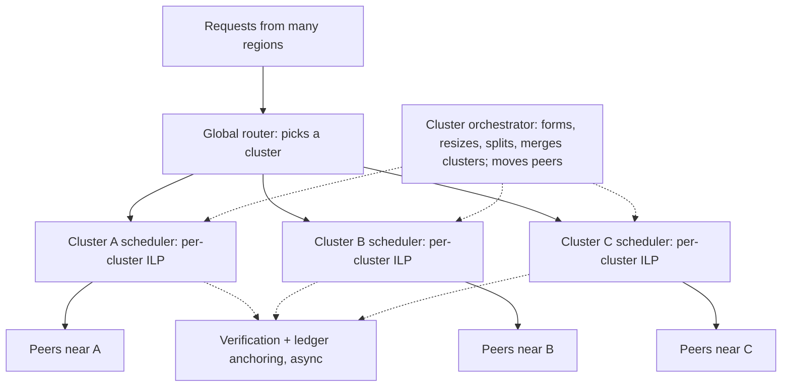

# VOSS: Research Specification

**Volunteer-Oriented Serverless Scheduling** (formerly PeerCompute, then ANTS)

> **Paper:** *A Scheduling Framework for Serverless Computing over Heterogeneous, Geo-Distributed, Unreliable Volunteer-Based Edge Resources*

---

## 0. How to Use This Document (Team and AI Agents)

- This spec defines **what must be true and what must be answered**, not how to build it. Code architecture, language and tooling are your choice. The logical system design in §5 is a research design, not a code layout.
- **[MUST]** marks requirements for scientific validity. **[EXPLORE]** marks prompts. Go beyond them.
- Propose extra baselines, experiments, sensitivity studies and plots. When in doubt, add it, document it and report it, including negative results.
- Compare against the baselines typically used in this literature: serverless scheduling and cold-start mitigation, volunteer/grid scheduling, edge/fog offloading, hierarchical and partitioned scheduling, tail-latency mitigation, cloud spot/harvest serverless, and P2P reputation systems. Survey recent work (SoCC, EuroSys, ATC, NSDI, ASPLOS, SC, Middleware, CCGrid, TPDS, FGCS) and include what reviewers would expect.
- Citations, numbers and dataset names here are from memory. **Verify before citing or depending on them.**
- VOSS is allowed to lose. A regime where a simple baseline wins is a result, not a failure.

---

## 1. Research Question and Thesis

**RQ (top level).** Can a pool of heterogeneous, geo-distributed, owner-preemptible volunteer machines execute latency-sensitive, ephemeral serverless invocations at acceptable tail latency and success rate? Can a hierarchical, geography-aware, risk-aware, lifecycle-aware scheduler beat conventional strategies in the regimes where it matters?

**Thesis.** Volunteer capacity is not "unreliable cloud". It is a different stochastic object: revocable by the owner, diurnally and geographically correlated, heavy-tailed in lifetime, and observed through stale state. VOSS treats geography as an asset rather than a cost. It partitions the pool into **dynamic geographic clusters**, which brings computation close to requesters and makes exact per-cluster optimization tractable. Within each cluster it places invocations using predicted completion-time **distributions**, **reputation**, and **per-node sandbox lifecycle state**. A **tamper-evident ledger** of completed work underpins the reputation and rewards that keep volunteers honest and present. The benefit must outweigh the cost of prediction, optimization, cluster management and ledger overhead, and this must be quantified.

---

## 2. Motivation

- Idle consumer and edge hardware is abundant, geographically close to users, and has no provider-owned capex.
- Volunteer computing (BOINC, Folding@home) proved idle cycles can be harvested at scale, but only for **delay-tolerant batch work** with deadlines of hours or days.
- Serverless invocations are short, independent, bursty and numerous. Most are sub-second to a few seconds in production traces (Shahrad et al., ATC'20). Short work is a plausible fit for opportunistic capacity. This is a **hypothesis to test**.
- In serverless, network latency and cold starts often dominate execution time for short functions. Geo-distributed volunteers could beat a distant cloud region on proximity, *if* cold starts, churn and stragglers are controlled.
- Volunteers are independent parties. Sustained participation needs **fair, verifiable rewards** and **accountability** for flaky or dishonest behavior.
- Nobody serves latency-sensitive FaaS from volunteer capacity. Existing work either assumes reliable nodes (cloud or edge FaaS) or tolerates huge latency (volunteer batch). VOSS studies this intersection.

---

## 3. Unique Constraints

### 3.1 Volunteer environment

| # | Constraint | Why it breaks conventional serverless scheduling |
|---|---|---|
| 1 | **Owner preemption**: the owner always has priority and can revoke capacity | Distinct from a crash: correlated with human activity, sometimes signalled in advance. Crash, eviction and departure need separate semantics. |
| 2 | **Correlated, diurnal availability** | Peers in one timezone go idle or busy together. Supply tends to peak at local night, demand at local day. |
| 3 | **Heavy-tailed session lengths** | Uptime is far from exponential and survival is age-dependent. Point reliability estimates lose this. |
| 4 | **Deep heterogeneity** | CPU model and speed, memory, disk, asymmetric residential bandwidth, NAT/relay overhead. **Platform assumption:** all peers run Linux with KVM-capable hardware, so microVMs are available on every peer. Heterogeneity in microVM performance (boot, restore, I/O) remains. |
| 5 | **Stale, partial control-plane state** | Heartbeat-based views lag reality, and monitoring traffic is a cost. |
| 6 | **Donor-side costs** | Energy, bandwidth caps, disk and memory consumed by images, snapshots and warm VMs, interference with the owner. Volunteer does not mean free. |
| 7 | **Untrusted participants** | Wrong or lazy results, false claims of work done, identity churn (leave and rejoin with a clean record). |
| 8 | **Continuous arrival of unknown peers** | Every new peer is a cold start for the predictor, the reputation system and the image cache. |

### 3.2 Serverless concerns that must be first-class [MUST]

These are standard concerns in the serverless literature. The design, motivation and evaluation must treat each one explicitly, as a modeled mechanism or as a documented, justified exclusion. **Agents: expand this list from the literature and do not silently drop items.**

- **Cold starts and the cold-start ladder** (§7): image pull, sandbox boot, snapshot restore, runtime and function initialization.
- **Keep-alive / keep-warm policy**: fixed TTL, histogram-based, cost-aware caching, prewarming from arrival prediction. On volunteers, warm state also costs donor memory and is lost on churn.
- **Image and dependency distribution**: registry distance, image size, layer dedup, peer-to-peer image sharing within a cluster, disk cache eviction.
- **Autoscaling and scale-to-zero**: instance count per function per cluster, scale-up lag, burst absorption.
- **Per-instance concurrency**: one invocation per sandbox vs. multiplexing.
- **Memory/CPU sizing** and coupling, including over-provisioning and OOM on small peers.
- **Timeouts and maximum duration**, deadlines and SLO classes (sync, async, batch filler).
- **At-least-once semantics and idempotency**: retries and hedging duplicate side effects. Document the assumed semantics for each workload.
- **Statelessness and external state**: where inputs and outputs and intermediate data live, and the latency and egress cost of reaching storage from edge peers. Data gravity can outweigh compute placement.
- **Function composition and workflows**: chains and fan-out/fan-in, data passing between functions, placement affinity (SeBS-Flow as secondary evaluation).
- **Bursty and flash-crowd arrivals**: admission control, throttling, overload behavior and backpressure.
- **Multi-tenancy and interference**: noisy neighbors on shared peers, fairness across tenants and functions.
- **Function versioning and deployment**: code updates invalidate cached images and snapshots.
- **Isolation and security**: sandbox strength vs. start-up cost (§7).
- **Observability**: what state the platform can observe and how stale it is.
- **Cost and billing granularity**: per-ms billing at reference platforms versus credit accounting in VOSS.
- **Graceful shutdown and draining** (§4.6): volunteers can leave without dropping work.
- **Control-plane fault tolerance** (§5.5): no single point of failure on volunteer-hosted components.

---

## 4. Volunteer Participation Model (System Assumptions)

This fixes the assumed socio-technical environment so that simulation parameters are justified. It is not a build guide.

### 4.1 Lessons from prior volunteer and P2P systems

| System | What it got right | Take-away for VOSS |
|---|---|---|
| **BOINC / SETI@home** | Idle-only harvesting, client pull, replication and quorum validation, adaptive replication driven by per-host error rate, credit | Owner priority is non-negotiable. Trust is earned, so new peers start on probation. |
| **HTCondor** | Cycle stealing with eviction when the owner returns | Preemption is a first-class event, separate from failure. |
| **Folding@home** | Points plus a quick-return bonus | Reward timeliness and reliability, not raw cycles. |
| **BitTorrent (private trackers)** | Share ratios, tit-for-tat, free-rider control, P2P content distribution | Give-to-get credit. Peers also distribute function images to each other. |
| **Peer-assisted CDNs** | Peers offload the provider; a backstop guarantees QoS | Optional backstop ablation. |
| **Marketplaces (Vast.ai, Akash, Golem, Salad)** | Self-declared resources, visible reliability scores, interruptible vs. on-demand tiers, sandboxing; on-chain settlement in some | Reputation is visible and measured. Commitment level is a peer attribute. |
| **P2P reputation (EigenTrust and successors)** | Reputation aggregation, Sybil and whitewashing resistance | Newcomer scores and punishment design. |
| **Cloud harvest/spot serverless (e.g., Zhang et al. SOSP'21)** | Serverless on evictable capacity can work | Closest cloud analogue and eviction-handling baseline. |

### 4.2 Supply tiers (peer attribute)

| Tier | Name | Behavior |
|---|---|---|
| 0 | Opportunistic | Idle-only, no promise, preempted on owner activity |
| 1 | Envelope | Declared cores, memory, disk and bandwidth, plus hours. Soft commitment. |
| 2 | Dedicated | Always-on small host, high reliability |
| opt. | Backstop | Small provider-owned pool, ablation only |

A permanently reserved core per volunteer is **not** assumed, because it deters donors and sits idle under bursty demand. Model it as **one regime** to quantify its cost. Recover utilization with a preemptible **filler class** (delay-tolerant invocations) on idle capacity. The objective is **SLO attainment per unit of volunteer resource**, not raw utilization. **[EXPLORE]** the minimum committed fraction needed for a given SLO.

### 4.3 Onboarding lifecycle (modeled)

- Agent installed, identity registered.
- Calibration benchmark: CPU, memory, disk, bandwidth, RTT to landmarks, microVM boot and restore timing. This gives the predictor its prior.
- Peer declares tier, envelope and availability windows, and is assigned to a geographic cluster.
- **Probation:** low-stakes or replicated invocations. This doubles as forced exploration for the predictor and reputation system.
- Reputation and credit accrue, and steady-state scheduling follows.
- Owner activity triggers throttle, suspend or evict. Leaving the platform means departure.

### 4.4 Reputation and rewards

- Each peer has a **reputationScore**, updated from verified outcomes: completions, failures, undeclared departures, broken commitments, timeliness, verification mismatches.
- It feeds (a) **rewards** and (b) the **cluster-level placement cost**, so that repeatedly unreliable peers become less preferred.
- **[MUST] Keep two concepts distinct:**
  - *Reliability estimate:* a statistical predictor of P(success) for this invocation now.
  - *Reputation:* a long-horizon incentive and trust signal that includes honesty and commitment-keeping.
  - Feeding both into the cost without care double-counts failures. Document how they combine and ablate each.
- **Punishment must be fair:** a Tier 0 peer preempted by its owner is behaving as declared. A Tier 1/2 peer leaving inside its declared window breaks a promise. Weight these differently.
- **Design hazards to address:**
  - *Starvation loop:* low score leads to no work, so there is no evidence to recover. Needs decay, recovery and exploration.
  - *Rich-get-richer concentration:* work piles onto a few peers, which hurts fairness and correlation exposure.
  - *Whitewashing:* a newcomer score must not exceed a punished score.
  - *Sybil identities.*
  - *Gaming:* accepting only short, safe invocations to farm score.
- **[EXPLORE]** reputation update rules (success rate, EWMA, Bayesian Beta, survival-informed, EigenTrust-style), and their effect on both scheduling and incentive outcomes.

### 4.5 Verifiable work ledger (blockchain)

- **Purpose:** an immutable, auditable record of completed work used to compute rewards and reputation between parties who do not trust each other or a single operator.
- **Recorded:** snapshots of work done, meaning per-invocation or per-epoch receipts (peer, function, outcome, duration/resources, verification result) and reputation and credit updates. Batch them, for example as Merkle roots per epoch per cluster, rather than one transaction per invocation.
- **[MUST] Immutability is not correctness.** The ledger proves a record was not altered after commit, not that the claimed work was done correctly. Records must pass verification (replication/quorum, spot checks, trust-weighted sampling) **before** anchoring. Verification costs capacity, and that cost must be measured.
- **[MUST] Off the critical path.** Invocation latency must not wait for chain finality. Anchoring is asynchronous. Results report both invocation latency and settlement latency.
- **Design space [EXPLORE]:** permissioned vs. public chain or rollup; anchoring interval vs. dispute window vs. cost; per-invocation vs. batched records; who runs validators (cluster orchestrators, a federation, a public network).
- **Evaluate:** recording overhead, settlement latency, throughput of receipts, storage growth, transaction cost, and impact on invocation metrics. Compare against no ledger and a centralized append-only log, which is the honest baseline: what does decentralized immutability buy over a trusted operator's signed log?
- **Confidentiality** against malicious volunteers is out of scope (trusted hardware is future work). Workloads are assumed non-sensitive.

### 4.6 Departure modes and graceful drain

- Peers leave in three ways, modeled separately:
  - **Graceful drain:** volunteer-initiated. The peer stops accepting new work, finishes in-flight work within a bounded drain deadline, then exits.
  - **Owner preemption:** immediate, or with a short grace period.
  - **Abrupt failure:** crash, network loss, power loss.
- Graceful drain is a first-class option. Volunteers can request it at any time, and it should be the normal way to leave.
- **Effects across the system:**
  - *Scheduler:* a drain notice with a deadline is **known** availability information. Stop assigning new work, or accept only invocations predicted to finish before the deadline.
  - *Orchestrator:* anticipated capacity loss lets it rebalance before the peer leaves.
  - *Reputation and ledger:* a clean drain is not penalized (and may be rewarded) relative to abrupt failure, and the clean exit is recorded.
  - *Lifecycle:* warm state is lost on exit. **[EXPLORE]** optional handover, such as seeding images or snapshots to cluster peers during drain.
  - *Control-plane hosts:* draining a node that holds a control-plane role must trigger handover (§5.5).
- **Hazards:** drain abuse (declaring drain to avoid work, or draining indefinitely). Bound deadlines and account for them.
- **Parameters to sweep:** fraction of departures that are graceful, notice lead time, drain deadline distribution.
- **[EXPLORE]** how much graceful drain reduces failures, retries and tail latency, how many volunteers must adopt it to matter, and which incentives drive adoption.

---

## 5. Logical System Design: Hierarchical Geo-Clustered Scheduling



### 5.1 Three decision levels

| Level | Timescale | Decides | Uses |
|---|---|---|---|
| **Cluster orchestrator** | Seconds to hours | Cluster membership: form, split, merge, lend or borrow peers between clusters | Peer locations and RTT, cluster SLO health, demand forecasts, churn, capacity headroom |
| **Global router** | Per request | Which cluster serves a request, including spillover when the home cluster is saturated or degraded | Proximity, cluster load, warm-state availability, predicted cluster-level completion and SLO health |
| **Cluster scheduler** | Per invocation or window | Peer placement and lifecycle actions (prewarm, keep-alive, retry, hedge) | Per-peer predictions, reputation, microVM state, resources |

### 5.2 Why clustering matters

- **Locality:** network latency and data and image transfer shrink when requests stay near their origin.
- **Tractability:** the ILP size scales with (invocations in window) × (peers in cluster), not the whole pool.
- **Isolation of decisions:** each cluster schedules independently and in parallel, and only cluster-level summaries cross clusters.

### 5.3 Dynamic cluster triggers (the orchestrator's inputs)

- Peers join, leave or go down, so a cluster falls below the capacity floor or exceeds the ILP size ceiling.
- SLO violations in a cluster mean it needs more resources: borrow peers from neighbours or widen its boundary.
- Low demand in a cluster means its capacity can be lent to busier clusters.
- Diurnal shifts: as one region's volunteers go busy, neighbouring idle regions absorb load.
- Predicted demand changes, such as a regional flash crowd.
- Drain notices and announced departures (§4.6), which allow proactive rebalancing.

### 5.4 Research issues the paper must address

- **Partitioning loses optimality.** Per-cluster ILPs give up the global optimum. Quantify the gap against a global ILP at small scale and against global heuristics at large scale.
- **Per-cluster ILP is tractable in practice, not guaranteed.** ILP is NP-hard. Smaller clusters help, but window size, constraint count and solver variance still matter. Report solve-time distributions and timeouts.
- **Geography concentrates correlated failure.** Peers in one cluster share timezone, ISP and power grid, so they tend to go busy or fail together. Locality and diversity conflict. **[EXPLORE]** cross-cluster spillover and cross-cluster replica placement for critical invocations.
- **Cluster sizing:** too small means fragmentation and no headroom; too large means slow ILP and wide spread. Find the sweet spot and its dependence on churn and load.
- **Rebalancing stability:** avoid oscillation and thrashing of peers between clusters (hysteresis, cooldowns, migration cost). Moving a peer discards its warm state and cache relevance.
- **Boundary effects:** requests near cluster borders, and peers equidistant from two clusters.
- **Router information staleness:** the router sees cluster summaries, not peer state.
- **Orchestrator as control plane:** where it runs, its failure, and its overhead. Treat decentralization of the orchestrator as a separate evaluation axis.

### 5.5 Control-plane fault tolerance [MUST]

- The router, cluster scheduler, cluster API/state store, orchestrator, image seeds and ledger submitters may be hosted on volunteer nodes. **No component hosted on a volunteer node may be a single point of failure** wherever avoidable. Any residual single point (for example a provider-owned root) must be named, justified and costed.
- Redundancy, failover and state-recovery mechanisms are the team's choice (replicated state with leader election, hot or warm standbys, stateless schedulers over replicated state, and so on). The spec requires only that the choice is modeled and evaluated.
- Choose control-plane hosts for reliability (tier, reputation, uptime) and spread them across failure domains (not one ASN or timezone).
- Separate the **data plane from the control plane**: in-flight invocations should be able to finish and report if a scheduler fails. Define what is lost.
- Simulate control-plane failures rather than assuming them away. Inject leader loss at random, during bursts, and correlated with cluster-wide churn. Measure failover time, invocations delayed, lost or duplicated, tail latency during failover, state staleness after recovery, split-brain risk, and the overhead of redundancy (replication traffic, coordination latency added to decision time).
- Compare no redundancy, active-passive, and replicated configurations at several replication factors, plus control planes on dedicated Tier 2 nodes. Include the case where a whole cluster's control plane is lost: router spillover and orchestrator reassignment of orphaned peers (the orchestrator itself must be redundant).
- Report these results separately from scheduling-quality results.

---

## 6. Core Novelty (Researcher's View)

**Positioning.**
- (a) Serverless schedulers assume reliable, provider-owned nodes.
- (b) Volunteer/grid schedulers target throughput batch work.
- (c) Edge-FaaS schedulers (e.g., the edgerun *faas-sim* line) handle heterogeneity and locality but assume stable nodes.
- (d) Harvest/spot serverless handles eviction inside one homogeneous provider.
- (e) Hierarchical and geo-distributed schedulers rarely couple dynamic partitioning with exact per-partition optimization under churn.
- (f) Blockchain compute marketplaces focus on settlement, not on latency-sensitive scheduling.

VOSS targets the intersection.

**Candidate contributions:**

- **C1: Environment model.** Owner-preemptible, correlated, heavy-tailed volunteer availability built from real traces, with crash, eviction and departure kept separate.
- **C2: Dynamic geo-clustered hierarchical scheduling.** Proximity-aware routing plus a churn-, SLO- and demand-driven cluster orchestrator. This makes exact per-cluster optimization tractable while exploiting geography for latency. The novelty is *dynamic* partitioning driven by volunteer-specific signals, not static regions.
- **C3: Risk- and reputation-aware placement.** The per-cluster ILP over predicted completion-time distributions, survival-based residual availability and reputation. The thesis is that expected-value schedulers are mis-specified under heavy-tailed, correlated unreliability, and the gap shows up in P99 and success rate.
- **C4: Lifecycle-aware placement.** Per-peer microVM state (cold, cached, snapshotted, warm) enters the placement cost. Keep-alive, prewarming and P2P image distribution are coupled to churn and donor resource budgets.
- **C5: Verifiable incentive layer.** Ledger-anchored, verified work receipts drive reputation and rewards, and reputation in turn drives placement. This closes the loop between trust, incentives and scheduling.
- **C6: Viability map.** Regimes (churn × heterogeneity × load × cluster size × committed fraction × sandbox class) where volunteer FaaS meets an SLO or beats baselines.

**Scoping advice (revisit after pilots):**
- The title is a *scheduling framework*, so the headline should be **C2 + C3 + C4 + C6**.
- C1 is the necessary foundation.
- C5 is a genuine differentiator, but reviewers at systems and scheduling venues will ask what the chain buys over a signed operator log. Frame it as the trust substrate whose overhead is measured, and let reputation be the bridge into scheduling.
- Too many headline contributions dilutes the paper. Pick after pilot data.

**On the ILP:** it is the per-cluster reference optimizer, not the novelty. The novelty is the hierarchy that makes it tractable and *what feeds it*. **[EXPLORE]** whether a risk-adjusted greedy heuristic matches the ILP within clusters.

**Falsifiable hypotheses (seed set):**
- **H1.** Geo-clustered scheduling reduces end-to-end P50 and P99 versus global, proximity-agnostic scheduling, at a bounded optimality loss versus a global ILP.
- **H2.** Dynamic clusters beat static regions as churn and demand skew rise.
- **H3.** Risk- and reputation-aware placement reduces P99 and failure rate versus expected-value placement as churn rises.
- **H4.** Lifecycle-aware placement cuts cold-start-induced tail latency, and the benefit shrinks as churn destroys warm state.
- **H5.** Under homogeneous, stable conditions, simple schedulers match VOSS.
- **H6.** Prediction accuracy gains saturate in scheduling benefit.
- **H7.** Ledger anchoring adds negligible invocation latency when kept asynchronous.
- **H8.** Per-cluster solve time grows faster than placement-quality gains as clusters grow, so end-to-end latency has an optimum at a finite cluster size that shifts with load and churn.
- **H9.** Cost scalarizations that use predictive uncertainty (quantile or CVaR) beat expectation-only costs on P99 as churn rises, and Bayesian predictors help most for new peers and functions.
- **H10.** Graceful drain and a redundant control plane reduce failure-induced tail latency, and drain notices matter once adoption is high enough.

---

## 7. MicroVM Lifecycle, Cold Starts and Keep-Warm [MUST]

### 7.1 Per-peer, per-function state (scheduler-visible, possibly stale)

| State | Meaning | Start-up cost if placed here |
|---|---|---|
| **S0 Not present** | Image only in a registry or on other peers | Pull image + boot + runtime init + function init |
| **S1 Image on disk** | Rootfs and kernel cached locally | Boot + init (disk read) |
| **S2 Snapshot on disk** | Memory/VM snapshot of an initialized function | Snapshot restore (lazy or eager page loading) |
| **S3 Warm idle** | VM running or paused, initialized, holding donor memory | Near zero (resume or dispatch) |
| **S4 Busy** | Serving an invocation | Queue behind it, or use another instance |

- Transitions: pull, boot, snapshot, restore, pause, evict (memory pressure, keep-alive expiry, owner activity), invalidate (function version update), and **loss of everything on churn or departure**. Disk state may survive a temporary outage.
- **Costs to model:** donor memory for S3, donor disk for S1 and S2, network for S0 (registry distance vs. a cluster peer seeding the image).
- **Snapshot compatibility:** snapshots may be restorable only on hosts with compatible CPU models or feature sets (verify against current Firecracker guidance). Heterogeneous peers may therefore split into snapshot-compatibility classes, limiting where a snapshot can be restored or shared peer-to-peer. **[EXPLORE]** the effect on placement.
- **Policies to compare [EXPLORE]:**
  - Keep-alive: fixed TTL (cloud defaults), histogram-based (Shahrad et al.), cache-eviction-based (e.g., FaasCache-style greedy-dual), reputation- and churn-aware TTL.
  - Prewarming from arrival forecasts.
  - Snapshot-restore optimizations (e.g., REAP and FaaSnap-style).
  - P2P image distribution within clusters (Dragonfly and Kraken-style).
  - Placement that prefers S3 > S2 > S1 > S0 against queueing and risk.

### 7.2 Isolation (platform assumption)

**Assumption:** all volunteer peers run Linux with KVM-capable hardware, so microVMs are available everywhere. Peers that cannot run microVMs are out of scope. Variation in microVM performance (boot, restore, I/O, memory overhead) across hardware is still modeled. The other sandbox classes below are comparison points only.

| Sandbox class | Notes (calibrate from literature and measurement) |
|---|---|
| **microVM (Firecracker-style)** | Primary and only deployed sandbox. Strong isolation and snapshot support. |
| Userspace sandbox (gVisor-style) | Fallback on Linux, moderate overhead |
| Wasm/WASI or V8 isolate | Fast start, limited language and native-library support. Some SeBS functions will not run. |
| VM wrapper (BOINC VirtualBox style) | Heavy, slow, broad compatibility |

**[EXPLORE]** microVM overhead per hardware class, and optionally a comparison with lighter sandboxes to quantify what the isolation choice costs in cold-start time and density.

### 7.3 Simulating microVMs in SimGrid

SimGrid has no notion of VMs-as-sandboxes, images or snapshots, so this is a modeling contribution in its own right. Requirements, not implementation:

- Represent each lifecycle step as a composition of SimGrid-native activities: **network transfer** (registry or seeding peer to host), **disk I/O** (image and snapshot read and write), **CPU work** (boot, runtime and function init), and calibrated **fixed delays** for steps not well captured by resource models.
- Model **memory occupancy** of warm VMs and snapshots against the donor envelope, and evict under pressure.
- **Calibrate** boot, restore and init distributions by measuring Firecracker (and fallback sandboxes) on commodity hardware representative of volunteers, plus published numbers. Report calibration error.
- Validate full cold-start and warm-start latency distributions per SeBS function against measurements before using them in scheduling experiments.

---

## 8. Scheduling Problem (Conceptual)

- **Router decision:** cluster for each request, including spillover.
- **Cluster decision:** peer (or several, with redundancy) for each invocation or window, plus lifecycle actions.
- **Orchestrator decision:** cluster membership over time.
- **Information boundary [MUST]:** every level sees only historical observations, current (possibly stale) state, declared attributes and predictions. Never future execution time, failures, availability, queue lengths or arrivals. Oracles are for gap analysis only.
- **Per-cluster objective:** configurable composite of
  - queueing, network, start-up (by lifecycle state) and execution cost;
  - risk/failure cost from distributional predictions;
  - reputation-based penalty;
  - load and donor-side cost.
- Weights are experimental variables. Reliability estimate and reputation must not silently double-count (§4.4).
- **Constraints:** resource and envelope feasibility, sandbox compatibility, memory for warm instances, SLO class and deadlines, availability at decision time.
- **Decision latency:** real solver time, router time and orchestrator time must be reflected in simulated time. Do not hide them.

### 8.1 What the ILP optimizes

- The per-pair quantity is the predicted **end-to-end completion latency of invocation i on node j**, not just runtime. Runtime is one component:

```
C(i,j) = T_wait + T_startup(lifecycle state) + T_net(in + out) + T_exec
         + failure/risk cost + reputation penalty (+ donor-side cost)
```

- **Primary objective (hypothesis to validate against alternatives): minimize expected SLO-violation cost, with expected latency as a regularizer.**

```
minimize  sum_i sum_j x[i][j] * ( w_i * pMiss(i,j) + eps * E[T(i,j)]
                                  + lambda * repPenalty_j + donorCost(i,j) )

pMiss(i,j) = 1 - P( invocation i succeeds on node j  AND  T(i,j) <= d_i )
```

  - `d_i` is the invocation's deadline from its SLO class, `w_i` its weight. Failures and retries count as misses.
  - **Why:** an SLA of "P99 <= d" is equivalent to "at most 1% of invocations exceed d". A violation count is a sum over invocations, so it is linear in the assignment variables, whereas a percentile is not. Minimizing expected violations is the decomposable proxy for the percentile SLA.
  - **Direct P99 minimization is not a valid ILP objective:** a percentile is a property of the whole invocation stream, not of one window, and with tens of invocations per window the empirical P99 collapses to the maximum. P99 is an *evaluation metric*, not a per-decision objective.
  - **Makespan is wrong as the primary objective:** invocations are independent, so no one waits for the batch to finish. Use it (or critical path) only for batch/filler classes and workflows (SeBS-Flow).
  - **Sum of latencies** (mean latency) is tractable but blind to deadlines. It spends fast nodes on invocations with slack. Keep it as the `eps` regularizer.
  - **The `eps` term is required:** `pMiss` is zero on every node when all nodes meet the deadline, so latency breaks ties. For invocations that will miss anyway, use expected tardiness `E[max(0, T - d_i)]` instead of the probability, or reject at admission.
  - **Deadlines:** from the SLO class. In experiments, set `d_i` as a multiple of the function's warm latency on a reference-platform model, and sweep strictness.
  - **Fairness:** a sum can concentrate violations on one function. If observed, add per-class violation budgets as constraints.
  - **[MUST]** Compare objective variants experimentally: makespan, sum of latencies, expected tardiness, miss probability, quantile cost, CVaR. Report P50, P99, violation rate and failure rate for each.
- Some terms depend on **other assignments in the same window** (queue position on a node, sharing a warm instance). The formulation must handle this coupling.

### 8.2 Inputs: state versus predictions

| Term | Nature | Source |
|---|---|---|
| T_wait | Current state + predicted residual time of running work | Cluster bookkeeping (possibly stale) |
| T_startup | Lifecycle state (S0 to S4, §7.1) × per-node calibrated distribution | State lookup + calibration (disk, bandwidth to image source) |
| T_net | Payload size (known at invocation) ÷ predicted bandwidth, plus RTT | Probes and online estimates per peer pair |
| T_exec | **Prediction** from function, input features, node speed and current node load | Online model (§8.3) |
| Failure/risk | Probability the peer fails or is preempted during the predicted completion interval, plus a recovery-cost estimate | Survival and time-of-day model, declared window, drain notice (§4.6) |
| Reputation | Long-horizon trust signal | §4.4 |

- **History versus prediction is a false dichotomy.** History is the training data. The ILP consumes *predictions* (which are functions of history and current state), never realized outcomes of the invocation being scheduled. Even a historical mean is a weak predictor.
- Features available at decision time are legitimate inputs: payload size, parameters, current queue, benchmark results. Anything realized after dispatch is leakage.
- Evaluate predictors with **time-ordered, online** evaluation. Random-split cross-validation leaks the future.
- The router uses cluster-level aggregates of the same predictions, at lower fidelity.

### 8.3 Predicting execution time

- **Do not model a table per (node, function) pair.** The pairs are sparse, new nodes and functions have none, and the data is non-stationary. Prefer a **factorized** model, for example:

```
log T_exec = function effect + input-size effect - log(node speed)
             + node-specific deviation + load/interference effect + noise
```

  Function and input-size terms are shared across nodes. Node terms are shared across functions. Cold-start priors: a new node uses its calibration benchmark, a new function uses profiled or similar-function data.
- **Plain linear regression (log space):** simple and cheap, but gives only a point estimate. It has no principled cold start and no uncertainty, so it cannot feed a risk-aware cost.
- **Bayesian linear regression and hierarchical (partial-pooling) variants:** give a posterior predictive *distribution*, use priors for cold start, and update recursively in closed form (cheap enough to run online). A forgetting factor handles drift. Caveat: Gaussian noise in log space is probably too light-tailed for interference and preemption effects, so test heavy-tailed likelihoods (e.g., Student-t) or add quantile/conformal calibration.
- **Compare against** per-pair EWMA, gradient-boosted quantile regression, conformal wrappers around any point predictor, nearest-neighbor/similarity methods, and learned models. Gaussian processes are likely too heavy online.
- A hierarchical Bayesian log-linear model with calibration checks is a reasonable *default candidate*, not a decision. Evaluate point accuracy **and interval calibration**, since the scheduler uses the distribution.
- Remember H6: better prediction does not automatically mean better scheduling.

### 8.4 Turning distributions into ILP costs

The ILP is linear in the assignment variables, so each (i,j) needs a scalar cost computed before solving. Compare scalarizations:

- expected value;
- mean + λ·spread;
- a chosen quantile (P90 or P95) of completion time;
- CVaR of per-assignment completion (CVaR is subadditive, so summing per-assignment values is a conservative surrogate for the total);
- SLO-miss probability × penalty;
- a scenario-based stochastic program as an expensive reference at small scale.

The failure term is P(fail) × (wasted time + expected recovery latency). Recovery depends on the retry policy, so approximate it and state the approximation. Per-assignment costs ignore correlation between assignments. Handle correlated failure with **constraints** (failure-domain caps, anti-affinity for replicas), not costs.

### 8.5 Is an ILP feasible, and is it needed?

- **Size:** W invocations in a window × N cluster nodes gives W·N binary variables (more with queue-position or replica variables). Candidate pruning to the top K nodes per invocation reduces this to W·K.
- **Structure decides difficulty.**
  - With only "one node per invocation" and per-node slot capacities, the problem is a transportation/min-cost-flow problem, solvable in polynomial time.
  - For sum of completion times on unrelated machines with queue-position costs, a polynomial matching formulation is known (verify: Horn; Bruno, Coffman and Sethi).
  - Integer programming is needed only when constraints break that structure: multi-dimensional resources (CPU + memory packing), deadlines, warm-instance coupling, replica anti-affinity or failure-domain caps, reputation thresholds. The problem then resembles generalized assignment and is NP-hard.
- **Therefore the paper must show which constraints force an ILP**, and compare it against min-cost flow or matching, LP relaxation with rounding, and greedy placement using the same cost matrix. If a flow formulation matches ILP quality, it is the better system and that is a reportable result.
- **Timing:** solve time grows with W·N and constraint structure and has heavy-tailed variance. Milliseconds to seconds is plausible, but it must be measured, with the solver stated. Batching wait plus solve time is added latency for every invocation in the window.
- **Overhead sources to count:** cost-matrix construction (W·N predictor evaluations per window), solve time, batching wait.
- **Mitigations to compare:** time-limited solves with incumbent, warm start from a greedy solution, candidate pruning, rolling horizon, and a **fast path** where latency-critical invocations are placed immediately by a cheap policy using the same cost matrix while the ILP handles batched, async and filler work plus periodic rebalancing and prewarm planning. **[EXPLORE]** ILP in the request loop versus ILP on the side.

### 8.6 Cluster size × ILP time × end-to-end latency experiment [MUST]

- Define **total execution time (end-to-end)** = batching wait + decision time (router, cost-matrix construction, solve) + queue + startup + network + execution + retries.
- Sweep cluster size N, window size or duration W, candidate count K, solver time limit, load level, churn level and ILP formulation, over multiple seeds.
- Measure the solve-time distribution (median, tail, timeouts), the decision-time share of end-to-end latency, realized end-to-end P50 and P99, solution quality versus time limit, and the optimality gap versus a larger-scope or global solve at small scale. Compare against heuristics at the same N.
- The expected trade-off: small clusters solve fast but offer less choice, less headroom and more fragmentation. Large clusters offer more choice and capacity but slower decisions and more distant peers.
- Report the knee and how it shifts with load, churn and formulation. The result sets the orchestrator's cluster-size target and ceiling (§5.3).

---

## 9. Simulation and Methodology

- **Engine:** SimGrid for heterogeneous hosts, network contention, disks, availability profiles and failures. WRENCH was considered and not selected: it is a workflow layer over SimGrid and adds little for per-invocation FaaS. Revisit only for the SeBS-Flow secondary evaluation. FaaS simulators (e.g., faas-sim, SimFaaS) are design and calibration references.
- **Workloads [MUST]:** SeBS as primary, profiled on real hardware for compute, memory, I/O, transfer, image size and init cost. Cover diverse classes. Use the same arrival process, inputs and intensity across all compared systems.
- **Arrivals:** public Azure Functions traces or equivalent, with geographic attribution of request origin (synthetic if traces lack it, and say so), plus synthetic bursts and flash crowds.
- **Availability and churn:** empirical traces (Failure Trace Archive, BOINC/SETI@home availability studies) fitted to heavy-tailed and diurnal models, assigned per geography with timezone-correct diurnality, plus synthetic regimes (none, low, medium, high, burst, regionally correlated).
- **Network:** geographic latency and residential bandwidth from public measurement datasets (e.g., RIPE Atlas, M-Lab; verify), with asymmetry, registry placement and storage endpoints.
- **MicroVM lifecycle:** per §7.3.
- **Ledger:** modeled as an asynchronous service with calibrated submission, verification and finality delays and throughput limits. Optionally measure a real local chain or rollup for calibration.
- **Reference systems:** Lambda- and Azure-style models calibrated against published measurements (latency, cold start, keep-alive), regionally placed, not artificially weakened. Report calibration error.
- **Validation [MUST]:** validate network, cold start and end-to-end latency models before evaluating VOSS. Distinguish observation, calibration parameter, model and validation.
- **Reproducibility [MUST]:** each run records seed, peer population and geography, hardware, network, churn, reputation and cluster-orchestrator configuration, sandbox class, workload, arrivals, scheduler, predictor, ILP configuration and duration. Use multiple seeds with mean, variance, confidence intervals and tails. No single-run evidence.
- **Control-plane and departure faults:** simulate failures of routers, schedulers, state stores, orchestrators and validators (§5.5), and graceful, preempted and abrupt departures (§4.6), with their own parameters.
- **Keep evaluation axes separate:** scheduling quality, clustering and orchestration, lifecycle management, incentives and ledger, control-plane fault tolerance, and decentralization of the control plane.

---

## 10. Research Questions

- **RQ1 Viability:** under what conditions does volunteer FaaS meet a latency/success SLO?
- **RQ2 Geo-clustering:** how much latency does proximity routing save, and what is the optimality loss versus global scheduling?
- **RQ3 Dynamic clusters:** do dynamic clusters beat static regions under churn, diurnal shifts and demand skew? Are they stable?
- **RQ4 Heterogeneity:** does modeling heterogeneity improve scheduling?
- **RQ5 Risk and reputation:** do distribution-aware placement and reputation improve tail latency and success? Does reputation create starvation or concentration?
- **RQ6 Lifecycle:** how much do microVM state awareness, keep-alive, prewarming, snapshots and P2P image distribution reduce cold-start impact under churn and donor memory limits?
- **RQ7 Prediction:** does prediction beat instantaneous state, and how robust is VOSS to prediction, reliability and reputation error?
- **RQ8 Churn and correlation:** how does performance degrade with churn rate, burstiness and regionally correlated availability?
- **RQ9 Optimization:** does the per-cluster ILP justify its overhead over heuristics, and how does it scale with cluster size?
- **RQ10 Incentives and ledger:** what does the ledger cost (latency, throughput, storage, verification capacity) relative to a centralized log, and what does it buy?
- **RQ11 Tiers and utilization:** what is the effect of supply tiers, committed fraction and the filler class on the SLO–utilization trade-off?
- **RQ12 Commercial comparison:** how does VOSS compare with Lambda/Azure-style models under identical workloads (latency, success, cost)?
- **RQ13 Scalability:** how do quality and overhead scale with peers, clusters and concurrency?
- **RQ14 Component contribution:** which mechanisms matter most?
- **RQ15 ILP inputs and prediction:** which cost scalarization (expectation, quantile, CVaR) and which predictor family (log-linear, Bayesian, hierarchical, learned) gives the best scheduling, including for new peers and functions?
- **RQ16 ILP necessity and trade-off:** which constraints force integer programming over min-cost flow, and what is the cluster-size, solve-time and end-to-end latency trade-off?
- **RQ17 Control-plane resilience:** what do redundancy and failover cost, and how much tail latency do they save under control-plane failures?
- **RQ18 Graceful departure:** how much does graceful drain reduce failures and tail latency, and what adoption level is needed?

---

## 11. Baselines and Ablations (Guidance, Not a Ceiling)

- **Placement:**
  - Random, Round-Robin, Least-Loaded, join-shortest-queue, power-of-two-choices.
  - Fastest-Predicted, Latency-Aware, Reliability-Aware, Weighted-Score (including a tuned variant).
  - Kubernetes-style feasible, least-allocated, bin-packing, spread (name them "Kubernetes-style").
  - Warm-first and hash/locality-based placement.
  - Min-Min/Sufferage-style heuristics, BOINC-style pull with replication, Condor-style matchmaking.
  - Edge nearest-node offloading.
  - Hedged and tied requests.
- **Clustering:** no clustering (global heuristic), global ILP at small scale, static geographic regions, static k-means or RTT-based clusters, random partitions, dynamic clusters without SLO triggers, dynamic clusters without demand triggers.
- **Routing:** nearest cluster, least-loaded cluster, power-of-two across nearby clusters, warm-state-aware routing.
- **Lifecycle:** no keep-alive, fixed TTL, histogram-based, cache-eviction-based, prewarming on or off, snapshots on or off, registry-only vs. P2P image distribution.
- **Failure handling:** retry same peer, other peer, most-reputable peer, lowest predicted completion time; replication and speculation; cross-cluster retry. Report wasted work.
- **Prediction:** global, peer, function and peer×function means; EWMA; resource-normalized; similarity-based; log-linear regression; Bayesian linear regression (Gaussian and heavy-tailed likelihoods); hierarchical/partial pooling; gradient-boosted quantile regression; quantile or conformal methods. Evaluate both accuracy and downstream scheduling impact.
- **ILP formulation and solver:** min-cost flow or matching without coupling constraints, ILP with queue-position variables, LP relaxation with rounding, greedy over the same cost matrix, different solvers (MILP versus CP-SAT), with and without warm start, candidate pruning and time limits, and fast-path versus batch.
- **Cost scalarization:** expectation, mean + λ·spread, quantile, CVaR, SLO-miss penalty.
- **Control plane:** none, active-passive, replicated at several factors, volunteer-hosted versus dedicated hosts.
- **Departure handling:** abrupt only, graceful drain at varying adoption, drain with state handover.
- **Reliability and reputation:** static, success rate, EWMA, Bayesian Beta, survival (Weibull/Kaplan-Meier), time-of-day-aware, EigenTrust-style. Also no reputation, reputation without decay, and reputation without fair-punishment rules.
- **Ledger:** none, centralized signed log, per-invocation on-chain, batched Merkle anchoring at varying intervals.
- **Ablations [MUST]:** remove each of geo-clustering, dynamic orchestration, heterogeneity, risk, reputation, prediction, network awareness, lifecycle awareness, history and correlation awareness. Replace the ILP with a heuristic. Remove the filler class. Compare system-level metrics for every ablation to establish causality.
- **Oracle:** analysis only, never in main results.

---

## 12. Experiments and Figures (Open-Ended)

**Agents: treat this as a floor, not a ceiling.** Generate as many informative, reproducible experiments and plots as you can, and flag surprising results.

**Seed experiments**
- **[MUST]** Cluster size × ILP solve time × end-to-end latency trade-off (§8.6).
- Predictor and scalarization comparison (§8.3, §8.4), including cold-start behavior for new peers and functions, and the min-cost-flow versus ILP comparison (§8.5).
- Control-plane failure injection and redundancy comparison (§5.5).
- Graceful-drain adoption sweep and drain-abuse scenarios (§4.6).
- Sweeps over heterogeneity, churn (including regionally correlated and diurnal), load (under to overloaded) and geographic dispersion of requests.
- Cluster-size sweep: latency, optimality gap, ILP solve time.
- Rebalancing-trigger study, cluster stability and migration cost.
- Spillover-policy study.
- Cold-start ladder study: share of S0/S1/S2/S3 placements versus churn; keep-alive TTL versus donor memory versus P99; prewarm accuracy; image-size and registry-distance sensitivity; P2P image seeding.
- Prediction, reliability and reputation error injection (noise, bias, staleness); heartbeat staleness sweep.
- Reputation dynamics over long horizons: recovery, starvation, concentration, whitewashing and adversarial peers.
- Ledger: anchoring interval versus overhead versus settlement latency; verification redundancy versus wasted capacity versus detected cheating.
- Tier mix and committed fraction; filler class on or off; sandbox-class eligibility.
- Scalability: 10 → 100k peers, with 1 → many clusters.
- Cost per million invocations versus reference platforms.
- Workflow (SeBS-Flow) placement affinity across clusters.
- Optional small real testbed with emulated churn for validation.

**Figure ideas**
- Latency CDFs; P99 versus churn with confidence bands; latency decomposition (network, queue, cold-start ladder, execution, retry).
- **Regime maps:** VOSS advantage over the best baseline across churn × heterogeneity, and across cluster size × load.
- Optimality gap and ILP solve time versus cluster size, and end-to-end latency versus cluster size with the decision-time share stacked (to show the knee).
- Control-plane failover timeline (P99 and dropped or delayed invocations around a leader loss), and drain-adoption versus failure-rate curves.
- Cluster membership over a simulated day (world map or timeline) as diurnal waves move.
- Warm-hit ratio versus churn; keep-alive memory versus P99 Pareto.
- Reputation trajectories and distribution; Lorenz curve and Jain's index of work and rewards.
- Ledger overhead versus anchoring interval; settlement latency CDF.
- Ablation bars with confidence intervals; tornado sensitivity plots; prediction error versus scheduling regret; regret versus oracle.
- Timeline of a regional churn burst: failures, spillover, recovery.
- SLO versus utilization Pareto frontier; cost per million invocations.

---

## 13. Metrics [MUST]

- **Latency:** mean, P50, P90, P95, P99, P99.9, max; per workload class and per region. Never averages only.
- **Cold start:** cold-start rate, start-up latency by lifecycle state, warm-hit ratio, image-pull volume, donor memory and disk used by warm state.
- **Throughput:** completed invocations per unit time.
- **Reliability:** success, failure, retry, deadline-violation rates; wasted and duplicate work.
- **Clustering:** cluster count and size distribution, rebalancing frequency, peer migrations, spillover rate, optimality gap.
- **Reputation and incentives:** score distribution, recovery time, starvation incidents, reward fairness, detected cheating.
- **Ledger:** records per second, settlement latency, storage growth, transaction cost, verification overhead.
- **Utilization and fairness:** CPU, memory, network, peer utilization distribution, effective utilization including filler; Jain's index; work conservation.
- **Scheduling overhead:** router, scheduler (solver time and timeouts), orchestrator and monitoring cost; decision-time breakdown (batching wait, cost-matrix construction, solve).
- **Control plane:** failover time, invocations delayed, lost or duplicated, control-plane availability, replication overhead.
- **Departures:** graceful versus abrupt ratio, drain completion time, invocations lost during drain.
- **Prediction quality:** MAE, RMSE, MAPE, bias, tail error, calibration of uncertainty.
- **Cost:** compute, transfer, energy, donor-side and ledger cost, kept separate from the scheduling objective.

---

## 14. Principles (Must / Must Not)

- No future information at any level. No oracle as the main method.
- Never assume identical, permanently available or perfectly predictable peers, or that warm state survives churn. Never treat failure as infinite latency.
- Never alter workloads to favor VOSS. Never weaken the Lambda/Azure models.
- Never tune for one benchmark. Never report only the best configuration or a single seed.
- Never hide ILP, router, orchestrator, ledger or verification overhead, tail latency, retries, failures or churn effects.
- Never put chain finality on the invocation critical path. Never treat immutability as proof of correct work.
- Never leave a volunteer-hosted control-plane component as an unexamined single point of failure.
- Never use makespan as the sole objective for independent latency-sensitive invocations without justification.
- Never claim simulated results are automatically realistic. Report calibration and validation error.
- VOSS is a per-invocation FaaS scheduler, not a VM or container orchestrator. Do not conflate it with Kubernetes job scheduling.
- Do not conflate scheduling results with decentralization results.
- Report regimes where baselines win.

---

## 15. Definition of Success and Paper Skeleton

**Success** is a measured, explained advantage in the regimes VOSS targets, with honest cost accounting. It is not universal victory over Lambda, Azure or Kubernetes.

| Benefit | Cost |
|---|---|
| Tail latency and success via locality and risk-aware placement | Prediction and per-cluster ILP overhead |
| Robustness under churn | Orchestration and rebalancing overhead |
| Fewer cold starts | Donor memory and disk for warm state and images |
| Trustworthy rewards | Verification and ledger overhead |
| Viability map | Optimality loss from partitioning |

**Paper skeleton:**
1. Introduction and motivation
2. Background and related work
3. Environment and participation model (C1)
4. VOSS design: hierarchy and clustering (C2), placement (C3), lifecycle (C4), incentives and ledger (C5)
5. Simulation methodology, microVM modeling and validation
6. Evaluation (RQs, baselines, ablations, regime maps)
7. Overhead and scalability
8. Discussion and threats to validity
9. Conclusion

**Open decisions for the team:**
- Headline contribution set after pilots: is C5 headline or supporting?
- Permissioned vs. public chain, and who validates?
- Where the control plane runs: replicated on volunteer nodes, on dedicated Tier 2 hosts, or a small provider-owned root (and which single points remain).
- Primary ILP objective and cost scalarization, and whether the ILP runs in the request loop or on the side.
- Is the provider backstop in scope or ablation only?
- Is a small real testbed feasible for validating lifecycle and network models?
