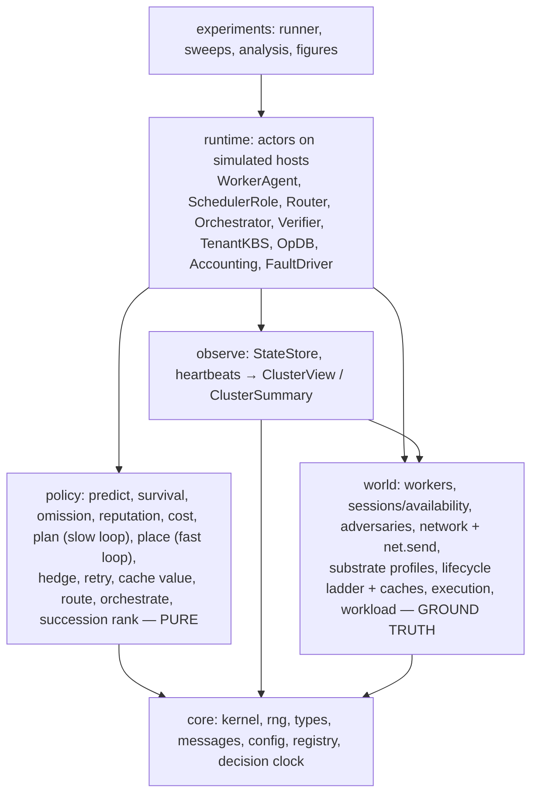
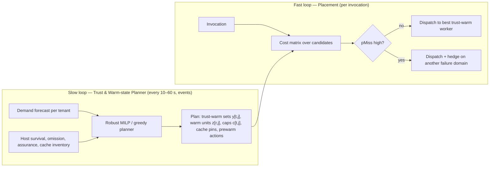

# 00 · Architecture Overview

## 1. Problem and thesis

**Problem.** Run latency-sensitive, ephemeral serverless invocations on **idle volunteer machines** that are
heterogeneous, geo-distributed, unreliable (owners reboot, unplug or reclaim them at will) and **untrusted** (an
owner may be malicious).

**Thesis.**
- **Attested execution turns malicious volunteers into merely unreliable ones.** Once tenant code and VOSS control
  code run only on attested, owner-locked software, a hostile owner can no longer read, forge or tamper. What remains
  is *omission and timing*: power off, drop, delay, throttle.
- **What remains is a scheduling problem in which trust is a perishable resource.** Trust is:
  - **costly to establish:** boot and attestation, key release, artifact loading;
  - **destroyed by churn;**
  - **exposing:** every host given a tenant's key widens that tenant's attack surface.
- **VOSS schedules it.** Geo-clustered, **two-timescale** scheduling: a slow robust planner decides *where trust and
  warm state live*, and a fast risk-aware placer decides *where each invocation runs*.

**This repository is a research POC.** A deterministic simulator plus the VOSS scheduler, baselines and experiments,
calibrated by measurements on a real consumer machine (doc 10). No real distributed deployment, no frontend.

## 2. Roles and trust

| Role | Runs on | Trusted for | Doc |
|---|---|---|---|
| **Orchestrator tier**: orchestrator, regional routers, operational DB, attestation verifier | Provider cloud | Availability and accounting (not tenant confidentiality) | 03, 08 |
| **Tenant key broker (KBS)** | Tenant-operated (located per tenant) | Releasing the tenant's secrets only to attested hosts | 04 |
| **Scheduler** | A role inside one worker's attested appliance, one active per cluster | Correct placement (code is attested); its *host* may still omit or delay | 03, 07 |
| **Worker** | Volunteer machine booted into the **attested VOSS appliance** | Executes functions in microVMs; host owner may omit or delay | 02, 04 |

**Threat model (doc 04):** owners are Byzantine but neutralized by measured boot and TPM attestation, so their
residual power is omission and timing. Lab-grade physical attacks, kernel 0-days and side channels are out of scope.
There is **no blockchain**: work is recorded as attested receipts in the operational DB.

**Trust substrate (doc 04 §3):** VOSS is substrate-agnostic.
- **Primary: `appliance_tpm`.** A consumer PC with TPM 2.0 boots a locked VOSS OS for a *donation session*; tenant
  functions run in Firecracker microVMs. This is measured on our Intel i7 node.
- **Modeled profiles:**
  - `cvm_snp`: server CVMs with trustlets;
  - `coco_pool`: Confidential Containers;
  - `drtm_hv`: owner keeps using the machine;
  - `none`: reference.

## 3. Design principles

1. **Ground truth vs. observation.** The *world* holds true state; schedulers see stale *views* only (no future
   knowledge, enforced by import rules).
2. **Policies are pure functions** of views and predictions.
3. **Everything between nodes is a message** (`net.send`) with geography-derived delay; actors never call each other.
4. **Trust and warm state are explicit, perishable resources** in the model and in the optimizer.
5. **Substrates, ladders and caches are data** (YAML profiles), interpreted by one generic engine.
6. **One cost model, many placers; one plan format, many planners.** Baselines use the same interfaces.
7. **Reproducible by default:** pinned environment, manifests, one-command reruns; calibration data versioned.
8. **Nothing is free:** decision, attestation, key release, cache I/O, heartbeats and checkpoints are all simulated.
9. **Log raw, analyze offline.**
10. **Simple fidelity first;** every model has one default and one knob.

## 4. Layers (dependencies point downward only)



## 5. Two-timescale scheduling at a glance (doc 03)



## 6. Life of an invocation (primary substrate)

```mermaid
sequenceDiagram
    participant C as Client
    participant R as Router (orchestrator tier)
    participant S as Scheduler (attested worker)
    participant W as Worker appliance (attested)
    participant K as Tenant KBS
    participant DB as Operational DB
    C->>R: invoke(fn, payload)
    R->>R: pick cluster from summaries (trust-warm capacity, health, RTT); keep pending copy
    R->>S: ENQUEUE (metadata only)
    S->>S: candidates = trust-warm workers (plan) ∪ cold path; cost matrix; place (+hedge?)
    S->>W: DISPATCH (epoch, token)  and  S->>R: ASSIGNED
    R->>W: INPUT payload (TLS to attested appliance)
    W-->>R: ACCEPTED
    alt worker not trust-warm for tenant
        W->>K: key request with fresh attestation evidence
        K-->>W: key wrapped to this appliance
    end
    W->>W: cache ladder: warm VM ▸ snapshot restore ▸ boot ▸ fetch artifacts
    W-->>R: RESULT (bound to attested key) — latency ends here
    W-->>S: OUTCOME
    R-->>DB: attested receipt (batched, async)
```

End-to-end latency = route + (window wait) + decision + queue + trust (key release, only if trust-cold) +
start-up (by cache/ladder level) + network + execution + retries. Each term is a logged field.

## 7. Document map

| Doc | Content |
|---|---|
| 01 | Simulation kernel, determinism, actors and messages, decision clock, reproducibility |
| 02 | World model: workers, donation sessions, network, substrate profiles, lifecycle ladder, **worker caches**, adversaries, workload |
| 03 | Scheduling: orchestrator, router, scheduler slow loop (planner) and fast loop (placement), prediction, cost model |
| 04 | Trust and security: threat model, substrates, attestation, key release, identity, exposure, limitations |
| 05 | Code structure, layering, interfaces, config, tests |
| 06 | Experiments, metrics, baselines, hypotheses, statistics |
| 07 | Fault tolerance: progress-based detection, scheduler succession, worker omission handling |
| 08 | State, operational DB, protocols, worker readiness |
| 09 | Reliability vs reputation, attested receipts, credits |
| 10 | Calibration harness and single-box emulation testbed |
