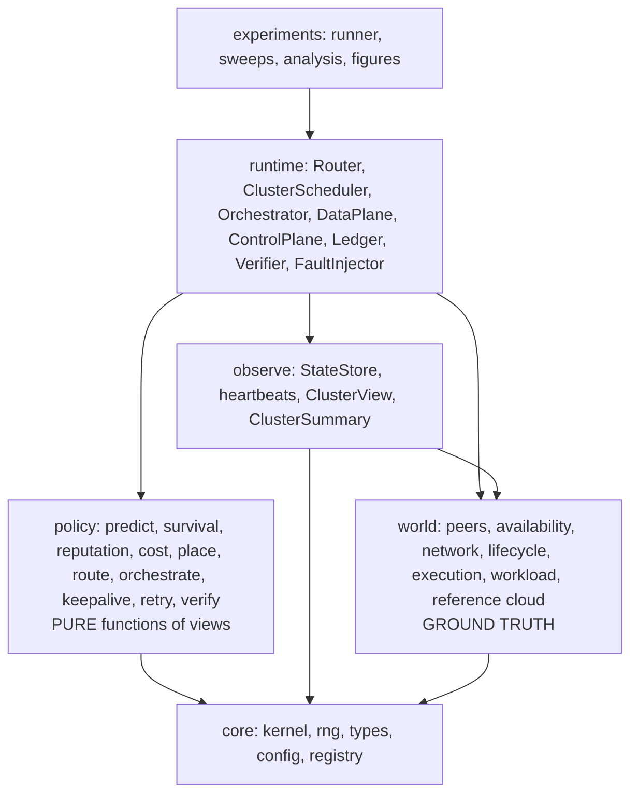
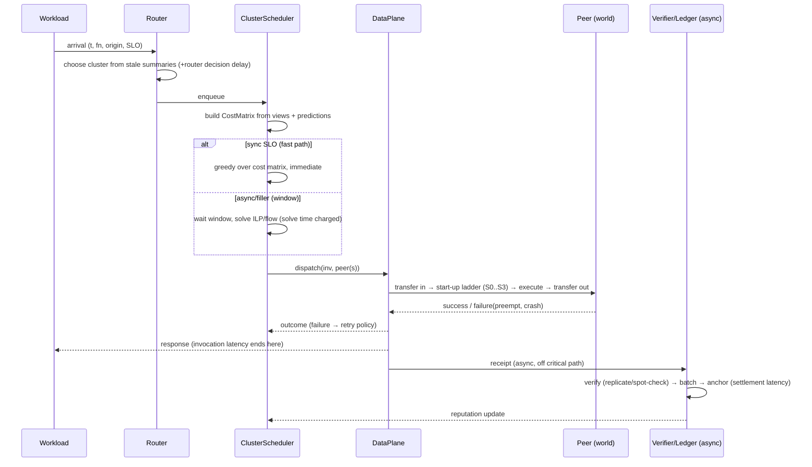

# 00 · Architecture Overview

## 1. Scope

**In scope:** a discrete-event simulator of a volunteer FaaS pool; the VOSS hierarchy (router, orchestrator,
cluster scheduler); prediction, risk and reputation models; microVM lifecycle model; verification and an
asynchronous ledger *model*; control-plane and departure fault injection; baselines; an experiment pipeline.

**Out of scope (POC):** UI/frontend, real networking/agents, real chain, real Firecracker orchestration (only a
calibration microbenchmark), confidentiality/TEE, billing UI. These are replaced by calibrated models.

## 2. Design principles

1. **Ground truth vs. observation.** The *world* holds true state. Schedulers see only *views*: stale, partial,
   immutable snapshots. This enforces spec §8 "no future information" by construction (see 01).
2. **Policies are pure.** `view + prediction → decision`. No simulator access, so they unit-test and swap easily.
3. **One cost matrix, many placers.** All placers (ILP, min-cost-flow, greedy, baselines) consume the same
   `CostMatrix`, so differences are due to the algorithm, not inputs.
4. **Precompute exogenous inputs.** Churn, arrivals, network are generated as *traces* before the run. Same seed →
   byte-identical scenario for every compared system.
5. **Nothing is free.** Decision latency, heartbeats, replication, verification and ledger costs are simulated.
6. **Plug-in by name.** Every variant in spec §11 is a registered class selected by config.
7. **Log raw, analyze offline.** Simulation emits event logs; metrics and plots come from logs.
8. **Simple fidelity first.** Each model has one simple default and one documented knob to refine. A model is
   made richer only when a validation or sensitivity result demands it.

## 3. Layers (dependencies point downward only)

- `policy` → `world` imports are **forbidden** (the information boundary). Only `observe` reads `world`.
- `runtime` is the only layer that wires everything and applies decisions to the world.

## 4. Component inventory

| Component | Layer | Responsibility | Spec |
|---|---|---|---|
| Kernel | core | Event loop, simulated time, timers | §9 |
| PeerPool / Availability | world | Peer attributes; replay of churn trace (owner-preempt, crash, drain, join) | §3.1, §4.6 |
| Network | world | RTT and bandwidth model, access-link sharing | §9 |
| Lifecycle | world | Per-(peer, function) S0–S4 microVM state, memory/disk accounting | §7 |
| Execution | world | Cores, interference, true runtime sampling, failure on preempt | §3.1 |
| Workload | world | Functions (SeBS profiles), arrivals, SLO classes | §9 |
| StateStore | observe | Heartbeat-fed, stale cluster state; produces views and summaries | §3.1 #5 |
| Predictor, Survival | policy | Completion-time distributions; residual availability | §8.2–8.3 |
| Reputation, Verify | policy | Score update rules; replication/spot-check decisions | §4.4–4.5 |
| CostModel | policy | Builds `CostMatrix` components and scalarizes | §8.1, §8.4 |
| Placers | policy | ILP, min-cost-flow, greedy, baselines | §8.5, §11 |
| Router, Orchestrator logic | policy | Cluster choice; membership moves/splits/merges | §5 |
| KeepAlive/Prewarm, Retry/Hedge | policy | Lifecycle and failure handling | §7.1, §11 |
| Router/Cluster/Orchestrator agents | runtime | Apply policies in simulated time with decision latency | §5 |
| DataPlane | runtime | Dispatch, transfer, start-up, execute, report; survives scheduler loss | §5.5 |
| ControlPlane | runtime | Replication/failover model for control components | §5.5 |
| Verifier, Ledger | runtime | Replicated checks; async batched anchoring model | §4.5 |
| FaultInjector | runtime | Control-plane faults (peer faults come from traces) | §5.5, §9 |
| Recorder | metrics | Raw event log to Parquet | §13 |

## 5. Life of an invocation

End-to-end latency = router delay + batching wait + decision time + queue + start-up + network + execution +
retries. Each term is a separate field in the invocation record (spec §8.6).

## 6. Delivery strategy

Build a **vertical slice first** (Roadmap P2: random placement on a small pool, full latency decomposition), then
deepen one axis at a time. Headline contributions are C2, C3, C4, C6 on top of the C1 environment model. The trust
layer (C5) and control-plane work are cheap *models* delivered after the core results exist, and are reported as
separate evaluation axes (spec §9).
