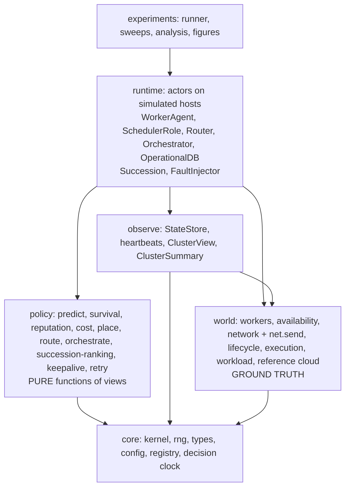

# 00 · Architecture Overview

## 1. Scope

**In scope:** a discrete-event simulator of a volunteer FaaS pool; the VOSS hierarchy (orchestrator, per-cluster
schedulers, workers); prediction, risk and reputation models; microVM lifecycle model; a router-written work log
with credit accounting (no blockchain); crash-fault injection and succession-based fault tolerance; baselines; an experiment
pipeline.

**Out of scope (POC):** UI/frontend, real networking/agents, blockchain of any kind (09), real Firecracker orchestration (only a
calibration microbenchmark), confidentiality/TEE, Byzantine behavior, billing UI, failure of the orchestrator tier.
Replaced by calibrated models or stated assumptions.

## 2. Roles (fixed terminology, ADR-022) and fault model

| Role | Who | Responsibility |
|---|---|---|
| **Orchestrator** | Provider-run cloud tier, **not a volunteer**, assumed reliable | Arranges clusters; appoints and fences schedulers (epochs); front-door routers; **operational DB on cloud** (private to this tier, 08) |
| **Scheduler** | A worker hosting an extra role; one active per cluster | Placement inside its cluster (cost matrix, ILP/greedy), dispatch, retries, lifecycle actions |
| **Worker** | Volunteer machine | Executes invocations; any eligible worker can be promoted to scheduler |

**Fault model (ADR-016): crash-fault tolerant, not Byzantine.** Workers and schedulers can crash (disk survives), be
preempted by their owner, drain, and suffer network delay (optionally loss/partition). Nobody lies: volunteers are **vetted at admission and honest but unreliable** (09), which
is also why no blockchain is needed. The orchestrator
tier is assumed reliable and is the one named, costed centralized component. Schedulers are made crash-tolerant by
**succession with soft state** (07): no consensus among volunteers. An optional known-answer canary audit is the only integrity extension (09 §5).

## 3. Design principles

1. **Ground truth vs. observation.** The *world* holds true state. Schedulers see only *views*: stale, partial,
   immutable snapshots (spec §8 "no future information" by construction, see 01).
2. **Policies are pure.** `view + prediction → decision`. No simulator access, so they unit-test and swap easily.
3. **Everything between nodes is a message.** Heartbeats, dispatch, appointment, roll call and data transfers all go
   through one `net.send`, whose delay comes from the geographic network model. No direct cross-node calls (01 §6).
4. **State lives with whoever must remember it.** Scheduler state is a rebuildable cache; truth is held by routers,
   workers and the orchestrator DB (07 §4.1).
5. **One cost matrix, many placers.** All placers consume the same `CostMatrix`.
6. **Precompute exogenous inputs.** Churn, arrivals and network are *traces* generated before the run.
7. **Reproducible by default.** Pinned environment, manifest per run, one-command rerun, deterministic decision clock
   (01 §9).
8. **Nothing is free.** Decision latency, heartbeats, checkpoints, accounting costs are simulated.
9. **Plug-in by name.** Every variant in spec §11 is a registered class selected by config.
10. **Log raw, analyze offline.** Simulation emits event logs; metrics and plots come from logs.

## 4. Layers (dependencies point downward only)



- `policy` → `world` imports are **forbidden** (the information boundary). Only `observe` reads `world`.
- `runtime` wires everything: actors are hosted on nodes and talk only through `net.send`.

## 5. Component inventory

| Component | Layer | Responsibility | Spec |
|---|---|---|---|
| Kernel, DecisionClock | core | Event loop, simulated time; charges solver/router/orchestrator time | §9, §8 |
| WorkerPool / Availability | world | Worker attributes; replay of churn trace (owner-preempt, crash, drain, join) | §3.1, §4.6 |
| Network, `net.send` | world | Geo RTT/bandwidth model; delay (and optional loss/partition) for every message | §9 |
| Lifecycle | world | Per-(worker, function) S0–S4 microVM state, memory/disk accounting | §7 |
| Execution | world | Cores, interference, true runtime sampling, failure on preempt | §3.1 |
| Workload | world | Functions (SeBS profiles), arrivals, SLO classes | §9 |
| StateStore | observe | Heartbeat-fed stale cluster state; produces views and summaries | §3.1 #5 |
| Predictor, Survival | policy | Completion-time distributions; residual availability (also ranks succession) | §8.2–8.3 |
| Reputation | policy | Commitment/timeliness score | §4.4 |
| CostModel, Placers | policy | Cost matrix, scalarizers; ILP, min-cost-flow, greedy, baselines | §8, §11 |
| Route / Orchestrate / Succession ranking | policy | Cluster choice; membership moves; successor ranking and handover triggers | §5 |
| KeepAlive/Prewarm, Retry/Hedge | policy | Lifecycle and failure handling | §7.1, §11 |
| **Orchestrator + OperationalDB** | runtime | Cluster arrangement; epoch CAS appointments; membership, checkpoints, reputation, work log (cloud, 08) | §5 |
| Routers | runtime | Front door (orchestrator tier): choose cluster, hold pending invocations and payloads until worker `ACCEPTED`, forward input, spill over, write the work log | §5 |
| **SchedulerRole** | runtime | Active scheduler on a worker: runs the placer, dispatches, checkpoints, steps down on `STALE` | §5.5 |
| **Succession** | runtime | Appointment, failover, roll call, planned handover, fencing protocol | §5.5 |
| WorkerAgent | runtime | Executes (epoch-fenced, token-dedup), retains outcomes, direct result path, buffers | §5.5 |
| Accounting | runtime | Credit batch job over the router-written work log; reputation updates (orchestrator) | §4.4–4.5 |
| FaultInjector | runtime | Partitions and extra crash patterns (worker faults come from traces) | §5.5, §9 |
| Recorder | metrics | Raw event log to Parquet | §13 |

## 6. Life of an invocation

```mermaid
sequenceDiagram
    participant W as Workload
    participant R as Router (orchestrator tier)
    participant S as Scheduler (a worker + role)
    participant K as Worker
    participant DB as Operational DB (orchestrator tier)
    W->>R: arrival (t, fn, origin, SLO)
    R->>R: choose cluster from stale summaries (+router decision delay); keep pending copy
    R->>S: ENQUEUE (net delay = geo RTT)
    S->>S: cost matrix from view + predictions; place (fast path greedy, or window ILP; solve time charged)
    S->>K: DISPATCH (epoch, token)
    K-->>R: ACCEPTED (router drops pending copy)
    K->>K: transfer in → start-up ladder (S0..S3) → execute → transfer out
    K-->>R: RESULT direct (invocation latency ends here)
    K-->>S: OUTCOME (failure → retry policy re-places; watchdog from predictor catches silent crashes)
    R-->>DB: invocation_log row (batched, async, off critical path)
```

End-to-end latency = router delay + batching wait + decision time + queue + start-up + network + execution +
retries. Each term is a separate field in the invocation record (spec §8.6). Scheduler crash timeline: 07 §4.3.

**Where to read next:** state, DB and message formats: 08; threat model and why there is no blockchain: 09.

## 7. Delivery strategy

Build a **vertical slice first** (Roadmap P2: random placement on a small pool with full latency decomposition, with
the scheduler already an actor reached only by `net.send` and appointed by an orchestrator that issues epochs), then
deepen one axis at a time. Headline contributions are C2, C3, C4, C6 on top of the C1 environment model. Trust (C5)
and succession are *models* delivered after the core results exist, and reported as separate evaluation axes
(spec §9).
