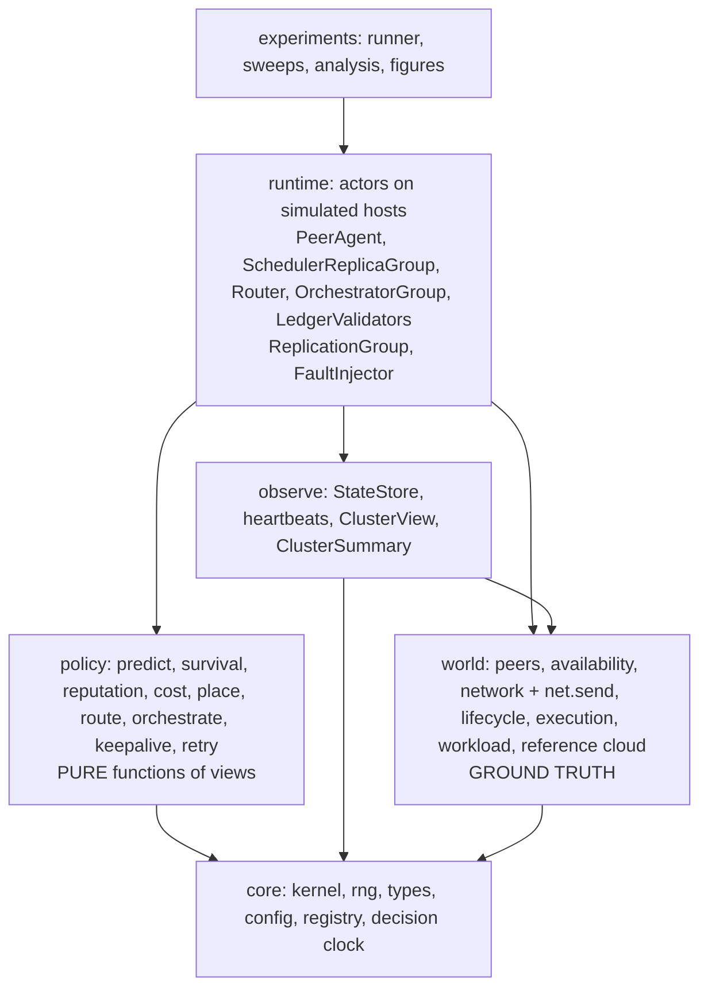

# 00 · Architecture Overview

## 1. Scope

**In scope:** a discrete-event simulator of a volunteer FaaS pool; the VOSS hierarchy (router, orchestrator,
replicated cluster schedulers); prediction, risk and reputation models; microVM lifecycle model; an asynchronous
ledger *model* that also records scheduler work; control-plane and departure fault injection; baselines; an
experiment pipeline.

**Out of scope (POC):** UI/frontend, real networking/agents, real chain, real Firecracker orchestration (only a
calibration microbenchmark), confidentiality/TEE, Byzantine behavior, billing UI. Replaced by calibrated models.

## 2. Fault model (system-wide, ADR-016)

**Crash-fault tolerant, not Byzantine.** Every node (worker peer, scheduler replica, router, orchestrator, ledger
validator) can crash (stop; disk survives), be preempted by its owner, drain, and suffer network delay (optionally
loss/partition). **No node is assumed to lie.** A scheduler never writes false records to the chain. The single
point of failure to eliminate is therefore *crash of a volunteer-hosted scheduler*, solved by replica groups
(07). Optional lazy-worker result verification is an off-by-default extension (04 §2).

## 3. Design principles

1. **Ground truth vs. observation.** The *world* holds true state. Schedulers see only *views*: stale, partial,
   immutable snapshots (spec §8 "no future information" by construction, see 01).
2. **Policies are pure.** `view + prediction → decision`. No simulator access, so they unit-test and swap easily.
3. **Everything between nodes is a message.** Heartbeats, dispatch, replication, ledger submissions and data
   transfers all go through one `net.send`, whose delay comes from the geographic network model. No direct
   cross-node calls (01 §6).
4. **One cost matrix, many placers.** All placers consume the same `CostMatrix`; differences are due to the
   algorithm, not inputs.
5. **Precompute exogenous inputs.** Churn, arrivals and network are *traces* generated before the run. Same seed →
   identical scenario for every compared system.
6. **Reproducible by default.** Pinned environment, manifest per run, one-command rerun, deterministic decision
   clock (01 §9).
7. **Nothing is free.** Decision latency, heartbeats, replication, ledger costs are simulated.
8. **Plug-in by name.** Every variant in spec §11 is a registered class selected by config.
9. **Log raw, analyze offline.** Simulation emits event logs; metrics and plots come from logs.
10. **Simple fidelity first.** Each model has one simple default and one documented knob.

## 4. Layers (dependencies point downward only)



- `policy` → `world` imports are **forbidden** (the information boundary). Only `observe` reads `world`.
- `runtime` wires everything: actors are hosted on peers and talk only through `net.send`.

## 5. Component inventory

| Component | Layer | Responsibility | Spec |
|---|---|---|---|
| Kernel, DecisionClock | core | Event loop, simulated time; charges solver/router/orchestrator time | §9, §8 |
| PeerPool / Availability | world | Peer attributes; replay of churn trace (owner-preempt, crash, drain, join) | §3.1, §4.6 |
| Network, `net.send` | world | Geo RTT/bandwidth model; delay (and optional loss/partition) for every message | §9 |
| Lifecycle | world | Per-(peer, function) S0–S4 microVM state, memory/disk accounting | §7 |
| Execution | world | Cores, interference, true runtime sampling, failure on preempt | §3.1 |
| Workload | world | Functions (SeBS profiles), arrivals, SLO classes | §9 |
| StateStore | observe | Heartbeat-fed stale cluster state; produces views and summaries | §3.1 #5 |
| Predictor, Survival | policy | Completion-time distributions; residual availability | §8.2–8.3 |
| Reputation | policy | Commitment/timeliness score (optionally verification) | §4.4 |
| CostModel, Placers | policy | Cost matrix, scalarizers; ILP, min-cost-flow, greedy, baselines | §8, §11 |
| Router/Orchestrator logic | policy | Cluster choice; membership moves/splits/merges | §5 |
| KeepAlive/Prewarm, Retry/Hedge | policy | Lifecycle and failure handling | §7.1, §11 |
| **ReplicationGroup** | runtime | Raft-lite log (terms, election, majority commit, snapshots) over `net.send`; reused by schedulers, orchestrator, validators | §5.5 |
| **SchedulerReplicaGroup** | runtime | Per-cluster replicated state machine; leader runs the placer; fencing; failover | §5.5 |
| Router, OrchestratorGroup | runtime | Stateless routers; replicated orchestrator; apply policies with decision latency | §5 |
| PeerAgent (DataPlane) | runtime | Accepts dispatch (term-fenced, token-dedup), transfers, start-up, executes, buffers outcomes | §5.5 |
| Ledger | runtime | Async batched anchoring of work receipts and **scheduler epoch records**; CFT validators | §4.5 |
| FaultInjector | runtime | Control-plane faults, partitions (peer faults come from traces) | §5.5 |
| Recorder | metrics | Raw event log to Parquet | §13 |

## 6. Life of an invocation

```mermaid
sequenceDiagram
    participant W as Workload
    participant R as Router
    participant L as Scheduler leader (+ followers)
    participant P as Peer (world)
    participant CH as Ledger (async)
    W->>R: arrival (t, fn, origin, SLO)
    R->>R: choose cluster from stale summaries (+router decision delay)
    R->>L: ENQUEUE (net delay = geo RTT)
    L->>L: cost matrix from view + predictions; place (fast path greedy, or window ILP; solve time charged)
    L->>L: replicate ENQUEUE+ASSIGN to majority (quorum RTT)
    L->>P: DISPATCH (term, token)
    P->>P: transfer in → start-up ladder (S0..S3) → execute → transfer out
    P-->>L: OUTCOME (failure → retry policy re-places)
    P-->>W: response (invocation latency ends here)
    L-->>CH: EPOCH_CLOSE: scheduler assignments + worker receipts (off critical path)
    CH-->>L: settlement (rewards, audit)
```

End-to-end latency = router delay + batching wait + decision time (solve + quorum RTT) + queue + start-up +
network + execution + retries. Each term is a separate field in the invocation record (spec §8.6).

Scheduler crash timeline: see 07 §3.5.

## 7. Delivery strategy

Build a **vertical slice first** (Roadmap P2: random placement on a small pool, full latency decomposition, with
the scheduler already behind the replica-group interface at `r=1`), then deepen one axis at a time. Headline
contributions are C2, C3, C4, C6 on top of the C1 environment model. The trust layer (C5) and control-plane
replication are *models* delivered after the core results exist and reported as separate evaluation axes
(spec §9).
