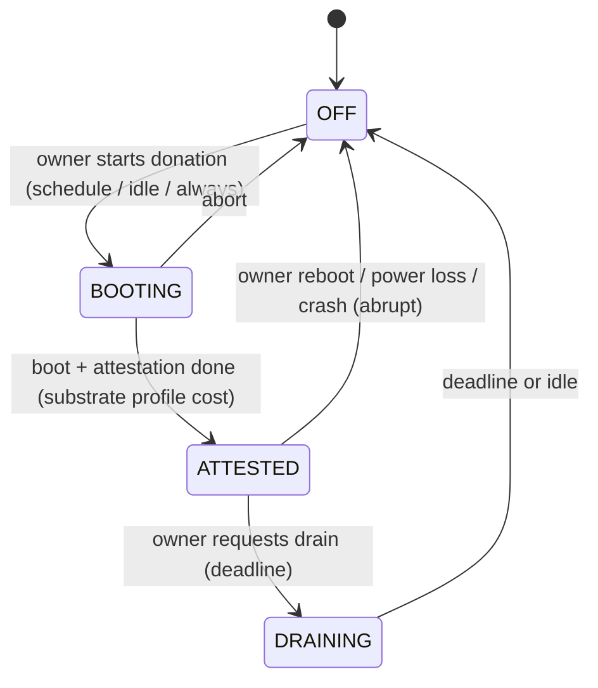
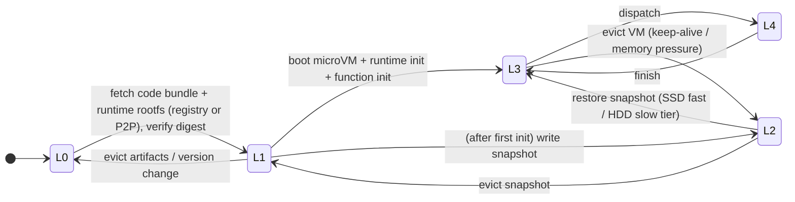

# 02 · Environment Model (the "world", contribution C1)

Everything here is ground truth, invisible to policies except through `observe`. Parameters live in
`configs/` as data. Each value is tagged `measured | literature | assumed` with a source (doc 10 produces the measured
ones). Every model has one default and one knob.

## 1. Workers

| Attribute | Default model | Notes |
|---|---|---|
| `location` | City sampled from an embedded ~100-metro table (lat, lon, tz, population weight) + jitter | Timezone-correct diurnality |
| `hw_class` | Discrete classes calibrated from real machines (the i7-12th-gen node is class `C0`), others scaled by benchmark ratios: `speed`, `cores`, `mem_gb`, `ssd_gb`, `hdd_gb`, `ssd/hdd read/write MB/s`, `cpu_model` (snapshot compatibility) | Donor envelope caps what VOSS may use |
| `substrate` | Profile name (doc 04 §3); per scenario one or a mix | `appliance_tpm` default |
| `tier` | `nightly` (scheduled donation sessions), `idle` (idle-triggered), `dedicated` (spare box, long sessions) | Replaces old tiers 0/1/2 |
| `identity` | `hash(EK)`; persistent across sessions | Doc 04 §7 |
| `failure_domain` | `(asn, city)`; workers in a city share a few ASNs | Anti-affinity, robust planning |
| `link` | Down/up Mbps lognormal, asymmetric, last-mile RTT, `relayed` flag (NAT) | Residential profile |
| `adversary` | Behavior (§7); default `benign` | Assigned by scenario |
| `assurance_policy` | `known_good` or `tofu` firmware | Feeds `a_j` (doc 04 §8) |

## 2. Availability: donation sessions

A worker alternates `OFF ⇄ SESSION`. A session is one boot into the trust substrate.

- **Session starts** come from per-tier processes modulated by **local time of day**: `nightly` peaks at local night;
  `idle` is Poisson with a diurnal rate; `dedicated` is rare and long.
- **Session lengths** are heavy-tailed (Weibull k<1 or lognormal) per tier, plus **regional shocks** (a fraction of a
  region goes off together).
- **Ends:** `graceful_frac` drain with a lead-time distribution, the rest abrupt.
- **Long-term churn:** identities join and leave the platform at per-tier rates.
- `drtm_hv` and `cvm_snp` hosts additionally have **owner-activity periods** inside a session (interference, not
  termination).
- Output: a precomputed `AvailabilityTrace` (doc 01 §4). Named regimes: `churn_{low,med,high,burst,correlated}`.

## 3. Network

- **RTT(a,b)** = `last_mile_a + last_mile_b + great_circle_km / c_eff × route_factor` + lognormal jitter. Orchestrator
  tier, verifier, registries, storage endpoints and tenant KBSs are located nodes.
- **Transfer** = RTT + bytes / rate, with fair sharing on each worker's access link (processor sharing; core network
  uncontended).
- **Every message**, from data to heartbeats, attestation, key release and planner actions, goes through `net.send`
  (doc 01 §6), so geography shapes control latency as well as data latency.
- TLS adds a fixed per-message CPU cost (calibrated). Session setup handshakes are paid once per channel.

## 4. Execution model

- A worker exposes `slots` (vCPUs available to VOSS within its envelope). Each invocation runs in its own microVM
  (concurrency 1 per VM by default).
- **True runtime** = `work_f(input) / (speed_j × interference(load)) × substrate_slowdown × noise`:
  - `work_f` comes from SeBS profiles (reference-core seconds, measured on node C0);
  - `substrate_slowdown` per profile: CPU, memory and I/O factors (TME ≈ small, measured; CVM I/O tax from
    literature);
  - `noise` is a heavy-tailed lognormal mixture.
  - It is drawn from the invocation's own RNG stream (common random numbers across compared systems).
- Failures come only from the availability trace (session end) and from adversary behavior (§7). OOM if the function's
  memory exceeds its VM size; timeouts per SLO class.

## 5. Lifecycle ladder: one generic engine, profiles as data

Each substrate profile defines **levels** for a `(worker, function@version)` pair, plus a per-session trust step. The
engine (`world/lifecycle.py`) interprets the profile; there is no per-substrate code.

**`appliance_tpm` / `none` ladder (primary):**

| Level | Meaning | Start-up cost if placed here |
|---|---|---|
| **L0** | Nothing cached | fetch (net) + verify + boot + init (+ snapshot write, async) |
| **L1** | Code bundle + rootfs cached on disk (SSD or HDD tier) | boot + init (disk read at tier speed) |
| **L2** | Snapshot cached (SSD or HDD tier) | restore (disk read of snapshot ∝ memory touched; tier speed) |
| **L3** | Warm VM idle in RAM | ~dispatch (ms) |
| **L4** | Busy | queue |

**Orthogonal trust flag `K[t,j]`** (tenant key present in appliance memory this session): a trust-cold start adds
key release (KBS RTT + check), and encrypted artifacts can be decrypted only once `K=1`.

**Per-session trust step:** the worker is unschedulable until `BOOTING → ATTESTED`. All `K`, L3 and L4 state is lost
at session end; L1/L2 disk state survives as ciphertext and is valid again after the next attestation.

**`cvm_snp` ladder (modeled):** session = wCVM boot + attest. Levels: no zygote → zygote(runtime) → function loaded
→ trustlet. Per-function key per wCVM. **`coco_pool`:** shell boot → tenant bind → warm container. These are pure data
files with literature ranges.

**Every transition is a composition of simulated resources:** `net.send` transfers, `disk.read/write(tier, bytes)`,
`cpu.run(work)`, the `tpm.quote()` server, and calibrated fixed-delay distributions.

## 6. Worker caches (where warm state lives)

Workers keep a **three-tier, content-addressed cache**. Policies are in `policy/cache_value.py`; mechanics are here.

| Tier | Holds | Capacity (donor envelope) | Speed | Survives session end |
|---|---|---|---|---|
| **RAM** | Warm VMs (L3), page cache of hot snapshots | `mem_budget` | — | No |
| **SSD** | Snapshots (L2), code bundles and rootfs (L1) for hot functions | `ssd_budget` | Calibrated (node C0 NVMe) | Yes (encrypted) |
| **HDD** | Cold tier: older snapshots, rootfs, bundles | `hdd_budget` | Calibrated (node C0 HDD) | Yes (encrypted) |

**Rules:**
- **Content addressing:** every artifact is keyed by `digest(fn, version, kind, snapshot_class)`. A load verifies the
  digest, so a host rolling back or corrupting its disk only produces misses, never wrong code.
- **Confidentiality:** the data partition is sealed to PCRs (doc 04 §4). Tenant bundles are also encrypted with the
  tenant key, so a worker can hold and forward them before it is trust-warm.
- **Snapshots** contain decrypted tenant memory. They are written only by trust-warm workers, shared only with
  workers in the **same snapshot class** (cpu_model + kernel + VMM version) that are already trust-warm for that tenant
  (planned `y[t,j]=1`), and counted in exposure.
- **Promotion/demotion:** a hit on HDD promotes to SSD in the background. SSD pressure demotes to HDD before eviction.
- **Two kinds of entries:**
  1. **Pinned by the plan** (doc 03 §4): never evicted while the plan holds them.
  2. **Opportunistic:** evicted by **value density** `v = (predicted hits in horizon × start-up time saved) / size`
     (a GreedyDual-Size-Frequency variant using the predictor's arrival forecast). LRU is the baseline.
- **P2P fetch:** an L0→L1 miss pulls from the best source: a cluster worker holding the digest with spare uplink, or
  the registry. Peers serve over attested TLS; sources are chosen by `policy/cache_value.source_score` (RTT, uplink
  headroom, tier).
- **Version change** invalidates all levels of the old version.
- **Accounting:** bytes per tier, hit ratios per level, promotions, evictions, P2P bytes served (donor cost).

## 7. Adversary behaviors (per worker, from scenario traces)

| Behavior | Model | Who can detect it, and how |
|---|---|---|
| `benign` | Only churn | — |
| `omit_random(p)` | Drops each accepted invocation's result with probability *p* (still heartbeats) | Router and scheduler progress watchdogs |
| `black_hole` | Accepts everything, returns nothing | Same, fast |
| `on_off(T_good, T_bad)` | Benign for `T_good`, then omits for `T_bad`, repeating | Change-point detection on outcomes |
| `throttle(f)` | Runs at speed × f | Predictor residuals |
| `fake_signals` | Sends false drain/preemption notices | Treated as hints only (doc 07) |
| `replay` | Replays old messages | TLS sequence numbers (rejected; counted) |
| `colluding_domain` | All workers of one failure domain defect together at time *t* | Domain caps in the planner |
| `selective(tenant_hot)` | Omits only for hot tenants (requires metadata inference) | Same as `omit_random`; padding knob |

The adversary fraction `α` and the strategy mix are scenario parameters (`configs/regimes/adversary_*.yaml`).

## 8. Workload

- **Functions:** `configs/functions.yaml` from SeBS, profiled on node C0 (doc 10): `work_ref_s` vs input size,
  `mem_mb`, `bundle_mb`, `rootfs`, `snapshot_mb`, `init_s`, runtime, `idempotent`, tenant.
- **Tenants:** own functions; sensitivity `σ_t`; KBS location; optional assurance floor.
- **SLO classes:** `sync` (deadline `k × warm latency`), `async`, `filler` (preemptible, idle capacity only).
- **Arrivals:** Zipf popularity, per-function Poisson/MMPP, origin city by population with demand diurnality, optional
  flash crowds. An Azure Functions trace loader provides the same schema (origin geography synthetic, stated).
- **Semantics:** at-least-once; hedging and retry only for `idempotent` functions. External state in storage
  endpoints.

## 9. Reference cloud

`world/reference_cloud.py`: regional always-on reliable workers with a fixed keep-alive TTL and published
cold-start distributions; no churn, no adversaries. Uses the same engine with substrate `none`. Not weakened;
calibration error reported.
