# 02 · Environment Model (the "world", contribution C1)

Everything here is ground truth, invisible to policies except through `observe`. Each model lists its **default**
and its **knob**. Calibration inputs live in `configs/calibration/*.yaml` and are tagged
`observation | calibration | model | validation` (spec §9).

## 1. Peers

| Attribute | Default model | Notes |
|---|---|---|
| `location` | City sampled from an embedded ~100-metro table (lat, lon, tz, population weight) + jitter | Real cities give timezone-correct diurnality |
| `tier` | 0/1/2 with mix e.g. 70/25/5 (sweep) | Tier 1 declares `window` (daily hours) |
| `hw_class` | Discrete classes (e.g., 6) with `speed` (lognormal around class), `cores`, `mem_mb`, `disk_gb`, `cpu_model` (for snapshot compat class) | Tier-1 envelope caps what the platform may use |
| `link` | Down/up Mbps lognormal, asymmetric (up ≈ 0.1–0.3× down), last-mile RTT | Residential profile |
| `behavior` | `honest` (default; crash-only threat model). `lazy(q)` only under the `crash_plus_lazy` extension | 04 §2 |
| `roles` | Control roles hosted (scheduler replica, orchestrator replica, validator); hosting reserves `sched_cores` | 07 §4 |
| `failure_domain` | `(asn, region)`; peers in a city share a few ASNs | Used by anti-affinity and control-plane placement |
| `benchmark` | Noisy measurement of true speed/bandwidth at onboarding | The predictor's prior sees this, never the truth |

## 2. Availability, preemption, departure (spec §3.1, §4.6)

A peer is `OFFLINE → ONLINE_IDLE ⇄ OWNER_BUSY`, with exits `DRAIN → LEFT`, `CRASH`. Three separate departure
types, each with its own generator parameters:

| Event | Semantics in sim |
|---|---|
| `OWNER_BUSY` | Running invocations get `grace_s` (0 to a few seconds) then are killed; microVMs paused/evicted; disk state survives; peer returns to idle later |
| `CRASH` | Instant loss of in-flight work and all memory state; disk survives; detected by missed heartbeat |
| `DRAIN_NOTICE(deadline)` → `LEAVE` | Peer stops accepting new work after notice, finishes in-flight work until deadline, then leaves; all state lost on leave |

**Generator (default).** For each peer, alternate idle and busy sessions:
- Idle-session length ~ **Weibull(k<1)** or lognormal (heavy tail); parameters per tier.
- Start-of-session hazard modulated by **local-time diurnal curve** (supply peaks at local night), so timezones
  produce traveling waves.
- **Regional correlation:** a per-region shock process (Poisson, heavy-tailed magnitude) forces a fraction of that
  region's peers busy/offline together (power/ISP events, evening onset).
- Long-term churn: peers `LEAVE` permanently with a per-tier rate; new peers `JOIN` (Poisson arrivals, weighted
  by city). Fraction of leaves that are graceful (`graceful_frac`) with lead-time/deadline distributions.
- Output is a precomputed `AvailabilityTrace`. **Knob:** replace the generator with a loader fitted to Failure
  Trace Archive / BOINC traces (same schema).
- Synthetic regimes for sweeps: `none | low | medium | high | burst | regionally_correlated` (named configs).

## 3. Network (`world/network.py`)

- **RTT(a, b)** = `last_mile_a + last_mile_b + haversine(a,b)/c_eff × route_factor` (+ lognormal jitter).
  Cluster/peer/registry/storage endpoints all use this. Registry and object storage are fixed endpoints
  (cloud-region locations) with high bandwidth.
- **Transfer(bytes, src, dst)** = `RTT + bytes / rate`, where `rate = min(src.up, dst.down, share)` and `share`
  is processor-sharing on each peer's access link (fluid fair share, recomputed on start/finish of flows).
  The core network is assumed uncontended (documented simplification).
- **Every message** (heartbeats, dispatch, replication, ledger, bulk data) uses `net.send` (01 §6), so geography
  affects control-plane latency (quorum RTT, election, spillover) as well as data transfer.
- NAT/relay: peers flagged `relayed` add a fixed RTT penalty and bandwidth factor.
- **Validation:** RTT model vs. RIPE Atlas/M-Lab-derived city-pair distributions (verify datasets); report error.

## 4. Execution model (`world/execution.py`)

- Peer has `cores`; one invocation per sandbox (concurrency = 1 default; knob `concurrency_per_instance`).
- **True runtime** `T = work_f(input) / (speed × interference(load)) × noise`, where `work_f` comes from the SeBS
  profile (ref-core seconds), `interference = 1 + β·(busy_cores/cores)` (+ owner-activity slowdown while
  `OWNER_BUSY` is throttled rather than evicted), `noise` lognormal with a heavy-tail mixture. Drawn from the
  invocation's own RNG stream.
- **Failure:** an invocation fails if its peer is preempted/crashes/leaves before completion (checked against the
  trace). No probabilistic "failure rate" outside the trace, except `lazy`/`malicious` wrong results.
- OOM: invocation memory > sandbox memory → fail immediately (sizing experiments).
- Timeouts: per SLO class `max_duration`; exceeded → failure.

## 5. MicroVM lifecycle (`world/lifecycle.py`, spec §7)

Per `(peer, function@version)` state with explicit transitions:

```mermaid
stateDiagram-v2
    [*] --> S0
    S0 --> S1: pull image (network + disk write)
    S1 --> S3: boot + runtime init + function init (cpu + disk read)
    S1 --> S2: snapshot (optional, after init)
    S2 --> S3: restore (disk read + lazy page faults)
    S3 --> S4: dispatch
    S4 --> S3: finish
    S3 --> S2: evict VM (keep-alive expiry / memory pressure, if snapshots on)
    S3 --> S1: evict VM + snapshot
    S1 --> S0: disk eviction
    S1 --> S0: version update (invalidate)
    S3 --> S0: crash / leave (memory lost; disk lost on leave)
```

- **Start-up latency** from state: `S0: pull + boot + init`, `S1: boot + init`, `S2: restore`, `S3: ~dispatch`.
  Each step = composition of `network transfer`, `disk read/write` (bytes ÷ disk rate), `cpu work` (÷ speed) and a
  calibrated fixed-delay distribution (lognormal per hw class).
- **Resource accounting per peer:** `mem_used = Σ warm VMs`, `disk_used = Σ images + snapshots`, both capped by
  the envelope; eviction (LRU default, policy-pluggable) on pressure. Counters feed donor-cost metrics.
- **Snapshot compatibility class** = `cpu_model` group. A snapshot is restorable only within its class;
  P2P sharing of snapshots is therefore class-restricted.
- **P2P image seeding:** an S0→S1 pull picks a source: registry or a cluster peer holding the image (chosen by the
  `ImageSourcePolicy`; default nearest holder with spare uplink). Seeding consumes the donor's uplink.
- **Calibration (Roadmap P9, parallel track):** `tools/calibrate/firecracker/` microbenchmark on 2–3 real
  machines gives boot/restore/init distributions per SeBS function; the lifecycle model is validated against them
  (report KS distance / percentile error).

## 6. Workload (`world/workload.py`)

- **Functions** from `configs/functions.yaml` (SeBS-derived): `work_ref_s` distribution (+ input-size dependence),
  `mem_mb`, `image_mb`, `init_s`, `snapshot_mb`, `in_bytes`, `out_bytes`, runtime. Profiled once on reference
  hardware (Roadmap P9); until then, literature-based placeholders flagged `# TODO verify`.
- **SLO classes:** `sync` (deadline `d = k × warm_ref_latency`, `k` swept), `async` (loose deadline), `filler`
  (no deadline, preemptible, lowest priority, only on idle capacity). Maximum duration per class.
- **Arrivals:** per-function Azure-like pattern: Zipf popularity; per-function rate with Poisson/MMPP burstiness;
  origin city drawn from population weights and modulated by local-time **demand diurnal curve** (demand peaks at
  local day); optional flash-crowd overlay (regional, spike factor, duration). Loader for real Azure Functions
  traces provides rates/IATs; origin geography is synthetic and stated as such.
- **Semantics:** at-least-once; functions are tagged `idempotent` (retry/hedge safe) or not (no hedging; retry only
  after a confirmed failure). External state lives in a storage endpoint (data-gravity cost = transfer to/from it).
- **Workflows** (SeBS-Flow) are a secondary extension: chains/fan-out with data passing between functions;
  deferred to Roadmap "Parked" until core results exist.

## 7. Reference cloud platform (`world/reference_cloud.py`)

Lambda/Azure-style baseline reusing the same engine: a small set of regional **always-on reliable peers** (tier
`cloud`), a fixed keep-alive TTL, published-calibrated cold-start distributions, regional placement, no churn, no
VOSS policies (random/least-loaded within the nearest region). Cost via $/GB-s tables. Calibration error to
published numbers is reported; the model is never deliberately weakened.
