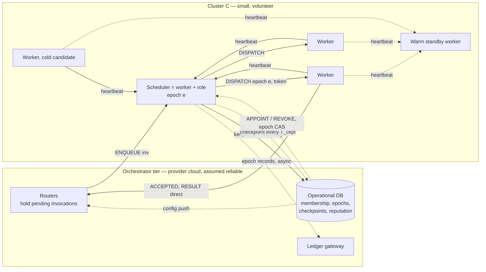

# 07 · Fault Tolerance: Succession Design for Schedulers and Workers

Supersedes the earlier Raft-replicated-scheduler sketch (kept only as a baseline, §10). Spec §5.5, §4.6.

## 1. Roles and trust (fixed terminology, ADR-022)

| Role | Who runs it | Does | Fault tolerance |
|---|---|---|---|
| **Orchestrator** | **Provider** (cloud), not a volunteer | Arranges clusters (membership, split/merge/move); appoints and fences schedulers (epochs); front-door **routers**; operational DB; ledger gateway | **Assumed reliable** (managed cloud HA; not studied, named and costed as the one centralized component) |
| **Scheduler** | A **worker** hosting an extra role (one active per cluster) | Placement inside its cluster: cost matrix, ILP/greedy, dispatch, retries, lifecycle actions | Crash-tolerant via succession (§4) |
| **Worker** | Volunteer machine | Executes invocations; heartbeats; any eligible worker can be **promoted to scheduler** | Crash-tolerant via detection, retry, hedging (§5) |

**Fault model (ADR-016):** crash-fault only, no Byzantine behavior. Workers and schedulers may crash (memory lost,
disk survives), be preempted by the owner (immediate or with grace), drain, or be partitioned/delayed. Nobody lies;
a scheduler never writes false records on-chain.

**Why this is the hard case:** unreliability is always high (volunteers continuously drop and join) and clusters are
small (tens of workers; the ILP cost forces it). A scheduler host is just another unreliable volunteer.

## 2. Operational DB (answer: yes, cloud-hosted, orchestrator-owned)

The authoritative operational store of cluster information lives in a **cloud database run by the orchestrator**.
It is *never* on the invocation critical path; the simulator models it as a service with an access latency (RTT to
the cloud region) and availability 1.0 by default.

| Table | Contents | Written by | Read by |
|---|---|---|---|
| `workers` | identity, tier, declared envelope, benchmark, state, cluster, reputation (global, whitewash-resistant) | orchestrator (on join/leave, from scheduler reports and ledger events) | orchestrator, scheduler at appointment |
| `clusters` | membership + version, medoid, size targets | orchestrator | orchestrator, routers, scheduler |
| `scheduler_epochs` | per cluster: `epoch`, `holder`, `succession` list, appointment time | orchestrator (atomic compare-and-swap on `epoch`) | routers, workers (via ask), schedulers |
| `checkpoints` | latest `SchedulerCheckpoint` per cluster (§4.4) | scheduler (async, every `T_ckpt`) | newly appointed scheduler |
| `functions` | versions, image digests, profiles | operator | scheduler, workers |
| `ledger_index` | anchored epoch roots, settlement status | ledger gateway | audit analysis |

Consequences stated plainly for the paper: this is a **centralized, provider-run dependency** (spec §5.5 requires
naming it). It is off the data path: if it were unreachable, running invocations and the current scheduler keep
working; what stops is appointments, membership change and checkpoint upload. A stress experiment (orchestrator
outage) is parked; costs of the cloud tier (DB ops, egress) are reported.

## 3. How this is usually done, and why we do not copy it

| System | Mechanism | Take-away |
|---|---|---|
| **Borg** | Paxos-replicated Borgmaster (5 replicas); Borglets keep tasks running when master is down | Separate control and data plane (we do). Paxos quorum among *reliable* machines |
| **Kubernetes** | Scheduler instances elect a leader via a **Lease** in etcd (compare-and-swap); scheduler is stateless, rebuilt from the API server | External arbiter + stateless scheduler (we do, with the orchestrator DB as arbiter) |
| **Mesos** | Master failover; **agents re-register and reconcile tasks** to rebuild master state | State reconstruction from the edge (we generalize this) |
| **Sparrow** | Decentralized stateless schedulers, late binding | No scheduler state to lose, but no global optimization (we want per-cluster ILP) |
| **Super-peer P2P** (Gnutella ultrapeers, Skype supernodes) | Capacity/uptime-based supernode election; edge workers hold backup lists; re-elect on missed acks | Closest to volunteers; lacks fencing and churn-aware ranking (we add both) |
| **BOINC** | Single server + DB, clients pull; deadlines and replication tolerate lost clients | Server is the SPOF; we need latency-class recovery |
| **Raft/Paxos group of volunteers** | Majority-replicated log | **Brittle at high churn:** needs a majority alive *simultaneously*; membership change needs a majority; every decision pays a quorum RTT. Kept as baseline `raft_group` |

**Our position:** because the orchestrator is a reliable arbiter, **volunteers need no consensus among themselves**.
Combine external arbitration (Kubernetes-style epochs), soft-state reconciliation (Mesos-style), and super-peer-style
succession, add churn-aware ranking, and shard the recovery state across the entities that already hold it.

## 4. Design: Succession with soft-state schedulers

### 4.1 Principle: state is held by whoever must already remember it

A scheduler's state is a **cache**, never the source of truth. Nothing needs a replicated log.

| State | Truth held by | Recovery path | Loss bound |
|---|---|---|---|
| Membership, cluster config, epochs | Orchestrator DB | Read at appointment | None |
| Undispatched invocations (queue, current window) | **Router** keeps a pending copy until the worker's `ACCEPTED` | Router re-sends to the new scheduler (dedupe by `inv_id`) | None (delay only) |
| Running / queued-at-worker assignments | The **worker** itself (token, epoch, state) | **Roll call** (§4.3) | None |
| Completed outcomes since last checkpoint | **Worker** retains them for `T_retain` | Roll call returns them; replayed into learned state | None if `T_retain > T_ckpt + failover` |
| Learned state (predictor posteriors, retry counters, rep deltas) | Orchestrator DB **checkpoint** + worker-retained recent outcomes | Load checkpoint, then replay retained outcomes | ≤ outcomes older than `T_retain` that lacked a checkpoint (tiny, measured) |
| Cluster view (free slots, lifecycle states, load) | Workers | Roll call + heartbeats | Rebuilt in ~1 RTT |
| Scheduler epoch record for the ledger | Worker receipts (carry `epoch, token`) + checkpoint | Gap filled from receipts, flagged `recovered` | Measured |

### 4.2 Appointment, succession list and epochs

- **Epoch** = monotone integer per cluster in the DB. A scheduler is whoever the orchestrator last appointed by atomic
  CAS (`epoch e → e+1, holder = S`). This is Kubernetes' lease idea with the orchestrator as the arbiter.
- **Succession list** per cluster: `[S0 active, S1, S2, …]` ranked by
  `score = P(survive horizon H) × speed × centrality`, with **failure-domain diversity** (S1 must be in a different
  ASN/region than S0) and hysteresis (re-rank only on meaningful change) to avoid flapping. The survival model
  (03 §6) provides `P(survive)`: long-lived, older sessions rank higher (age-dependent hazard).
- **Warm standbys:** the first `K` successors (default `K=1`, sweep 0–2) also receive worker heartbeats and
  periodically fetch checkpoints, so takeover skips view/checkpoint loading. Others are **cold** candidates: any
  eligible worker can be promoted ("workers can come up to be the scheduler"). Roll call makes cold promotion cheap,
  so `K=0` is a legitimate cheap configuration (hypothesis H12).
- **Eligibility:** tier ≥ 1, or Tier 0 with high predicted survival; enough free cores for `sched_cores`
  (default 1 reserved core, removed from that host's worker capacity); not draining.
- **Host speed matters:** solver time on the host = `solve_wall × cpu_scale / host.speed` (01 §7).



### 4.3 Failure and failover protocol

```mermaid
sequenceDiagram
    participant R as Router
    participant S as Scheduler (epoch 7)
    participant O as Orchestrator + DB
    participant N as New scheduler
    participant W as Workers
    R->>S: ENQUEUE(inv2)
    S->>W: DISPATCH(inv1, epoch 7)
    W-->>R: ACCEPTED(inv1)  (router drops pending copy)
    Note over S: host crashes / owner preempts
    W->>W: inv1 keeps running (data plane independent)
    S--xO: keepalive missed (adaptive detector)
    W->>O: SUSPECT (corroboration from workers)
    R->>R: inv2 not ACCEPTED within T_dispatch → spill-first for sync SLO
    O->>O: CAS epoch 7→8, holder = N (next in succession list)
    O->>N: APPOINT(epoch 8, membership, checkpoint ref)
    O->>R: config push (new scheduler)
    N->>O: load checkpoint (cold) / already warm
    N->>W: EPOCH_INSTALL(8) + ROLL_CALL
    W-->>N: report: running assignments, retained outcomes, free slots, lifecycle states
    N->>N: rebuild view; replay outcomes into learned state; adopt running assignments
    R->>N: re-send pending (inv2) — dedupe by inv_id
    N->>W: DISPATCH(inv2, epoch 8)
    W-->>R: RESULT(inv1) (direct path, never needed the scheduler)
```

- **Fencing is worker-side.** Workers adopt `(epoch, scheduler)` when higher, and reject dispatches from lower
  epochs with `STALE(epoch)`; the old scheduler steps down on `STALE` or `REVOKE`. The old scheduler can only affect
  the world through workers, so once workers adopt epoch 8 it is harmless.
- **Zombie bound:** a scheduler that cannot reach the orchestrator for `lease_s` **self-fences** (stops
  dispatching). `failover_mode: fast` (default) appoints on strong suspicion and relies on fencing (possible brief
  overlap, duplicates counted); `lease_safe` waits out `lease_s` first. Ablated in E21.
- **Detection (fast):** (1) orchestrator ↔ scheduler keepalive with an adaptive accrual detector (phi-style);
  (2) workers detect missing scheduler acks/beacons and send `SUSPECT`; `k` corroborations shorten the decision;
  (3) **push signals take precedence:** drain notice, or owner-preempt-with-grace, trigger a *planned handover*
  (§4.5) instead of waiting for failure.
- **Roll call:** workers report all state in one message each (small); new scheduler waits for a quorum of reports
  or `T_roll` (whichever first), proceeds, and late reports merge in.
- **Router retention:** `ENQUEUE` is *not* acked by the scheduler; the router clears its pending copy only on the
  worker's `ACCEPTED`. If none arrives within `T_dispatch` (window + decision + RTT bound), it re-sends; after
  `T_spill` (short for sync SLO) it **spills over** to a neighboring cluster. Worker-side `token = (inv_id, attempt)`
  and scheduler-side `inv_id` dedupe make re-sends safe. Semantics are at-least-once; duplicates are counted.
- **Response path:** workers return results directly to the router/origin, so completed work never depends on
  scheduler liveness.
- **Total loss of the succession list's hosts** (correlated crash): orchestrator promotes any eligible worker; if
  the cluster has too few live workers it is merged/reassigned (03 §2). A cluster with no live workers is marked dead
  and the router spills over.

### 4.4 Checkpoints

`SchedulerCheckpoint{cluster, epoch, covered_until_t, predictor posteriors (small), retry/storm counters,
reputation deltas}` is uploaded to the DB every `T_ckpt` (default 30 s) and at clean handover. Workers retain
outcome records for `T_retain ≥ 2·T_ckpt` and drop them once a later checkpoint's `covered_until_t` passes them
(announced in scheduler beacons). A new scheduler = checkpoint + replay of retained outcomes (dedupe by
`(inv_id, attempt)`): learned state survives failover almost losslessly with **no replicated log**. Predictor
hierarchy helps: function-level effects are shared globally at the orchestrator, only worker-level deviations are
cluster-local.

### 4.5 Proactive, hazard-triggered handover (converts crashes into planned handovers)

The orchestrator evaluates the scheduler host's survival hazard continuously (age, tier, local time-of-day,
declared window, recent owner activity). If `P(host fails within H) > θ` **and** a successor beats it by a margin
(hysteresis, cooldown), it orders a **planned handover**: new scheduler appointed, old one flushes a checkpoint and
hands its window over; no detection delay, no loss. Drain notices and owner-preempt grace use the same path.
`no_proactive_handover` is an ablation.

### 4.6 Overhead (reported)

Steady state is cheap: one scheduler (+ `K` warm standbys), no replicated log, no quorum RTT in the decision path.
Costs: keepalive/checkpoint traffic to the cloud, `K+1×` heartbeat traffic, reserved scheduler core, cloud DB
operations, router pending tables, worker outcome retention. Failover cost: detection + appointment RTT + roll call
≈ a few RTTs.

## 5. Worker crash tolerance

| Mechanism | Design |
|---|---|
| **Detection: per-invocation watchdog from the predictor** | Dispatch sets a watchdog at the predicted completion quantile (e.g., q90) plus margin from the same distribution the placer used (03 §5). On expiry the scheduler probes the worker; no reply ⇒ crash ⇒ re-place. Detection time adapts to each invocation instead of a global timeout |
| **Detection: accrual detector per worker** | Heartbeats feed a phi-style detector; suspected workers get no new work and their in-flight work is probed |
| **Push signals** | `OWNER_BUSY(grace)` and `DRAIN_NOTICE` arrive as messages: queued-not-started work is re-placed immediately, running short work may finish within grace; known availability is a hard constraint, not a prediction |
| **Recovery** | Retry policy re-places with the failed worker excluded and elapsed time counted (03 §9) |
| **Risk-proportional hedging** | If not done by the hedge quantile (e.g., q95) and `pMiss` is high, launch a tied duplicate on another worker (idempotent functions only), under a cluster **hedge budget** to cap wasted work |
| **Storm control** | A regional preemption wave fails many invocations at once; a per-cluster retry token bucket plus router spillover prevent retry storms from overloading survivors |
| **Crash-recover rejoin** | Disk survives: on return the worker re-registers with the orchestrator, reports surviving image/snapshot state (S1/S2), and re-enters the cluster; memory state (S3/S4) is lost |
| **Correlated failure** | Anti-affinity for replicated or hedged copies (same failure domain never holds both); succession list diversity |
| **Membership** | Join/leave go through the orchestrator (registration, calibration, cluster assignment); the scheduler reports `WORKER_LOST` in batches; scheduler also learns by heartbeat, reconciled by membership version |

## 6. Failure matrix

| Failure | Detected by | Recovered by | Lost / delayed |
|---|---|---|---|
| Worker crash mid-invocation | Watchdog, accrual detector | Retry/hedge elsewhere | That attempt; wasted work counted |
| Worker owner-preempt with grace | Push message | Re-place queued, finish short work | Possibly running attempt |
| Scheduler crash | Orchestrator keepalive, worker `SUSPECT` | Appoint next successor; roll call; router re-send | Delay for undispatched invocations; no loss |
| Scheduler + standby crash together | Same | Promote any eligible worker (cold) | Slightly longer failover; learned-state tail |
| Scheduler partitioned (zombie) | `STALE`/`REVOKE`, `lease_s` self-fence | Fencing by epoch | Possible duplicates (counted) |
| Scheduler drain / owner preempt | Push message | Planned handover | None |
| Router instance loss | Provider tier (assumed reliable) | Another router; client retry | Out of scope |
| Orchestrator/DB outage | — | Assumed not to happen; stress test parked | Out of scope |
| Whole cluster offline | Orchestrator (no summary, no workers) | Router spillover; membership reassigned | Invocations at that cluster retried |

## 7. Scheduler work on the ledger

- Each epoch the scheduler sends the orchestrator's **ledger gateway** a `SchedulerEpochRecord{cluster, epoch,
  scheduler, n_enqueued, n_assigned, assign_root = Merkle(inv_id, attempt, worker, t_assign), outcome_root}` plus a
  `LeaderTerm{cluster, epoch, scheduler, start_t}` on change. Gateway dedupes by `(cluster, epoch, epoch_id)`.
- **Crash gap:** if a scheduler dies before sending, the gap is filled from **worker receipts** (they carry
  `epoch` and `token`) and marked `recovered`. Audit joins: every execution has an assignment under a valid epoch;
  every assignment has an outcome or is flagged lost; no dispatch from a stale epoch after fencing.
- **Credit:** scheduler credit ∝ committed assignments and time as active/warm scheduler (04 §4).
- The ledger is audit and reward only; election and fencing never wait for it (spec §14).

## 8. Parameters and metrics

| Parameter | Default | Sweep (E21) |
|---|---|---|
| `ha` | `succession` | `none`, `succession`, `raft_group(r)` baseline |
| `K` warm standbys | 1 | 0, 1, 2 |
| `T_ckpt`, `T_retain` | 30 s, 90 s | 5–120 s |
| keepalive period, detector threshold | 500 ms, phi 8 | ×0.5…×4 |
| `failover_mode`, `lease_s` | fast, 5 s | fast / lease_safe |
| `T_dispatch`, `T_spill` (sync) | 1 s, 1.5 s | |
| proactive handover `θ`, margin | 0.2, 2× | off, on |
| watchdog / hedge quantile, hedge budget | q90 / q95, 10% | |
| `sched_cores`, host policy | 1, survival-ranked | Tier 2 only |

Metrics: failover time (crash → first new dispatch), invocations delayed/lost/duplicated, P99 in the failover
window, learned-state loss, roll-call duration, control overhead (cores, traffic, cloud ops), planned vs. crash
handover ratio, fencing rejections and any execution from a stale epoch (must be zero after install), cluster
unavailability fraction, unanchored/`recovered` epoch share.

**H11.** Succession cuts failure-induced tail latency versus no redundancy, at near-zero steady-state decision cost
(no quorum in the decision path).
**H12.** At high churn, reconcile-based succession (even cold, `K=0`) achieves lower cluster unavailability than a
volunteer Raft group of the same overhead, because it needs the reliable orchestrator plus any one eligible
worker, not a simultaneous majority.
**H13.** Proactive hazard-triggered handover converts most scheduler losses into planned handovers and reduces
delayed invocations versus reactive failover.

## 9. Novelty and honest claims (for the paper)

Individually known: epoch/lease arbitration (Kubernetes/Chubby), reconciliation (Mesos), accrual failure detectors,
super-peer succession, hedging. **Claimed contribution is the combination for volunteer FaaS:** (1) no consensus among
volunteers: recovery state is *sharded across entities that already hold it* (router, workers, orchestrator DB);
(2) any worker is a scheduler candidate, ranked by a churn-aware survival model with failure-domain diversity;
(3) hazard-triggered proactive handover; (4) failure detection and hedging driven by the same predictive
distributions as placement. Evaluated against `none` and `raft_group` in E21; negative results are reported.

## 10. Baselines and simplifications

- `ha: none`: scheduler crash loses its state; no roll call, no router retention; orchestrator re-appoints blindly.
- `ha: raft_group(r)`: replicated-log scheduler on volunteers (terms, majority commit, snapshot catch-up, fencing),
  implemented in Roadmap P7b **only if** needed for E21; all messages go through `net.send`.
- Not modeled: orchestrator/DB failure, router failure, Byzantine nodes, active-active sharding of invocations.
