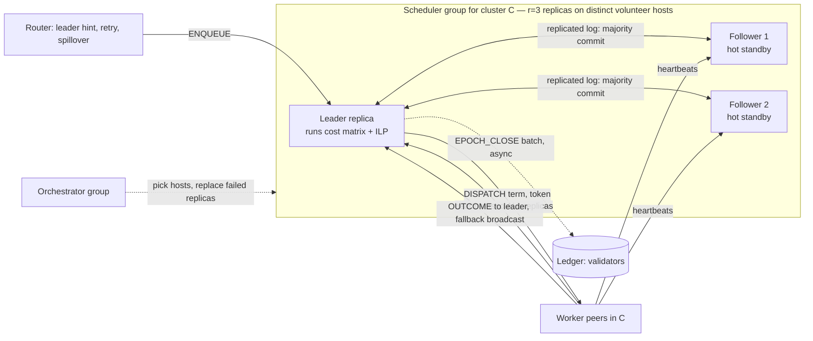

# 07 · Scheduler Replication and Control-Plane HA

This is the design for removing the cluster scheduler as a single point of failure when schedulers run on
unreliable volunteer machines. It supersedes the sketch in 04 §6 (spec §5.5).

## 1. Problem

The cluster scheduler holds the invocation queue and runs the cost-matrix + ILP. It is hosted on a volunteer, so it
can crash, be preempted by its owner, or drain. We need:

1. **No lost or duplicated invocations** across a scheduler failure (within stated semantics).
2. **Fast failover** whose time emerges from geography and heartbeats, not from a fixed constant.
3. **Small decision-latency cost** for replication.
4. **Host-aware scheduling**: a scheduler host's speed sets solver time, and it gives up donor capacity.
5. **Auditable work**: scheduler decisions are tracked on the ledger.

**Why replica groups are cheap here.** The ILP cost grows quickly with window size × cluster size, so clusters are
kept **small** (tens of peers; the exact target comes from experiment E02). A group of `r` replicas inside one
small, geographically tight cluster has a small quorum RTT. The price is **correlated failure** (same city,
ISP, timezone), handled by spreading replicas across failure domains under an RTT bound (§4).

## 2. Fault model (applies to the whole system, see ADR-016)

**Crash-fault tolerant (CFT), not Byzantine.** Every node (worker peer, scheduler replica, router, orchestrator,
ledger validator) may:

- **crash-stop / crash-recover** (disk survives a crash, memory does not),
- be **preempted by its owner** (immediate, or with a short grace),
- **drain gracefully**,
- suffer **message delay**, and optionally **loss or partition** (injected, to exercise split-brain handling).

No node is assumed to lie, forge, or equivocate. In particular, **a scheduler never writes false records to the
chain**, so the ledger needs no verification of scheduler claims and validators run a CFT protocol. Consequences:
no signature-verification cost model, no BFT consensus, and safety under partitions rests on **terms + fencing**
(§3), not on cryptography. (Optional lazy-worker verification is a separate extension: 04 §2.)

## 3. Design: per-cluster scheduler group



### 3.1 Replicated state machine (what is in the log)

The scheduler is a **deterministic state machine** whose `apply(entry)` is a pure update. Policies stay pure: the
leader runs the placer over `(replicated state + its view)` and the **result becomes a log entry**. Followers
**never re-run the ILP**; they apply the entry.

| Replicated (log entries) | Not replicated (each replica builds its own) |
|---|---|
| `ENQUEUE(inv)` accepted invocations | Heartbeat-fed `ClusterView` (peers send heartbeats to **all** replicas; costs `r×` monitoring traffic, counted) |
| `ASSIGN(inv, attempt, peers, term, token)` | Cost matrices, solver state |
| `OUTCOME(inv, attempt, status, timings)` (also updates predictor posteriors, reputation counters, retry state in every replica via `apply`) | |
| `EPOCH_CLOSE(epoch, digests)` ledger batch boundary | |
| `CONFIG(add/remove replica)` single-server membership change | |

State is small (queue, in-flight assignments, counters), so catch-up of a new replica is a **snapshot transfer**.

### 3.2 Protocol: "Raft-lite" over the simulated network

One reusable component (`runtime/replication.py`, also used for the orchestrator and ledger validators): terms,
randomized election timeout, leader heartbeats among replicas, `AppendEntries` with majority commit, persistent log
(survives crash-recover), snapshot for catch-up, single-server membership change. **Not implemented:** log
compaction beyond snapshots, read leases (all reads on the leader), pre-vote, batching optimizations. Every message
goes through `net.send` (01 §6), so **election time, quorum RTT and catch-up time derive from geography**.

### 3.3 Commit and dispatch

| Path | Entries | Decision latency added |
|---|---|---|
| Fast path (sync) | one combined `ENQUEUE+ASSIGN` | one quorum RTT before dispatch |
| Window path | `ENQUEUE` on arrival; `ASSIGN` batch after solve | quorum RTT on enqueue (hidden by the batching wait) + one before dispatch |

`dispatch: committed` (default): dispatch only after the entry commits, so a new leader's log always contains every
dispatched assignment: nothing is lost or double-dispatched.
`dispatch: speculative` (allowed only for `idempotent` functions): dispatch immediately and replicate in
parallel, hiding the quorum RTT; a failover may re-dispatch, producing **duplicate execution**, which peers
de-duplicate by `token = (inv_id, attempt)`. Semantics are at-least-once either way (spec §3.2). This trade-off is
ablated in E21.

### 3.4 Fencing (split-brain under crash faults)

Every `DISPATCH` carries `(cluster, term)`. A worker peer remembers the highest term seen per cluster and **rejects
lower terms**. A deposed leader (false suspicion, partition) therefore cannot cause new executions once any peer has
seen the new term. Outcomes carry the term too. This (not the chain) is the safety mechanism: the ledger is never on
the control path.

### 3.5 Failover sequence

```mermaid
sequenceDiagram
    participant R as Router
    participant L as Leader (term 7)
    participant F as Follower A
    participant P as Peers
    R->>L: ENQUEUE(inv1)
    L->>F: AppendEntries(ENQUEUE+ASSIGN inv1)
    F-->>L: ack (majority)
    L->>P: DISPATCH(inv1, term 7, token)
    Note over L: host crashes / owner preempts
    P->>P: inv1 keeps running (data plane independent)
    R->>L: ENQUEUE(inv2) — timeout
    F->>F: election timeout (randomized)
    F->>F: becomes leader, term 8, wins majority
    R->>F: retry ENQUEUE(inv2) (leader hint updated)
    F->>F: replay log; rebuild view from heartbeats; short warm-up window T_warm
    F->>P: re-dispatch ASSIGNs with no OUTCOME (token dedupes), DISPATCH term 8
    P-->>F: OUTCOME(inv1) (buffered until a leader existed)
```

- **New-leader warm-up (`T_warm`)**: one heartbeat period of conservative slot accounting (assume uncertain
  in-flight work still holds slots) to avoid double-booking peers.
- **Clients:** the router keeps a leader hint, retries other replicas with backoff, and **spills over to another
  cluster after `T_spill`**. `ENQUEUE` is acked only after commit, idempotent on `inv_id`. If an entire group's log
  is lost, in-flight committed-but-unfinished invocations are lost; the origin's timeout-retry reissues them and the
  loss/duplication is **counted**.
- **Planned handover:** on a drain notice or an owner-preempt grace period, the leader transfers leadership
  (`TimeoutNow`-style) before leaving: near-zero gap. Crash and zero-grace preemption take the election path.
- **Peers:** keep running work, buffer outcomes, and send to the known leader, falling back to broadcasting to all
  replicas after a timeout.

## 4. Hosting: choosing and replacing replicas

Selected by the orchestrator group (itself replicated):

- **Eligibility:** tier ≥ 1, or Tier 0 with high predicted survival; enough free cores for `sched_cores`
  (default 1 reserved core, removed from that host's worker capacity); not hosting another control role
  (role anti-affinity).
- **Score:** `P(survive horizon H) × speed × centrality` where centrality is inverse max-RTT to the cluster's peers.
- **Constraints:** ≥ 2 distinct failure domains (ASN/region) per group where possible; max pairwise replica RTT
  ≤ `R_max` (bounds quorum latency). Config `replica_spread` tunes locality vs. diversity (spec §5.4).
- **Replacement:** on replica loss (detected by leader heartbeat timeout or drain notice), the leader proposes
  `CONFIG(add new, remove old)`; the new replica catches up from a snapshot. A group below quorum is **orphaned**
  (§5).
- **Host speed matters:** solver time on the host = `solve_wall × cpu_scale / host.speed` (01 §7). A slow host
  schedules slowly; hence the speed term in the score.
- **Overhead is reported:** share of peers/cores used by control roles, `r×` heartbeat traffic, replication
  traffic and added decision latency. Cluster size and `r` are tuned jointly (small `N`, `r=3` ⇒ ~10% of a 30-peer
  cluster hosts schedulers). `dedicated_tier2` is the alternative host policy.

## 5. Other control-plane components

| Component | Design | Failure behavior |
|---|---|---|
| **Router** | Stateless, several per region; consumes `ClusterSummary` pushed by scheduler leaders; clients use any router (list from bootstrap root) | Any router can serve; summary staleness grows if a leader is down; unreachable cluster excluded after summary expiry |
| **Orchestrator** | Replica group (r = 3–5) with the same replication component; state = membership map and cooldowns; decisions commit before being applied; Tier 2 preferred hosts | Failover as for schedulers; peers keep running under last membership meanwhile |
| **Ledger validators** | CFT consensus group over the same component (04 §3); finality = quorum RTT among validators + batching | A validator crash is tolerated up to a minority |
| **Bootstrap root** | Provider-owned, tiny, near-stateless (peer discovery, genesis, router list). **The one named residual SPOF** (ADR-008) | Costed; new joiners blocked while down, running system unaffected |
| **Whole scheduler group lost** | Orchestrator detects no leader summary for `T_orphan` → reassigns the cluster's peers to neighbors and creates a new group; router spills over meanwhile | Committed-but-unfinished invocations retried by origin timeout; counted |

## 6. Scheduler work on the ledger

Schedulers are volunteers, so their work is also recorded and credited.

- The leader batches decisions per epoch. `EPOCH_CLOSE` is a **log entry**, so a new leader can resubmit unacked
  batches. Chain dedupes by `(cluster, term, epoch_id)`.
- **Record content:** `SchedulerEpochRecord{cluster, term, epoch_id, leader, n_enqueued, n_assigned,
  assign_root = Merkle(inv_id, attempt, peer, t_assign, term), outcome_root}` plus `LeaderTerm{cluster, term,
  leader, start_t}` entries on leadership change.
- **No verification of scheduler claims** (CFT, §2). The record supports **audit joins** against worker execution
  receipts: every executed invocation has an assignment under a valid term; every assignment has an outcome or is
  flagged lost; no dispatch from a stale term (fencing violations must be zero).
- **Credit:** scheduler credit ∝ committed assignments (leader) and replica-uptime (followers), counted in the
  reward fairness metrics (04 §4).
- **The ledger is audit and reward only.** It is never used for election or fencing (that would put finality on
  the critical path, spec §14). **Measured loss:** work not yet anchored when a whole group dies (≤ one epoch).

## 7. Parameters and metrics

| Parameter | Default | Sweep (E21) |
|---|---|---|
| `r` (replicas/group) | 3 | 1, 3, 5 |
| `election_timeout`, `repl_heartbeat` | 150–300 ms, 50 ms | ×0.5…×4 |
| `dispatch` | committed | committed / speculative |
| `replica_spread`, `R_max` | ≥2 domains, 40 ms | 1–3 domains, 10–100 ms |
| `sched_cores`, host policy | 1, reliability_ranked | dedicated_tier2 |
| `T_warm`, `T_retry`, `T_spill` | 1 hb, 200 ms, 2 s | |
| `epoch_s` | 30 | 5–120 |

Metrics: failover time (crash → first new dispatch), invocations delayed / lost / duplicated, P99 over a failover
window, quorum-RTT share of decision time, control-role overhead (cores, traffic), election count, fencing
rejections, split-brain incidents (must be zero executions from stale terms), unanchored loss.

**Proposed hypothesis H11** (add to the spec): replicated schedulers cut failure-induced tail latency at small
decision-latency cost because intra-cluster quorum RTT is small; speculative dispatch removes most of that cost for
idempotent functions at the price of rare duplicates.

## 8. Deliberate simplifications

CFT only; Raft-lite instead of a full production protocol; no dynamic `r`; all reads served by the leader; one
leader per cluster (no active-active sharding). Active-active sharding of invocations across replicas was
considered and rejected (ADR-017): small clusters already bound the work, and sharding would duplicate peer-slot
accounting and add conflict resolution.
