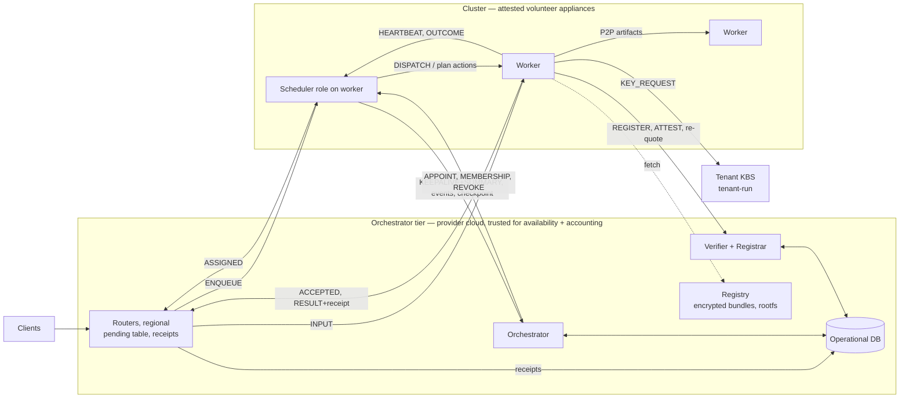

# 08 · State, Operational DB and Protocols

## 1. Rules

1. **The operational DB is private to the orchestrator tier.** Workers and schedulers never touch it; they send
   messages and the orchestrator reads or writes on their behalf. `APPOINT` embeds what a new scheduler needs.
2. **The invocation hot path never touches the DB** (a cloud round trip would land in latency).
3. **One writer per datum** and one authority for its truth.
4. **Live state stays where it is born:**
   - worker queues, caches and keys in workers;
   - undispatched invocations in routers;
   - cost matrices in the scheduler.

   It is recovered by roll call (doc 07), not read from the DB.
5. **Routers write the ground truth of work**: attested receipts.
6. **Every channel is TLS terminated inside attested parties** (appliances, orchestrator tier, KBS); certificates
   come from attestation (doc 04 §5).

## 2. Who talks to whom



**Transport:** workers sit behind NAT, so each opens outbound persistent TLS streams to its scheduler, the
verifier/orchestrator and routers. Pushes ride those streams; `relayed` workers pay a penalty. Bulk payloads never pass
through the scheduler.

## 3. Operational DB

### 3.1 Tables

| Table | Contents | Single writer |
|---|---|---|
| `identities` | `identity = hash(EK)`, EK cert chain status, first seen, status (active/banned) | verifier |
| `workers` | identity, hw class, substrate, tier, declared envelope (slots, mem, SSD, HDD, bandwidth), location, failure domain, `cluster_id`, role, firmware policy (`known_good`/`tofu`) | orchestrator |
| `sessions` | identity, session-cert id, start, last quote, assurance, expiry, end reason | verifier |
| `clusters` | members + version, medoid, `epoch`, `scheduler_cert_id`, succession list, size targets | orchestrator (epoch via CAS) |
| `scheduler_roles` | cluster, epoch, scheduler, start, end, end reason | orchestrator |
| `checkpoints` | per cluster: epoch, `covered_until_t`, last **plan**, predictor/survival/omission posteriors | orchestrator (on `PUT_CHECKPOINT`, epoch-fenced) |
| `tenants` | tenant id, KBS location/address, sensitivity `σ`, assurance floor, robustness `f` | operator |
| `functions` | fn, version, tenant, bundle/rootfs/snapshot digests and sizes, memory, profile priors, idempotent, SLO defaults | operator |
| `receipts` | **ground truth of work**: `inv_id, attempt, fn, tenant, origin, cluster, epoch, worker, session_cert, t_arrive, t_assigned, t_accepted, t_result, status, exec_s, ref_work_units, start_level, trust_cold, bytes, output_digest` | routers (batched, async) |
| `worker_events` | session start/end (graceful/abrupt), suspicion, change point, commitment breach | verifier, orchestrator, scheduler batches |
| `cluster_stats` | periodic summaries | orchestrator |
| `reputation`, `credits` | derived (doc 09) | orchestrator batch jobs |

**Not stored (by design):** the live queue, per-worker pending work, heartbeats, cache contents, tenant keys (never
leave appliances and KBSs), cost matrices.

### 3.2 Access matrix (all through orchestrator-tier messages)

| Actor | Operations | On hot path? |
|---|---|---|
| Worker → verifier | `REGISTER`, `ATTEST`, re-quote | No (session-scoped) |
| Worker → orchestrator | `JOIN`, `DRAIN_NOTICE`, `LEAVE`, `WHO_IS_SCHEDULER` | No |
| Scheduler → orchestrator | `KEEPALIVE+SUMMARY` (0.5–2 s), `REPORT_EVENTS` (5 s), `PUT_CHECKPOINT` (30 s), `PLAN_INFEASIBLE` | No |
| Orchestrator → scheduler | `APPOINT`, `MEMBERSHIP`, `REVOKE` (incl. revoked sessions) | No |
| Router → DB | append `receipts` | No (async ≤ 1 s) |

Scheduler writes carry `epoch` and are rejected unless it is current (zombie fencing).

### 3.3 Volumes (estimates, to measure)

For N=30 workers per cluster, 1,000 workers, 100 inv/s:
- in-cluster control traffic ≈ 10 KB/s per cluster (heartbeats, beacons, dispatch);
- scheduler → orchestrator ≈ 2 KB/s per cluster;
- receipts ≈ 30 KB/s (≈ 2.5 GB/day; partition by day, roll up);
- attestation re-quotes: 1,000 workers / `T_reattest` (e.g., 10 min) ≈ 1.7/s at the verifier.

At 100k workers, scale by 100: a standard cloud service.

## 4. Message catalogue

All messages are typed dataclasses in `core/messages.py`, sent with `net.send` (geo delay).

| Message | From → To | Content |
|---|---|---|
| `REGISTER` / `ATTEST` / `QUOTE_REQ` / `SESSION_CERT` / `REVOKE_SESSION` | Worker ⇄ Verifier | EK/AK, quote, event logs, session pubkey; cert with assurance and expiry |
| `JOIN` / `DRAIN_NOTICE` / `LEAVE` / `WHO_IS_SCHEDULER` | Worker → Orchestrator | Session cert, envelope, cache summary; deadline (hint) |
| `APPOINT` / `REVOKE` / `MEMBERSHIP` | Orchestrator → Scheduler | Epoch, cert binding, snapshots, checkpoint |
| `EPOCH_INSTALL` / `ROLL_CALL` / `ROLL_CALL_REPORT` | Scheduler ⇄ Workers | Epoch; full `WorkerState` + retained outcomes |
| `BEACON` | Scheduler → Workers | Epoch, `ckpt_covered_until`, membership version |
| `HEARTBEAT` | Worker → Scheduler (+ standbys) | `WorkerState` delta (§5) |
| `KEEPALIVE+SUMMARY` | Scheduler → Orchestrator | Load, SLO health, **trust-warm capacity per hot tenant**, robust slack, diversity |
| `ENQUEUE` | Router → Scheduler | Metadata only: inv id, fn, tenant, deadline, class, in_bytes, idempotent |
| `DISPATCH` | Scheduler → Worker | inv, attempt, token, epoch, fn version, digests, source hints, deadline, hedge group |
| `ASSIGNED` | Scheduler → Router | inv, attempt, worker, epoch |
| `INPUT` | Router → Worker | Payload or storage reference |
| `ACCEPTED` | Worker → Router + Scheduler | Token, ETA |
| `RESULT` | Worker → Router | Output or reference + **attested receipt** (doc 04 §9) |
| `OUTCOME` | Worker → Scheduler | Status, timings, start level, trust_cold, resource use |
| `CANCEL` | Scheduler → Worker | Hedge loser / filler preemption |
| `PROBE` / `PONG` | Scheduler ⇄ Worker | Watchdog check |
| `PREPARE` / `PIN_SNAPSHOT` / `WARM` / `RELEASE` | Scheduler → Worker | Plan actions (doc 03 §4.4) |
| `KEY_REQUEST` / `KEY` | Worker ⇄ Tenant KBS | Session cert (+ fresh quote) → key wrapped to the session key |
| `FETCH` / `CHUNK` | Worker ⇄ Worker or Registry | Content-addressed artifact transfer (bulk) |
| `STALL` | Router → Orchestrator | Cluster, epoch, count |

## 5. Worker state and readiness (fast-loop input)

**`WorkerState`** (heartbeat; static fields from `JOIN`):
- `slots_busy`, `running[]` = `(inv, fn, phase ∈ {trust, fetch, startup, exec, io}, elapsed)`, `queued[]`;
- `mem_free`, `ssd_free`, `hdd_free`;
- **cache inventory delta:** `{fn@version: level ∈ L0..L3, tier ∈ {ram, ssd, hdd}, warm_vms}`;
- **trust flags:** `K = {tenant ids with keys present}`; plan actions in progress / confirmed;
- `load`, `drain_deadline` (hint), `session_expiry`, `outcomes_retained_until`.

**Readiness, as designed** (*implementation note, D-69: the shipped code uses the simpler queue-length estimate `wait = max(0, busy + queued + inflight − slots + 1) · svc / slots`, with `svc` the scheduler's EWMA of observed execution times; the per-slot residual `ready_at` below is not implemented*). **Readiness, computed by the scheduler** (single source of predictions; policies stay pure):

```
age            = now − view.as_of
residual_m     = E[T(run_m) − (elapsed_m + age) | T > elapsed_m + age]      # per slot, predictor-based
queued_m       = Σ queued on slot m (trust + startup + E[exec])
inflight_m     = Σ dispatched-by-me since as_of on slot m
ready_at[j,m]  = now + residual_m + queued_m + inflight_m                  # mean + variance kept
time_to_start(i,j) = min_m ready_at[j,m] ⊕ trust(t,j) ⊕ startup(level(f,j), tier)
                    where artifact fetch overlaps waiting: max(ready_at, fetch_done) + boot/restore
```

Sorting `ready_at[j,·]` gives the slot ladder for the flow placer. Mean and variance feed the moment-matched
completion distribution. Hard constraints come from: `session_expiry` (finish before), the drain hint (conservative),
the memory needed for a new VM, and the assurance floor.

## 6. Payload path

`ENQUEUE` carries metadata. The scheduler sends `DISPATCH` (worker) and `ASSIGNED` (router) in parallel. The router
streams `INPUT` to the worker over attested TLS, and the worker overlaps trust/fetch/restore with payload arrival.
The router keeps the payload until `ACCEPTED`. Results return worker → router directly. The scheduler never handles
payloads, results or tenant keys.
