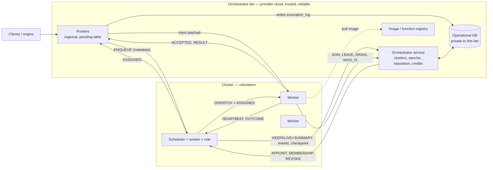

# 08 · State, Operational DB and Protocols

Answers: what exactly is stored where, who may touch the DB, how scheduler and workers talk, and how worker readiness
(time-to-start) enters the ILP. Complements 07 (failover) and 03 (placement).

## 1. Rules (keep the system simple)

1. **The DB is private to the orchestrator tier.** Schedulers and workers never read or write it directly; they send
   messages to the orchestrator, which reads/writes on their behalf. So **workers need no DB access** (they only
   message the orchestrator to join, leave, or look up their scheduler), and schedulers use a small API (§3.3).
2. **The hot path never touches the DB.** Placement, dispatch and results use only messages between router,
   scheduler and workers. A cloud DB round trip (tens to hundreds of ms) would land directly in invocation latency.
3. **Every datum has exactly one writer** (no write conflicts) and one authority for its truth (§3.2).
4. **Live state stays where it is born** (worker queues in workers, undispatched invocations in routers, cost
   matrices in the scheduler) and is recovered by roll call, not read from the DB (07 §4.1).
5. **Ground truth of work done is written by the routers**, which are trusted and observe both ends of every
   invocation (§3.2). Nobody else needs to author work records.

## 2. Who talks to whom



**Transport (real-world analog, modeled by `net.send`):** volunteers sit behind NAT, so each worker opens an
**outbound, persistent bidirectional stream** to its scheduler (and one control channel to the orchestrator). The
scheduler pushes DISPATCH down that stream (no polling latency); heartbeats ride the same stream. Workers that
need a relay get the `relayed` penalty (02 §3). After a scheduler change, workers reconnect to the new scheduler
whose address arrives in `EPOCH_INSTALL` or via `WHO_IS_SCHEDULER`. The scheduler's own link is a volunteer link,
so **bulk payloads never pass through the scheduler** (§6).

## 3. The operational DB

### 3.1 What is stored (tables)

| Table | Contents | Single writer |
|---|---|---|
| `identities` | vetted identity ref (opaque, e.g. institution/ORCID, 09), status active/banned | orchestrator (admission is out of scope, stubbed) |
| `workers` | `worker_id`, `identity_id`, tier, declared envelope (cores, mem, disk, bandwidth, availability windows), hw class + `cpu_model` (snapshot class), calibration benchmark, location, failure domain, `cluster_id`, role (`worker`/`scheduler`/`standby`), state (`offline`/`online`/`draining`/`left`), session start, **reputation** `(alpha, beta, updated)` | orchestrator |
| `clusters` | `cluster_id`, membership version, medoid, **current `epoch`, `scheduler_id`, succession list, scheduler address**, size targets | orchestrator (epoch via atomic CAS) |
| `scheduler_roles` | history: cluster, epoch, scheduler, start, end, end reason (`crash`/`handover`/`revoked`) | orchestrator |
| `checkpoints` | latest per cluster: `epoch`, `covered_until_t`, predictor posteriors, retry/storm counters | orchestrator, on scheduler's `PUT_CHECKPOINT` |
| `functions` | function versions, image digest and size, memory, profile priors, idempotent flag, SLO defaults | operator |
| `invocation_log` | **ground truth of work**, append-only: `inv_id, attempt, fn, version, origin, cluster, epoch, scheduler_id, worker_id, slo_class, deadline, t_arrive, t_assigned, t_accepted, t_result, status, exec_s, cpu_s, bytes_in/out, start_state` | **routers** (batched, async) |
| `worker_events` | `JOINED, LOST_CRASH, PREEMPTED, DRAIN_CLEAN, COMMIT_BROKEN, ENVELOPE_SHORT` with cluster, epoch, time | orchestrator, from worker messages (join/leave/drain) and scheduler batches (crash detections) |
| `cluster_stats` | periodic summaries: size, utilization, queue length, SLO health, warm-function sets | orchestrator, from scheduler summaries |
| `credits` | per worker and per scheduler, per period; **derived**, never hand-written | orchestrator batch job over `invocation_log` + `scheduler_roles` |

**Deliberately NOT in the DB:** the live invocation queue and current batch, per-worker pending jobs, heartbeats,
cost matrices, in-flight dispatches. They change per millisecond and are recoverable from routers and workers; storing
them would put DB latency on the decision path. (Image layers and code live in the registry, not the DB; the DB
holds only digests.)

So, "which workers are in the cluster": `workers.cluster_id` + `clusters.members_version`. "Which node is the
scheduler": `clusters.scheduler_id/epoch`. "Reputation": `workers.reputation`. "Current batch allocated to a cluster":
**not durable by design**; it lives in the router pending table and the scheduler's window, and only its aggregate
(queue length, load) reaches `cluster_stats`.

### 3.2 Who holds the truth

| Fact | Authority | Why that one |
|---|---|---|
| Membership, roles, epoch | Orchestrator DB | Needs a reliable arbiter; strong consistency on `epoch` |
| Work done (accepted, result, outcome status) | **Routers** (`invocation_log`) | Trusted, see ACCEPTED and RESULT directly, independent of scheduler crashes |
| Worker events: join/leave/drain | Orchestrator (worker messages it directly) | Direct and authoritative |
| Worker events: crash/preempt detected | Scheduler's report, cross-checked with membership changes | Only the scheduler observes missed heartbeats |
| Reputation, credits | Orchestrator (derived from the above) | Single computation, no conflicts |
| Worker's live state | The worker | Reported by heartbeat, always stale by design |

### 3.3 Access matrix (all through orchestrator messages)

| Actor | Operation | Sync on hot path? | Frequency |
|---|---|---|---|
| Worker → orchestrator | `JOIN` (register + benchmark → gets cluster, scheduler address, epoch), `LEAVE`, `DRAIN_NOTICE`, `REJOIN`, `WHO_IS_SCHEDULER` | No | Per session event |
| Scheduler → orchestrator | `KEEPALIVE+SUMMARY` (also renews role), `REPORT_EVENTS(batch)`, `PUT_CHECKPOINT(epoch)` | No | 0.5–2 s, 5 s, 30 s |
| Orchestrator → scheduler | `APPOINT(epoch, membership snapshot, checkpoint, reputation snapshot)` (so the scheduler never queries the DB), `MEMBERSHIP(deltas)`, `REVOKE` | No | On change |
| Router → DB | Append `invocation_log` rows | No | Batched ≤ 1 s |
| Router ← orchestrator | Cluster config / scheduler address push | No | On change |
| Orchestrator internal | Reputation update, credit batch, cluster re-arrangement | No | Seconds to minutes |

**Fencing at the API:** `PUT_CHECKPOINT`, `REPORT_EVENTS` carry the sender's `epoch` and are rejected unless it equals
`clusters.epoch`, so a zombie scheduler cannot corrupt the DB.

### 3.4 Volumes (design estimates, to be measured in P2/P7)

Assume clusters of N=30 workers, a 1,000-worker system (~33 clusters), 100 invocations/s overall, heartbeats every
5 s at ~400 B, `invocation_log` row ~200 B.

| Flow | Per cluster | System (1k workers) | 100k workers (10⁴ inv/s) |
|---|---|---|---|
| Heartbeats to scheduler (+1 warm standby) | 30×400 B/5 s ≈ 2.4 KB/s (×2) | stays inside clusters | same |
| Scheduler beacon to workers (0.5 s) | ≈ 3.8 KB/s | inside clusters | same |
| Dispatch + accepted + outcome | ≈ 3 inv/s × ~1.2 KB ≈ 3.6 KB/s | inside clusters | same |
| Scheduler → orchestrator (summary, events, checkpoint ~20 KB/30 s) | ≈ 2 KB/s | ≈ 66 KB/s | ≈ 6.6 MB/s |
| `invocation_log` appends (×1.2 attempts) | n/a | ≈ 24 KB/s ≈ 2 GB/day | ≈ 2.4 MB/s ≈ 200 GB/day (partition by day, keep raw 7–30 d, roll up) |
| Epoch CAS | ≈ 1 per scheduler tenure (hours) | ≈ 0.003/s | ≈ 0.3/s |
| Appointment payload (30 worker rows + checkpoint) | ≈ 18 KB + 20 KB, once | rare | rare |
| Roll call (30 reports × 1–4 KB) | ≈ 45 KB burst, one RTT | rare | rare |

Conclusion: DB load is small and entirely asynchronous; the orchestrator tier is a standard cloud service. Its
cost (DB writes, storage, egress) is reported in E13.

### 3.5 Failover and handover and the DB

- **Crash:** orchestrator CAS `epoch e → e+1` with the new `scheduler_id` and appends `scheduler_roles`; embeds the
  membership snapshot and last checkpoint in `APPOINT` (no scheduler-side DB access). Work records are **unaffected**
  because routers write `invocation_log`. What a crash can lose: crash detections not yet reported
  (≤ `T_report`), and learned-state newer than `T_retain` without checkpoint (07 §4.4); both measured.
- **Planned handover:** old scheduler sends a final `PUT_CHECKPOINT` + `REPORT_EVENTS`, then the orchestrator CASes to
  the successor, which receives the checkpoint in `APPOINT`; nothing is lost.
- **Zombie:** its writes are rejected by epoch (above); workers reject its dispatches (07 §4.3).
- **Orchestrator restart:** DB is the source of truth; routers hold pending copies; no volunteer state needed.

## 4. Message catalogue

All are `net.send` messages with geo-derived delay (01 §6). Sizes are design estimates.

| Message | From → To | Content | Rate / size |
|---|---|---|---|
| `JOIN` / `REJOIN` | Worker → Orch | identity token, envelope, benchmark, surviving disk state | per session; ~1 KB |
| `LEAVE` / `DRAIN_NOTICE(deadline)` | Worker → Orch + Scheduler | reason, deadline | rare; 100 B |
| `PREEMPT_WARNING(grace)` | Worker → Scheduler (+Orch) | grace left, running work | rare; 100 B |
| `WHO_IS_SCHEDULER` | Worker → Orch | cluster id | on suspicion; 50 B |
| `APPOINT` | Orch → Scheduler | epoch, snapshots, checkpoint, rep | rare; ~40 KB |
| `EPOCH_INSTALL` | Scheduler → Workers (+Routers via Orch) | epoch, scheduler addr | per failover; 100 B |
| `ROLL_CALL` / `ROLL_CALL_REPORT` | Scheduler ⇄ Worker | full `WorkerState` + retained outcomes | per failover; 1–4 KB |
| `BEACON` | Scheduler → Workers | epoch, `ckpt_covered_until`, membership version | 0.5 s; 64 B |
| `HEARTBEAT` | Worker → Scheduler (+standby) | `WorkerState` delta (§5) | 5 s; ~400 B |
| `KEEPALIVE+SUMMARY` | Scheduler → Orch | cluster summary (load, warm fns, SLO health) | 0.5–2 s; ~1 KB |
| `REPORT_EVENTS` / `PUT_CHECKPOINT` | Scheduler → Orch | worker events batch / checkpoint | 5 s / 30 s |
| `MEMBERSHIP` | Orch → Scheduler | joins/leaves/moves (delta + version) | on change |
| `ENQUEUE` | Router → Scheduler | **metadata only**: inv id, fn, version, origin, deadline, class, in_bytes, idempotent | per invocation; ~150 B |
| `DISPATCH` | Scheduler → Worker | `inv_id, attempt, token, epoch, fn+version+image digest, image source hint, deadline, class` | per invocation; ~300 B |
| `ASSIGNED` | Scheduler → Router | `inv_id, attempt, worker, token, epoch` | per invocation; 100 B |
| `INPUT` | Router → Worker | payload (or storage reference) | per invocation; `in_bytes` |
| `ACCEPTED` | Worker → Router + Scheduler | token, queue position, ETA | per invocation; 80 B |
| `RESULT` | Worker → Router | output (or storage reference), `exec_s`, `cpu_s`, bytes | per invocation |
| `OUTCOME` | Worker → Scheduler | status, timings, start state, resource use | per invocation; ~150 B |
| `PROBE` / `PONG` | Scheduler ⇄ Worker | watchdog check of an invocation | on watchdog |
| `CANCEL(token)` | Scheduler → Worker | hedge/preempt-filler cancel | rare |
| `PREWARM(fn, state, source)` / `SEED` | Scheduler → Worker | lifecycle directives | planned |

## 5. Worker state and time-to-start (the ILP input)

Every placement needs, per worker, *when it could start working on this invocation* (`T_wait + T_startup` in the
cost, 03 §7). The scheduler builds it from the heartbeat state plus its own bookkeeping.

**`WorkerState` (heartbeat; static fields come from `JOIN`/appointment, not repeated):**
`cores_busy`; `running[]` = `(inv_id, token, fn, phase ∈ {startup, exec, io}, elapsed_s)`; `queued[]` =
`(inv_id, token, fn, queued_age_s)` (accepted, not yet started); `mem_free`, `disk_free`; `lifecycle[fn]` ∈ S0–S3
plus warm-instance count; `load` (CPU incl. owner activity); `owner_state` ∈ {idle, throttled, preempt_pending(grace_left)};
`drain_deadline`; `link_est`; `outcomes_retained_until`.

**Per-worker readiness, computed by the scheduler (not reported by the worker, so the single predictor stays the
only source of predictions and policies stay pure):**

```
age            = now − view.as_of                       # staleness of the heartbeat
residual_run_m = E[ T_exec(run_m) − (elapsed_m + age) | T_exec(run_m) > elapsed_m + age ]      # per core m, from predictor
queued_m       = Σ_{q on core m} ( startup_est(q) + E[T_exec(q)] )
inflight_m     = Σ dispatched-by-me-after-as_of on core m (startup_est + E[T_exec])             # optimistic bookkeeping
ready_at[j,m]  = now + residual_run_m + queued_m + inflight_m           # when core m can start new work; mean and variance kept
```

- A worker with `c` cores gives `c` parallel servers. New jobs go to the earliest-free core; sorting `ready_at[j,·]`
  gives the **slot ladder** `(j, ℓ)` used by the min-cost-flow/ILP formulation (03 §8): slot ℓ of worker j has base
  `ready_at`, and within a window each later position adds the window's mean execution time of the function mix
  (the positional cost), so assignments in the same window are coupled correctly.
- `time_to_start(i, j, ℓ) = ready_at[j, ℓ] ⊕ startup(i, j)`, where `startup` follows the lifecycle state
  (S3 ≈ 0, S2 restore, S1 boot + init, S0 pull + boot + init). **Image pull overlaps with waiting**:
  `ready_with_image = max(ready_at, t_pull_done) + boot + init`.
- The mean and variance of these terms feed the moment-matched completion distribution (03 §7), so a busy worker is
  penalized in both expected time and `pMiss`.
- Hard constraints from state: `mem_free` for warm instances, `owner_state`/`drain_deadline` (completion must be
  before the deadline), slot availability. Staleness of `as_of` also widens the variance.
- After dispatch the scheduler appends the job to `inflight` until a heartbeat reflects it, preventing
  double-booking between heartbeats.

## 6. Payload path

`ENQUEUE` carries metadata only. After placing, the scheduler sends `DISPATCH` to the worker and `ASSIGNED` to the
router in parallel; the router forwards the input payload to the worker, which starts booting/initializing while the
payload arrives. The router keeps the payload until `ACCEPTED` (07 §4.3), so a scheduler crash never loses it. The
scheduler never handles payloads or results, which keeps a volunteer scheduler's uplink free and makes results
independent of scheduler liveness. Large inputs/outputs use the storage endpoint (data gravity, 02 §6).

## 7. Router deployment

Routers are the orchestrator tier's **regional front doors** (`router_regions` config, each a located node), so the
origin → router hop is short and router → scheduler RTT is a geographic quantity. The pending table is small
(only undispatched/unaccepted invocations). Routers write `invocation_log` asynchronously.
