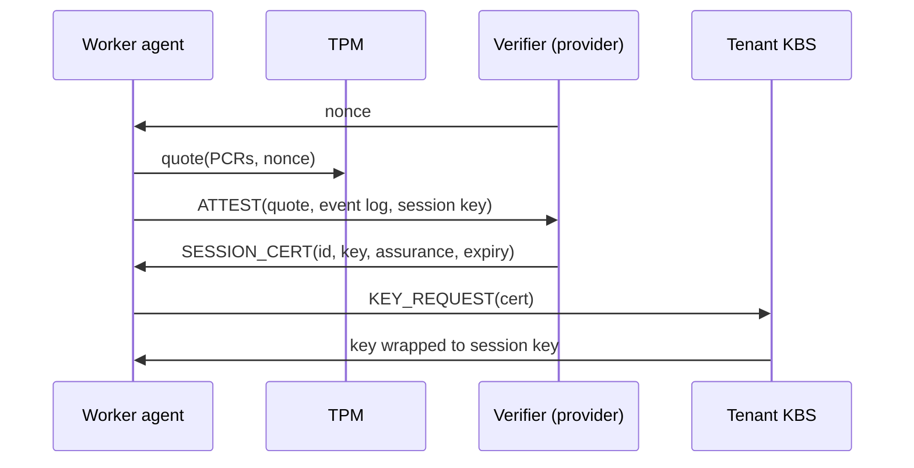
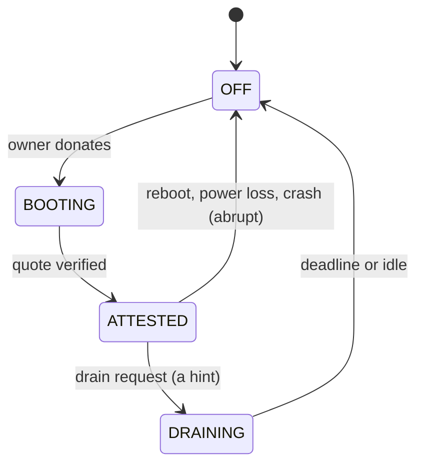
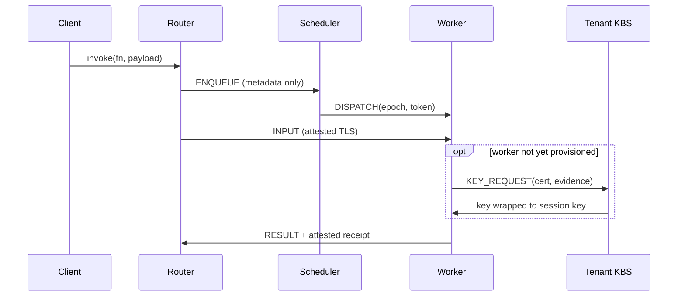
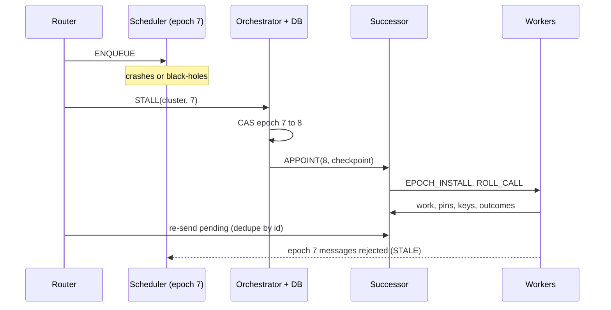
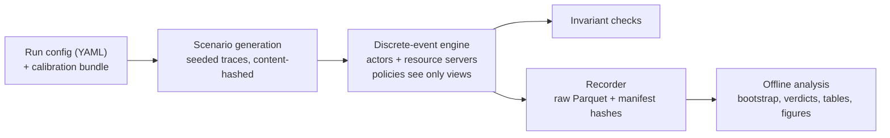

# VOSS, explained informally

Scheduling attested session state for serverless computing on volunteer machines

*Companion to the manuscript (draft 8). Numbers are from the paper. Details marked (repo) come from the repository docs and code, and are not all in the paper.*

---

## TL;DR

- Serverless functions are short, so the time a user waits is mostly **starting a sandbox** and **network distance**, not computing.
- Idle personal computers are numerous and near users. But their owners can **switch them off at any moment**, and the owners **cannot be trusted** with customers' code and data.
- **Remote attestation** (a cryptographic proof of exactly which software a machine booted) means a hostile owner can no longer read or tamper through software. What is left: the machine may vanish, drop work, or answer late.
- The platform must then decide **which machines get each customer's decryption key and pre-started sandboxes**. VOSS decides that with a slow planning loop, and places each call with a fast loop.

---

## How to read this deck

- Order: **vocabulary → motivation → what exists → why a new design → how components talk → scheduling core → fault tolerance → evaluation → results → limits**.
- Slides with a diagram or table have a few lines. Text slides can be longer.
- Results include the **negative ones**: the paper reports them on purpose.
- Everything is from **simulation**, calibrated on one laptop. A single-machine emulation (E01) checks part of it.
- The design questions that came out of reviewing this deck are tracked in `docs/critique/CRITIQUE.md`. The last slides summarise them.

---

# Part 0. Vocabulary

---

## The parties

- **Provider**: whoever runs the platform (VOSS). Like AWS runs Lambda, but here part of the hardware is donated.
- **Tenant**: a **customer** of the platform. A developer or organization that writes functions and deploys them. A tenant is *not* a VM or a sandbox.
- **Volunteer / owner**: a person who owns a computer and donates its capacity to the platform.
- **Worker**: a volunteer's machine while it is running the platform's software and accepting work.
- **Client**: whoever calls a tenant's function (for example the tenant's own web app or its users).

---

## The objects

- **Function**: one piece of tenant code, for example "make a thumbnail".
- **Invocation**: one call of a function with some input.
- **Sandbox / microVM**: a small virtual machine, here a Firecracker microVM, that runs one function in isolation from other tenants' code and from the host.
- **Warm sandbox**: a sandbox that is already started and idle, ready to take an invocation. **Cold start**: starting one from scratch, which is slow.
- **Snapshot**: the saved memory and device state of a started sandbox. Restoring a snapshot is faster than booting.
- **Session**: the interval during which a volunteer's machine is booted into the platform and usable.

---

## What a tenant's "secret" is

- A **secret** here is a **decryption key controlled by the tenant**.
- It decrypts the tenant's **code bundles** (stored encrypted at the provider and in peer caches) and the tenant's **snapshots** (which contain decrypted memory).
- So a machine that holds a tenant's key can read that tenant's code and the data its functions have in memory.
- The key is released by the tenant's **key broker service (KBS)**, and only to machines that pass attestation. The platform calls this **provisioning** a machine for the tenant.
- "Key" in the rest of the deck always means this tenant decryption key, not a cache key or an SSH key.

---

## SLO, deadline, P99

- **SLO** (service level objective): the latency or success a tenant expects, for example "answer within X".
- Here each synchronous invocation gets a **deadline** of 5× its normal warm latency (plus 0.05 s). Missing it, or failing, is an **SLO violation**.
- **P99 latency**: the latency that 99% of invocations beat. It captures the slow tail.
- **Success rate** and **deadline-met fraction** are the other metrics.

---

# Part 1. Motivation

---

## Serverless (FaaS) in one slide

- A developer uploads a function. The platform runs it **on demand**, in a sandbox, and the developer does not manage servers.
- Most functions finish in **well under a second** in production traces.
- So the time a user waits is **not computation**.
- It is the **cold start** (create a sandbox, load the language runtime) plus **network distance** to the machine that runs it.

---

## Where latency goes

```text
T = T_route + T_decide + T_queue + T_prov
  + T_start + T_net + T_exec + T_retry
```

- `T_route`, `T_decide`: choose a region, choose a machine.
- `T_queue`: wait for a free slot on that machine.
- `T_prov`: make the machine able to read this tenant's code (fetch the tenant's key). Zero if already done.
- `T_start`: bring a sandbox to the point of running the function.
- `T_net`, `T_exec`: move data, run. `T_retry`: redo work lost to failures.
- For functions of tens to hundreds of ms, **`T_start` dominates** unless a sandbox is already warm. VOSS logs every term separately per invocation.

---

## The datacenter fix and its price

- Providers **keep sandboxes warm** (keep-alive) or restore them from snapshots.
- Warm sandboxes **hold memory around the clock**, whether or not they are used.
- Meanwhile, consumer desktops and laptops are **numerous, near users, and idle most of the day**.
- Idea: serve latency-sensitive functions from them.

---

## Volunteer computing already exists

- BOINC and SETI@home-style systems have harvested idle machines for **two decades**.
- But only for **batch work**, with deadlines of **hours or days**.
- A function that runs for **milliseconds**, on private data, is a different problem.
- Two things break.

---

## Problem 1: churn

- An owner can power off, reboot or reclaim the machine **at any moment**.
- When the session ends, **everything the platform built on the machine is lost**: warm sandboxes, provisioned keys. (Disk caches survive, but only as encrypted data.)
- For a 50 ms function, **rebuilding that state is the dominant cost**, not the function itself.

---

## Problem 2: distrust

- The owner controls the hardware and the operating system.
- They can **read tenant code and data**, **forge results**, or **stop cooperating at the worst moment**.
- The usual defense is to **establish trust in a machine before using it**.

---

## The two problems interact

```text
machine joins ──► establish trust (slow) ──► run work
                         ▲                      │
                         └─── session ends ─────┘
                       (churn destroys the trust)
```

- Trust is paid **per session**, not once.
- Short sessions mean you pay it often. Hence the scheduling problem.

---

## What "donating" means here

- The owner **reboots the machine into a locked platform image** (the "appliance"). There is no owner login in it.
- While it runs, **the owner cannot use the machine** for anything else.
- Getting from power-on to a worker that is attested and ready takes about **65 s** on the calibration laptop (measured, upper bound).
- A session ends when the owner reboots or loses power, or announces they will leave (a **drain**: a message saying "I leave at time X").
- So the supply is **scheduled or dedicated machines** (overnight, spare PC), not an idle desktop that donates for ten minutes.

---

## Terms used in the next slide

- **Page cache**: the operating system keeps recently read files in memory. A file is **warm** if it is in the page cache, **cold** if it must be read from the disk first.
- **Snapshot restore**: load a saved sandbox (memory and device state, a file on the machine's local disk) instead of booting it. Firecracker maps that file lazily, so the call returns before every page is loaded.
- **Boot microVM**: start a sandbox from a root file system, as a small VM boot. It is not a restart of the physical machine.
- **TPM quote**: a **signature made by the machine's TPM chip** over its measurement registers (a hash chain of every boot stage) and a fresh random number from the verifier. It proves which software booted. It is not itself a boot, and not a snapshot. Producing one takes about 0.5 s on this TPM.
- **Reboot to kernel**: the **physical machine** restarting: firmware, boot loader, kernel start.

---

## How expensive is "trust"? (measured)

```text
resume warm microVM          ▏ 2 ms     (model value)
restore snapshot, warm       ▏ 7 ms
boot microVM, warm cache     ▍ 154 ms
TPM quote                    ▌ 506 ms
restore snapshot, cold HDD   ▌ 627 ms
boot microVM, cold HDD       ▊ 1.5 s
create 512 MB snapshot       ██ 6.7 s
reboot to kernel             ██████ 21 s
power-on to attested worker  █████████████ 65 s
```

- Log scale in the paper (Fig. 1). **65 s versus milliseconds**: 3–4 orders of magnitude.
- The 65 s = **21 s** (firmware, boot loader, kernel start) + **44 s** from kernel start until the verifier accepts the quote, of which about 14 s is the TPM creating keys and quoting. Median of 9 boots, range 64–66 s.
- Measured on one laptop with a hard disk, with the appliance run in "host mode". So these are **upper bounds**.
- Hence trust **cannot be set up on the per-request path**.

---

# Part 2. What exists, and why it falls short

---

## 1. Volunteer computing (BOINC)

- It handles untrusted machines by **replicating** each task on several machines and accepting the answer a majority agrees on.
- That multiplies the cost by the replication factor.
- It needs tasks that are **deterministic** (same input, same output) and that **return an output** to compare. Many serverless functions return nothing useful: liking a photo, writing a record to an object store, sending a notification.
- It protects the integrity of results but **not the confidentiality of inputs**: every replica sees the data.
- Its time scale is hours.

---

## 2. Serverless schedulers and keep-alive

- Work on deciding **when to keep a sandbox alive**, when to **pre-start** one, and how to start faster (lighter sandboxes, snapshots).
- Examples: Azure's histogram-based keep-alive, FaasCache (treats keep-alive as a cache), Sparrow (low-latency scheduling).
- All assume **trusted servers that stay up**. A warm sandbox is lost only because a policy chose to evict it, never because an owner closed a laptop.
- Nothing in their model corresponds to a **provisioned secret** with a cost and an exposure.

---

## 3. Harvested and edge serverless

- **Harvested serverless**: a datacenter has virtual machines or memory that are idle because another service reserved them. The platform runs functions on that spare capacity, and the capacity can be **taken back** (evicted) when the other service needs it.
- **Edge serverless**: run functions on machines near users or data.
- In both, the machines belong to the provider or to a trusted party.
- So the failure to handle is **eviction**, announced by the owner of the resource, not a machine that silently stops answering.
- No customer secret is given to a party that might want to read it.

---

## 4. Confidential serverless

- Uses **trusted execution environments (TEEs)**: CPU features (for example AMD SEV-SNP, Intel TDX or SGX) that encrypt a VM's memory so even the machine's operator cannot read it.
- Protects tenants **from the platform operator**.
- TEEs are mostly found in **server-grade CPUs**, in datacenters the provider controls. Most consumer CPUs do not offer them.
- These designs treat attestation as a **one-time deployment step**, not as something with a **cost, a lifetime and a security price** that a scheduler must manage.

---

## 5. Trusted components and failure detection

- Byzantine fault tolerance: nodes may lie or behave arbitrarily, and agreement needs many replicas. Small **trusted components** (a TPM-like counter or log) reduce how many replicas are needed.
- VOSS uses attestation in a different way. Once a machine is attested, we can treat it as **honest but unreliable**: it may crash, drop, or be late, but it will not lie. We then need only **crash tolerance**, which is cheaper than Byzantine tolerance, and get the same protection.
- **Heartbeats** (periodic "I am alive" messages) infer that a machine is alive, not that it is **making progress**. A machine can heartbeat while dropping work: a **gray failure**.

---

## Coverage of required properties

| Approach | Untrusted hosts | Churn | Latency SLOs | Plans trust + warm state | Gray failures | Verifiable accounting |
|---|---|---|---|---|---|---|
| Volunteer computing | • | • | | | ◦ | ◦ |
| Serverless schedulers | | | • | ◦ | | |
| Harvested serverless | | • | • | ◦ | | |
| Confidential serverless | • | | • | | | |
| Trusted-component FT | • | | | | | |
| **VOSS** | • | • | • | • | • | • |

• addressed, ◦ partly, blank = not addressed. *The assessment is ours (paper Table I).*

---

# Part 3. The insight

---

## The key observation

- The **tenant** writes the function. The **provider's code** (the VOSS agent and the scheduler logic) decides where it runs.
- Both the tenant's function and the provider's scheduler code run **only inside a measured, owner-locked appliance image** on the volunteer's machine.
- A **verifier** checks TPM evidence that exactly this image booted.
- Then a hostile owner **cannot read, forge or tamper through software**.
- What is left: the machine **powers off, drops, delays or throttles**.

---

## Why that matters

- Those are **omission** (the machine accepts work and never returns the result) and **timing** (it returns the result too late) failures.
- That is exactly what churn **already forces us to tolerate**.
- So **one set of mechanisms** covers crashes, churn and malice.
- **Redundant execution is no longer needed to protect integrity.**
- Scope: this holds against an owner who controls software, power and network. An owner with physical access to the RAM of a running machine (cold boot, DMA, bus probing) is outside it unless the hardware encrypts memory.

---

## Attestation, step by step

```text
1. boot stages (firmware, loader, kernel, image) are hashed
   into the TPM's measurement registers (PCRs)
2. verifier sends a random nonce
3. TPM signs (PCRs, nonce)  = the quote
4. verifier checks: signature, the TPM's manufacturer-signed
   certificate chain, and the event log against known-good values
5. if acceptable: verifier issues a session certificate
```

- The verifier is **provider-operated**. The check is **cryptographic**: a TPM signature chained to the manufacturer.
- A quote shows what booted **at one moment**: evidence **goes stale** and must be refreshed.
- Attestation says **nothing about availability**.

---

## Attestation and key provisioning



- The **session key** (made inside the appliance) is **bound into the quote**, so the certificate belongs to this appliance instance.
- The certificate expires at the earlier of session end and the last quote plus a validity period.

---

## Who is the KBS?

- The **key broker service** holds a tenant's keys and releases them under the tenant's policy.
- In the design it is **operated by the tenant, or by a service the tenant trusts**. It is **not** operated by the provider, because the provider is not meant to hold tenant keys.
- It releases a key only to a worker with an acceptable certificate.
- **Subtlety:** by default the KBS accepts any certificate the verifier issued for an approved image. Then the verifier is effectively trusted for confidentiality. If the tenant requires a **fresh quote** that the KBS checks itself, it does not depend on the verifier, at the cost of one more quote.
- The simulator charges one calibrated cost for the policy check and does not model KBS outages.

---

## When does the function's code arrive?

- Attestation and the key release prove the machine may be trusted. They do not move code.
- Tenant code bundles and root file systems are stored **encrypted** in the provider's **artifact registry** and in peers' disk caches.
- **Provisioning** a machine for a tenant (the `PREPARE` action) means: get the key from the KBS, **fetch the encrypted bundle** from the registry or a nearby peer, and **decrypt** it.
- Then a microVM is booted from it (or a snapshot restored), and the invocation's input arrives from the router.
- So a worker can **store and forward** ciphertext without the key, but can only **use** it after provisioning.

---

## Property 1 (threat reduction)

- The owner **cannot run other code**: it would fail attestation, so no certificate and no key.
- The owner **cannot read or modify** the image's memory or its sealed disk state through software.
- Results and receipts are **signed with a key that never leaves the appliance**.
- The owner **keeps only**: power, the network path, and **when to stop answering**.

---

## What we trust, and what is out of scope

- **Trusted:** the CPU, the TPM, memory encryption (if present), the measured image, each tenant's own key broker, and the provider's control plane (for availability and accounting).
- **Out of scope:** physical attacks on the TPM, bugs in the appliance, side channels, control-plane failure.
- **If attestation breaks, the robustness results no longer hold.**

---

## The control plane, component by component

- **Regional router**: the front door. Receives invocations from clients, picks a cluster, keeps a pending copy of each invocation until a worker accepts, watches progress, and writes the receipts.
- **Orchestrator**: groups workers into **clusters** by geography, appoints one **scheduler** per cluster, and rebalances clusters.
- **Verifier + registrar**: checks attestation evidence, issues session certificates, registers workers by TPM identity.
- **Operational database (Ops DB)**: private to this tier. Stores identities, sessions, cluster epochs, checkpoints and receipts.
- **Artifact registry**: serves the encrypted code bundles and root file systems.
- All of these are operated by the provider and are assumed to be reliable.

---

## So the real problem is "attested session state"

- **Session**: the machine is booted and attested. Costly (65 s), **perishable** (lost when the session ends).
- **Provisioned**, written `K[t,j]`: tenant *t*'s key is on machine *j*. Costs a round trip to the KBS, and **exposes** the tenant: every holder is a place the key could leak from.
- **Warm state**: a sandbox or snapshot is ready. Costs memory or disk.
- Three properties that conventional schedulers **do not model**: costly to set up, perishable, exposing.

---

## Session lifecycle



- **Draining**: the owner announces "I will leave by time X". It is only a **hint**: it may be fake, or the owner may leave early.
- Session end loses the keys and all warm sandboxes.

---

## What survives a session end: the disk cache

- The worker keeps a **content-addressed cache** on disk: encrypted code bundles, root file systems and snapshots. It survives a reboot, but **only as ciphertext**. It is usable again after the next attestation and key release.
- Content addressing means each item is named by a hash of its content, so a machine that corrupts its disk can only cause misses, never run wrong code.
- **Eviction**: items the plan pins are never evicted. Others are evicted by a **value-density rule**: expected hits times start-up time saved, per byte of disk (a GreedyDual-size-frequency variant). **LRU** (least recently used) is the baseline.
- In experiment E09 the fancy policy is **at most 3% better than LRU**, and not distinguishable from it.

---

## Start-up tiers of one function on one machine

```text
L0  nothing cached
 │  fetch code bundle + root file system, verify
 ▼
L1  code + root file system on disk (encrypted) ── boot + init ──┐
 │  after the first init, write a snapshot                       │
 ▼                                                               ▼
L2  snapshot on disk ───────── restore ─────────────►  L3  warm microVM
                                                        idle in memory
                                                             │ dispatch
                                                             ▼
                                                        L4  busy
```

- Going up costs time and memory or disk. Deciding **who keeps what, where** is itself a scheduling problem.
- **L2** is a saved snapshot of an initialised sandbox. Restoring it is faster than booting (L1→L3).
- The key flag `K[t,j]` is separate from the tier: the tier says **what is cached**, `K` says **whether this machine can decrypt it**. After a session ends, L1 and L2 files stay on disk as ciphertext while `K` is lost.

---

## Exposure: the security cost of holding a key

```text
E_t = sum, over machines j holding tenant t's key:  (1 − a_j)
```

- Every machine that holds a tenant's key is one more place the key could leak from if the trust assumptions fail.
- `a_j` is a score between 0 and 1 for how far we trust machine *j*'s platform. Hardware with stronger protection scores higher. For the TPM appliance it is a policy value of 0.80.
- So **exposure is roughly "the number of key holders, discounted by how trustworthy each is"**.
- It is a **transparent proxy** for attack surface, **not a probability** of compromise. The scores are policy settings, not measurements, so results in exposure units are comparable only under the same scores.

---

# Part 4. How the components communicate

---

## Transport and messages

- Every interaction between components is a **typed message**: a message with a fixed format and a name, such as `ENQUEUE`, `DISPATCH`, `INPUT`, `RESULT`, `KEY_REQUEST`, `ATTEST`. Components never call each other's code.
- Workers sit behind **NAT** (a home router that allows outgoing but not incoming connections). So each worker opens **outbound, persistent TLS streams** to its scheduler, the verifier and the routers. Messages in the other direction ride on those same streams.
- Every stream uses TLS with the worker's **session certificate** (mutual authentication): the "attested TLS" of the paper. It is ordinary TLS whose client certificate was issued only after attestation.
- Large payloads go **router ↔ worker directly**. They never pass through the scheduler.

---

## Who issues certificates?

- The **verifier issues the session certificates** for workers, so it plays the role of a **certificate authority** for them (repo: doc 04). Tenants' key brokers must trust the verifier's certificates.
- The paper **does not specify** the rest: how the verifier's root certificate reaches workers and key brokers, what certificates routers and the orchestrator use, how fast revocation reaches peers.
- The paper's assumption is a private PKI run by the provider. This is not evaluated.
- What is specified: a certificate expires at the earlier of session end and last quote + validity, is renewed by periodic re-quotes, and is revoked on a failed re-quote.

---

## How does one component find another?

- A worker's identity is the **hash of its TPM endorsement key** plus its session certificate. It is **not** an IP address.
- The orchestrator knows which worker is each cluster's scheduler (it appoints one). After an appointment it **pushes the scheduler's address to the routers**. The new scheduler tells its workers (`EPOCH_INSTALL`).
- Each cluster's **summary reaches the routers every second** (through the orchestrator), so routers hold a cached view of every cluster.
- The **invocation hot path does not touch the database**: routers use cached addresses and summaries. The DB is read mainly on failover, and receipts are written to it in batches, off the critical path.

---

## What the paper does not specify

- A worker reaches its scheduler by an outbound connection. But **the scheduler is itself a volunteer machine, also behind NAT**. How does an outbound connection reach it? The simulator only adds **20 ms per endpoint behind a relay** (15% of workers by default), as an assumption.
- What happens when a home **IP address changes**? The identity survives, but the paper does not describe reconnecting or resuming in-flight work.
- After a scheduler change, **every worker in the cluster** (up to 30–60) must reconnect to a new volunteer machine.
- How clients **find a router**, and which routers a worker connects to, is not stated.
- The extra network hop: the router asks the scheduler first (**ENQUEUE → DISPATCH**), then sends the input to the worker. That round trip is in `T_route` + `T_decide`. It is simulated with geographic delays, not measured.
- These are open design questions (critique items C-01, C-02, C-31).

---

## Clusters: how volunteers are grouped

- The orchestrator groups attested workers into **clusters of tens** of machines, by **geographic proximity** (k-medoids clustering on round-trip time). Target size 30, between 10 and 60.
- Why: it bounds the planner's problem size, and keeps worker-to-scheduler latency low.
- It tries to give each cluster enough **different failure domains** (different cities or network providers) that a plan can survive losing some.
- One worker per cluster is appointed **scheduler**. The orchestrator moves workers between clusters on triggers (size, demand, scheduler loss), with hysteresis, because a moved worker loses its provisioned state.

---

# Part 5. The VOSS design

---

## Goals and non-goals

- **G1** Confidentiality and integrity: no tenant secret is learned and no result forged by an owner with software-level control.
- **G2** Latency under churn: tail latency stays within the SLO although sessions end at any time.
- **G3** Liveness under omission: a machine that accepts work and discards it, or a scheduler that stalls, is detected and bypassed within seconds, **without trusting liveness signals**. A *liveness signal* is a heartbeat: a periodic "still alive" message.
- **G4** Verifiable accounting: a machine cannot claim work it did not do.
- *Non-goals: physical TPM attacks, appliance bugs, side channels, control-plane failure. Invocations are treated as independent (workflows: later).*

---

## Three design principles

- **P1** Attestation turns distrust into unreliability.
- **P2** Trust is a **managed resource** with a cost, a lifetime and an exposure price. It is planned on a slower timescale than placing a single invocation.
- **P3** Liveness (heartbeats, drain notices, self-reported health) is a **hint**. **Progress**, observed by a trusted or attested party, is **evidence**.
- Example of P3: a machine that heartbeats but never returns results looks alive. Only the router, which sees the missing result, can tell.

---

## Architecture


*Numbered flows follow one invocation (next slides). Dashed/8 = control traffic off the hot path.*

---

## Who is trusted for what

- **Router, orchestrator, verifier, Ops DB, registry** (provider): trusted for availability and accounting. Not given tenant keys.
- **Tenant KBS** (operated by the tenant or a service it trusts): trusted to release the tenant's own secrets per policy. Not trusted for the availability of volunteers.
- **Scheduler role**: runs on **one of the attested volunteer machines** of the cluster, not on provider equipment. Its code is attested, so it places invocations correctly. Its host may still **omit** (stop answering) or **delay** (answer late).
- **Worker**: a volunteer machine running the attested image. Trusted to execute code faithfully. Not trusted for availability.

---

## The scheduler is a role, not a machine

- The **same image** runs on every worker. So any attested worker can be **promoted** to scheduler with no boot.
- The orchestrator keeps a **ranked list** of candidates, by survival odds, speed, centrality and assurance. So a more reliable machine is preferred, but any can serve.
- **Omit**: the host accepts something and never answers. **Delay**: it answers later than it should (for example by throttling).
- The scheduler's **code** cannot misbehave (it is attested). Its **host** can still vanish or be slow, so we need failover (later).

---

## Life of one invocation



- **Metadata** = function, tenant, deadline, input size, idempotence flag. The scheduler **never sees payloads, results or keys**.
- **Attested TLS**: the worker proves its identity with the session certificate the verifier issued after attestation (slide on certificates).

---

## Six rules for state and communication

1. **Typed messages only.** Every cross-node interaction is a message with a fixed format; components never call each other's code.
2. **The Ops DB is private to the control plane.** Workers and schedulers reach it only through messages.
3. **The hot path never touches the DB.** The *hot path* is the route one invocation takes: router → scheduler → worker → router. A database round trip would add latency, so none is on it.
4. **Live state stays where it is born.** Queues and keys live in workers, undispatched work in routers, cost matrices in the scheduler. After a scheduler change, the new scheduler **asks the workers**, not the DB.
5. **Routers write the ground truth of work as receipts.** A *receipt* is a record of an executed invocation, signed by the worker's session key.
6. **Every channel ends inside an attested party**: the appliance, the control plane, or the KBS. The session certificate is the credential for all.

---

## Receipts

- After a worker runs an invocation it signs a **receipt**: invocation and attempt ids, its own identity and certificate id, the scheduler epoch, execution time, work units, and a hash of the output.
- The router checks the signature against the certificate and appends the receipt to the Ops DB, off the critical path.
- Because the signing key never leaves the appliance, **a machine cannot claim work it did not do**. It can only decline to do work, which is an omission, handled by the detectors.
- Receipts also drive accounting and credits (later slide).

---

# Part 6. The scheduling core

---

## Why two loops

- **The security cost belongs to a group of machines, not to one placement.** A key stays on a machine for the whole session, so what matters is **how many different machines hold a tenant's key**. That count does not add up assignment by assignment.
- **Robustness concerns the whole group.** Whether demand is still covered if any *f* machines vanish cannot be read off from a single placement.
- **Setting state up takes seconds** (key release, bundle fetch, boot), far longer than one request can wait, so it must happen **before** demand arrives.
- **Choosing a machine for one call** is quick and independent per call, so it can run per invocation.
- Both loops run **on the scheduler** role of the cluster.

---

## The two loops

```text
SLOW loop (planner)  every T_plan = 30 s, horizon 60 s
   decides for the cluster as a whole:
     y: which machines hold which tenant's key
     s: which function snapshots are pinned on disk
     w: how many warm sandboxes of each function to keep
     c: how many slots of a machine are earmarked for a tenant
        │  plan; actions PREPARE / WARM / PIN / RELEASE to workers
        ▼
FAST loop (placer)   per invocation, milliseconds
   picks one machine from the confirmed state,
   using a cost model; may add a hedge
```

- **Warm** here means a sandbox of that function is **already started and initialised**, idle in memory (tier L3).
- Workers **confirm** plan actions in heartbeats. The placer only counts on **confirmed** state, never on a machine that is not yet warm.

---

## Where does 30 s come from?

- It is a **design choice, not a measured optimum**, and it is not swept in the paper's experiments.
- A plan's actions take from a few hundred ms (key release) to several seconds (bundle fetch, boot), so the period must be longer than that.
- Sessions last minutes to hours, so the period must be much shorter than that. The horizon is 2× the period.
- It is not derived from public trace statistics (such as function durations in the Azure study).
- A small pilot (15 s and 60 s, outside the reported experiments) showed no significant difference in P99.
- The plan is recomputed early when the situation changes materially, and reused otherwise.

---

## Common misreading: "it minimises SLO violations"

- **Fast loop** (placer): minimises a cost whose main term **is** the probability that **this invocation** misses its SLO. Yes, per invocation.
- **Slow loop** (planner): minimises **cost**: memory, disk, key exposure, plan churn, minus warm-start benefit. It is **constrained** to cover forecast demand. It does **not** minimise violations, by design (next slides).
- **Router**: minimises expected completion time with penalties. Partly.
- We **report** violations in every experiment. We just do not make the planner minimise them directly.

---

## Fast loop: what it minimises

```text
J(i,j) = w_i · P_miss(i,j) + ε · E[T_ij] + λ_exp · x_ij
```

For invocation *i* and candidate machine *j*:

- **P_miss**: the probability that placing *i* on *j* violates the SLO. It is the chance that *j* fails first (session ends or omits), plus the chance the completion time `T_ij` exceeds the **remaining time budget** of the invocation. **A failure counts as a violation.**
- **E[T_ij]**: expected completion time, in seconds. It breaks ties between machines with similar miss odds.
- **x_ij**: the **exposure** added if *j* does not yet hold the tenant's key: tenant sensitivity σ × (1 − assurance of *j*). Zero if *j* already holds it.
- Weights: `w=1` for synchronous, `0.3` for async and filler work; `ε = 0.05 per s`; `λ_exp = 1`. All **assumed**.
- Meaning of the units: 1 s of latency is weighted like a 5-point rise in miss probability. A new key holder with assurance 0.8 costs 0.2, like a 20% chance of an SLO violation.

---

## Why per-invocation miss probability, not P99

- **P99 is a population statistic**: a property of many invocations together. It cannot be assigned to one decision.
- The **mean of per-invocation miss probability is the deadline-miss rate**, and its tail drives P99. So minimising each invocation's own miss probability against its own remaining budget is the decision-level quantity that matters.
- Alternatives (expectation only, quantile, CVaR, tardiness) are compared in experiment E03.
- Result of E03: the distribution-aware (quantile) variant beats expectation-only at high churn by 2.8%, rated **weak**.

---

## Slow loop: what it minimises

```text
min   Σ_t Λ_t · u_t               uncovered demand, charged per slot
    + memory and disk cost of warm VMs and snapshots
    + λ · Σ σ_t (1 − a_j) y_tj    key exposure
    + ν · Σ |y_tj − y_prev|⁺      plan churn (new key holders)
    − β · Σ b_f (w_fj + γ s_fj)   benefit of warm starts
```

- **Uncovered demand** `u_t`: of the *q_t* slots that tenant *t*'s forecast says must be runnable at once, how many provisioned machines do **not** cover. Each missing slot costs `Λ = 10`, far more than memory or exposure, so coverage is bought unless it is impossible.
- **Warm-start benefit** `b_f`: start-up seconds a warm sandbox of function *f* saves over the horizon.
- **y, s, w, c**: the plan variables (previous slide). All coefficients are weights that put memory, disk, exposure and churn into one cost unit.

---

## Robust coverage: the constraint

```text
Σ_j  e_j · c_tj   −   (sum of the f_t largest c_tj)   +  u_t   ≥  q_t

e_j  = S_j(H) · (1 − p_j)
```

- `c_tj`: slots of machine *j* earmarked for tenant *t*.
- `e_j`: **effective availability** of *j*: the probability its session lasts the horizon `H` (survival `S_j`) times the probability it does not omit (`1 − p_j`).
- `q_t`: the **demand quantile**: how many slots tenant *t* needs at once, 95% of the time.
- `f_t`: how many machines to tolerate losing. Default `⌈0.1 × cluster size⌉`.
- `u_t`: shortfall allowed at a price.
- In words: **even if the *f* biggest contributors vanish, the rest still cover the demand.**
- The *f* removed machines are chosen by **worst case**, so no model of the adversary is needed for them. The remaining allocations are weighted by estimated availability.
- It stays **linear** (a standard LP-duality reformulation), so a mixed-integer solver can handle it.

---

## Why the planner does not minimise violations (1/2)

- **Circular.** Whether an invocation violates its SLO depends on where the placer sends it later, and that depends on the plan. Minimising violations directly would mean solving a plan that optimises over the placer's own optimisation (a two-level problem) at every round.
- **No per-request information.** At planning time the invocations do not exist yet. There is only a **forecast of demand**. So the planner can reason about capacity compared with the forecast, not about individual deadlines.
- **Rare, noisy events.** Violations are 1–5% events. An objective built from their empirical count is very noisy. A coverage requirement at a fixed demand quantile is stable and interpretable.

---

## Why the planner does not minimise violations (2/2)

- **Violations are not the only cost.** The trivial way to minimise violations is to warm everything everywhere, which puts every tenant's key on every machine. The scarce resources are **donor memory, donor disk and key exposure**. So the planner minimises cost **under a coverage requirement**, and the trade-off is reported as a Pareto front (latency, exposure, robustness) instead of one blended number.
- **No hard guarantee exists.** Under churn and adversaries, no plan can guarantee a deadline. Coverage against **any *f* defecting machines** is the strongest statement that assumes no model of the adversary.
- Cost against a commercial reference, provider cost, and fairness across donors are **not** objectives. P99 is not an explicit target either.

---

## How coverage still serves the SLO

- Suppose tenant *t*'s invocations arrive at rate λ and each takes `s` seconds on average. If arrivals are **Poisson** (independent, random), the number running at once is Poisson with mean **λ·s** (an M/G/∞ queue).
- `q_t` is that number's **95th percentile**. With `q_t` slots provisioned, 95% of the time every invocation finds a ready slot, so it **starts immediately** on a provisioned machine.
- That bounds the share of invocations pushed onto the **unprovisioned path** (a machine with no key or nothing warm), which is the main cause of violations here.
- **Caveat: the simulated arrivals are not purely Poisson.** They are a Markov-modulated process with 4× bursts: random quiet and busy phases. In a burst the real concurrency exceeds the Poisson quantile, so **coverage falls below 95% during bursts**. The Poisson model is the planner's assumption, not the world.

---

## The greedy planner: inputs and outputs

- **Inputs, per planning round** (all estimates from the scheduler's own view):
  - for each **machine**: survival over the horizon, omission probability, assurance, failure domain (city and network), free slots, memory, disk, cache contents;
  - for each **hot tenant**: demand quantile `q_t`, sensitivity σ, assurance floor, robustness `f_t`;
  - for each **hot function**: memory, snapshot size, start-up time a warm sandbox saves, forecast units needed;
  - the previous plan.
- **Output:** a plan `{y, s, w, c}` valid for the horizon, turned into actions (`PREPARE`, `PIN_SNAPSHOT`, `WARM`, `RELEASE`) sent to workers.
- The **exact solver (MILP)** takes the same inputs and produces the same output.
- **Hot set:** top 20 tenants and 50 functions by forecast rate. The rest stay on the unprovisioned path. The planning **pool** is at most 40 machines (previous holders first, then by slots × assurance).

---

## The greedy planner: the algorithm

1. **Rank hot tenants** by demand × cold-start penalty. The tenant that loses most from a cold start goes first.
2. **For each tenant, add machines one at a time.** Pick the machine with the best score  
   `availability × assurance ÷ (memory cost + exposure cost)`  
   (with a tie-break for under-used failure domains), subject to the assurance floor and a **failure-domain cap** (no city or network holds more than half the tenant's capacity). Stop when the coverage constraint holds: **even with the *f* largest contributions removed, `q_t` is covered.**
3. **Then add warm sandboxes and snapshots, only on machines that already hold that function's tenant key,** in order of **start-up time saved per megabyte** (the "value density"), until each machine's memory or disk is used up.

- So a tenant's hotness decides **where its functions may be warm**, and a function's hotness decides **whether it is kept warm**.

---

## Greedy, a tiny worked example (simplified)

```text
Tenant needs q = 3 slots, tolerates f = 1 machine vanishing.
Each machine has 2 earmarked slots; availability e: A 0.9, B 0.8, C 0.6, D 0.9
contribution e·c:  A 1.8   B 1.6   C 1.2   D 1.8

without robustness (f = 0):  A + B = 3.4 ≥ 3      → 2 machines
with f = 1: remove the largest contribution
   A + B           = 3.4 − 1.8 = 1.6 < 3
   A + B + C       = 4.6 − 1.8 = 2.8 < 3
   A + B + C + D   = 6.4 − 1.8 = 4.6 ≥ 3          → 4 machines
```

- Robustness doubles the number of key holders here. That is why **robust coverage costs exposure** (13 → 24 in the paper's experiment E23).

---

## Why we use greedy, and what industry does

- **Cheap:** about **8 ms** per planning round. The exact solver takes about 4 s (below).
- **Good enough:** the exact solver is **not distinguishable** from greedy at our sample size (next slides).
- Industry keep-alive policies decide when to keep a sandbox **per function or per application** from past idle times: a fixed timer (commonly around 10 minutes), an idle-time histogram (Azure), or caching ideas (FaasCache). They do **not** decide who holds secrets, or plan for sessions that vanish.
- Our baseline "keep-alive TTL" is the fixed 10-minute timer. A histogram policy adapted to volunteer machines is **not** in the evaluation.
- Greedy planning is **proactive and forecast-driven** (it provisions ahead of demand), and it respects exposure and robustness. A timer is **reactive** (it keeps what was recently used).

---

## Computational load: greedy vs exact

- **Greedy:** a few sorted passes over the machines and functions. About 8 ms per plan for a pool of up to 40 machines. It grows roughly linearly with pool size and number of tenants and functions.
- **Exact (MILP):** up to about 800 key variables, 800 allocation variables and 2,000 each of snapshot and warm-count variables, plus helper variables. Mixed-integer programs are NP-hard in the worst case, and solve time **grows steeply** with the pool. In a pilot (not in the paper's results): median solve about **0.3–1.1 s for 10 machines, 4.7–5.0 s for 40, 17–24 s for 80**.
- So a longer solve **delays when a plan takes effect**. At 80 machines it exceeds the planning period. A time limit and a fallback to the previous or greedy plan exist.
- In the **paper's runs** the simulator **charges both planners the same modelled delay** (about 0.1 s). The exact planner's measured 4.1 s is **not** charged. So the exact planner's results are optimistic about plan staleness.

---

## Greedy vs exact: the decision

- **Exact MILP:** same inputs and outputs as greedy, solved jointly with HiGHS, warm-started from the previous plan, falling back to the previous or greedy plan on timeout. **4.1 s** per cluster in the paper's runs (pool of up to 40 machines).
- **Decision rule, fixed before the experiments:** if the exact solver improves P99 by **less than 5%** over greedy in **all** regimes, greedy is the method.
- Result: **1.8%** at medium churn. **8.1%** at high churn, but the 95% interval runs from a 21% reduction to a 1% increase and **includes zero**.
- Verdict: **inconclusive**. We **do not claim** the rule is met. Greedy stays the default because that choice was made before the runs, and the exact solver is a reference.

---

## What the scheduler remembers

- **No table of past runtimes per (function, machine) exists.** The scheduler keeps a few numbers per quantity, in its memory:
  - one **execution-time regression per function**, with one **offset per worker**;
  - **Weibull parameters** (shape, scale) per hardware tier, for how long sessions last;
  - a **Beta pair** per machine, for how often it returns accepted work;
  - **counts of arrivals** in 10 s bins, smoothed.
- This state is **checkpointed to the control plane every 30 s**, so a replacement scheduler can resume (later slide).
- Estimates **forget** old data: the regression has a forgetting factor of 0.995, and surviving sessions are refit every 60 s.

---

## The placer: what it does per invocation

- **Input:** only **metadata** (function, tenant, deadline budget, input size, idempotence flag, class), the scheduler's view of the cluster (at most one heartbeat old plus its own dispatches since), and the current plan.
- **Candidates:** the best **K = 12** machines by a cheap lower bound, from (a) confirmed provisioned machines and (b) other attested machines (the **unprovisioned path**, which needs a key release and usually a start-up).
- **Infeasible** if: draining; its session would expire within 5 s of the predicted finish; its assurance is below the tenant's floor; no memory for a new sandbox.
- **Cost components, logged per invocation:** wait for a slot, trust (key release, zero if already held), start-up by tier, network, execution.
- **Wait for a slot** counts the machine's busy slots, queue and **requests already routed to it and still in flight**. So a machine is judged by its **current load**, not just by how good it is. Within one placement call, each assignment also raises the cost of the same machine for the next.

---

## The placer: sync vs async, and the window

- **Synchronous** invocations: placed **immediately**, one at a time (tightest remaining budget first within a call), on the machine with the lowest `J`.
- **Asynchronous and filler** work arrives in **windows of 0.2 s**. A **minimum-cost assignment** (solved in polynomial time) matches the window's invocations to (machine, slot) pairs.
- So async work waits at most 0.2 s for the window to fill. That wait is small next to its deadline (10× or 20× the warm latency).
- `J` is the cost from the earlier slide.

---

## Hedging, admission, retries, idempotence

- **Hedge:** if the best machine still has a miss probability above **0.2**, run a **duplicate on a machine in a different failure domain**, and **cancel the loser** when the first result arrives. At most **10% of placements** may be hedged.
- **Admission:** if every candidate would miss with probability ≥ 0.95 and even the shortest wait exceeds the remaining budget, the platform is **overloaded**: it **rejects** a synchronous request and **defers** an asynchronous one.
- **Idempotent** function: calling it twice has the same effect as calling it once. **Hedging and retries only apply to idempotent functions.** A non-idempotent function that was lost is **reported as a failure**.
- A **retry** re-places the invocation with the failed machine excluded.

---

## What happens when no result comes back?

- The **router's dispatch watchdog** (1 s): if the scheduler never acknowledges an enqueued invocation, the router re-sends or spills it to another cluster. Nothing has executed, so this is always safe.
- The **scheduler's result watchdog**: if a machine accepted an invocation but no result arrives by the predicted 90th-percentile completion time × 1.2 (at least 3 s), the scheduler **probes** it and marks it **suspected**.
- Then: if the function is **idempotent**, the invocation is re-placed (or its hedge wins). If **not**, it is reported as a failure, because the first attempt may or may not have had its effect.
- **How do AWS and others handle this?** For synchronous Lambda calls the service does not retry; the *client* retries. For asynchronous invocations it retries (at least once) and tells developers to write idempotent handlers. Datacenter failures are rare, so this works there. Volunteer churn is not rare.
- *(AWS details are from public docs, to be checked before citing.)*

---

## How many functions are idempotent?

- In our workload, **11 of 12** functions are marked idempotent, and **all synchronous ones** are. One function (a DNA visualisation) is not.
- These flags are **our assumption**, modelled on the SeBS benchmark suite, which is mostly pure computation plus object-store reads and writes. They are not a measured property.
- So the paper's success results under omission **rest on mostly idempotent functions**. Real serverless applications often have non-idempotent functions (counters, records, emails).
- Whether VOSS should **require** idempotence, or provide idempotency keys, is an open design question (critique C-09, C-10).

---

## History, forecast, observation: what the terms mean

- **Observed (O):** reported **now** by a trusted router or an attested agent: free slots, queue length, cache contents, whether a machine holds a key. At most a heartbeat (2 s) old, plus the scheduler's own dispatches since.
- **Learned from history (H):** an estimate updated from **past outcomes**: how long sessions last, how often a machine drops work, how long a function runs.
- **Forecast (F):** a value for the **future**, computed from history: expected arrivals over the next minute; the probability a session survives the next 60 s.
- **Calibrated constant (C):** a number **fixed before the run**: start-up times, network round trips (from distance), declared machine speed. **Not learned online.**
- **Policy (P):** set by the tenant or operator: sensitivity, assurance floor, weights.

---

## History, forecast, observation: who uses what

- The **slow loop is mostly forecast**: demand and survival over 60 s, extrapolated from rates smoothed over minutes and session-length statistics gathered over the whole run.
- The **fast loop is mostly observation**: occupancy, cache state and provisioning are a few seconds old. Only the execution-time distribution, survival over the next few seconds, and omission probability are estimates learned from history.
- The **speculative parts are the C items**: the scheduler assumes start-up and network times equal their calibrated values, and declared speeds are exact. A real deployment would measure these. This is a **stated limitation**. Sensitivity to wrong estimates is **not tested**.
- **Never used:** the true session end time, the true run time of an invocation, a machine's true behaviour, future arrivals. The policy code cannot even import the simulated world (enforced statically).

---

## The estimators, in one slide each

- **Session survival** `S_j(τ)`: a **Weibull** distribution per hardware tier, fitted by censored maximum likelihood on finished sessions and the ages of live ones. Start from a prior (shape 0.7, scale 7200 s) until 20 sessions of that tier have ended. Drain notices only **shorten** predicted life (they may be fake).
- **Omission** `p_j`: a **Beta distribution** over "accepted invocations that returned a result", counting only mid-session outcomes so session ends are not counted twice. A **CUSUM change-point detector** resets a machine that starts failing after behaving well (an on-off adversary).
- **Execution time:** a **Bayesian log-linear regression per function**, with a shrunken offset per machine, and a conformal rescaling of its spread from the last 500 residuals.
- **Arrivals:** per tenant and function, from counts in 10 s bins, smoothed with two time constants (60 s and 900 s). The forecast is the larger of the two and of the regional rate the routers report.

---

## Routing between clusters

```text
score(c) = rtt + overhead + backlog
         + health · max(0, miss_rate − θ)
         + [no provisioned capacity for the tenant]
         + [no warm sandbox of the function]
```

- Every term is in **seconds of expected delay**, so "priced" means "given an explicit cost in seconds".
- **rtt**: round-trip time from the request's origin to cluster *c*. **overhead**, **backlog**: the cluster's measured scheduling overhead and queueing delay when full.
- **health term**: seconds charged per unit of observed miss rate above θ = 0.2 (summary every second).
- **No provisioned capacity**: charged only if the cluster has no machine holding this tenant's key. The charge is the key-release time the cluster **measured**, plus an exposure term.
- **No warm sandbox**: charged only if the cluster has none warm for this function. The charge is the cold-start time the cluster **measured** for it (priors 3 s and 0.5 s until data exist). It is a **time**, not a count, and it uses recent starts, not the cluster's whole history.

---

# Part 7. Fault tolerance and accounting

---

## The progress principle

- **Liveness signals** from untrusted machines (heartbeats, drain notices, self-reported health) are **hints**.
- **Progress seen by a trusted or attested observer is evidence.** The router sees whether a result came back. The scheduler sees whether a machine finished.
- Hard cases:
  - **Black hole**: a machine that keeps heartbeating but silently drops the work it accepted (the networking term for a node that swallows what it receives).
  - **On-off**: behaves well to build a clean record, then defects.
  - **Fake drain**: announces it will leave to cause disruption.

---

## Progress-based detectors

- **Dispatch watchdog** (router, 1 s): an enqueued invocation was not acknowledged ⇒ suspect the **scheduler**.
- **Result watchdog** (scheduler): accepted but no result by the 90th-percentile prediction × 1.2 (at least 3 s) ⇒ suspect the **worker**.
- **Cluster stall** (router to orchestrator): 3 dispatch-watchdog fires within 5 s ⇒ the **scheduler**.
- **Decision latency** (orchestrator): scheduler's attested placement time above 200 ms ⇒ a **slow scheduler**.
- **Outcome rate** (scheduler): CUSUM change point on the omission rate ⇒ the **worker**.
- **Heartbeat** (scheduler): a **fast path for crashes only**, never sufficient alone.

---

## Scheduler failover without consensus



---

## Why no consensus among volunteers

- Replicated state machines on machines that may be adversarial are **slow** and bring back an agreement problem.
- Instead the **provider's orchestrator is a reliable arbiter**: it appoints a scheduler by an atomic **compare-and-swap on an epoch number** in its database (a lease).
- Workers accept dispatches only from the **current (epoch, certificate) pair** and reject lower epochs with `STALE`: a **fencing token**.
- A scheduler that cannot reach the orchestrator for 5 s **stops dispatching on its own**.
- A partitioned scheduler can only cause **duplicate work**. That is safe for idempotent functions. For a non-idempotent function a duplicate dispatched during that window could repeat its effect, which the protocol does not prevent.

---

## Scheduler state is soft

- **Undispatched invocations:** held by the **router**, which re-sends them.
- **Running and queued work, confirmed pins and keys:** held by the **workers**; the new scheduler learns them by a **roll call**.
- **Estimator state:** a **checkpoint** in the control plane, refreshed every 30 s, then replayed.
- **Work records:** router **receipts**: nothing to recover.
- Nothing authoritative lives on the old host. A restarted or rolled-back appliance is a **new instance** that must be re-appointed, and its stale memory is never trusted.

---

## Credits, and why no blockchain

- Each machine earns **credits proportional to reference work units** (a normalised amount of computation), **not elapsed time**: throttling earns nothing.
- A small credit rewards cache that a plan pinned while the machine answered probes.
- **No blockchain**: receipts are signed by a key that never leaves the appliance, so a third party can already verify them. The remaining risk is the control plane deleting records, which a signed transparency log would address (future work).
- **Reputation** (a long-term score) is kept separate from the survival and omission estimators so nothing is counted twice. It only affects rewards and acts as a placement tie-breaker.

---

# Part 8. How we evaluated it

---

## Why a simulator

- A platform with **thousands of machines**, **controlled churn and adversaries**, and **paired comparison** of policies cannot be run on real machines.
- A custom **discrete-event simulator**, Python 3.11, single-threaded: time jumps from one scheduled event to the next, in a fixed order. The kernel is under 70 lines.
- The **policies are the real code**. The **world** (network, churn, adversaries) is a **model**.
- No SimPy: one **total event order** makes runs exactly repeatable.

---

## Simulation pipeline



- Systems compared on one seed face **identical worlds** (common random numbers).

---

## Nothing is free

- Network delays come from **great-circle distance** (about 100 metro areas, 100 km per ms, route factor 1.3) plus last-mile terms and jitter. **20 ms** is added for each endpoint behind a relay (15% of workers).
- Disk reads, CPU contention, **TPM quotes, key release** all cost simulated time.
- **Decision latency** of planner, placer, router and orchestrator is modelled as `a + b × work`, so results do not depend on the speed of the simulating machine. The planner is charged **0.02 s + 50 µs per variable** (about 0.1 s here), the same for greedy and exact. The coefficients are **placeholders**.
- Invariants checked every run: every success ran on an attested machine after key release; one terminal outcome per invocation; no stale-epoch dispatch.

---

## What is simulated, calibrated, assumed

- **Simulated (emerges from the model):** queueing, contention, caches, session boots, attestation, failures, detection, failover, hedging waste.
- **Calibrated (measured):** start-up and snapshot times, TPM quote and boot times, disk speeds, function work.
- **Literature (swept):** confidential-VM and measured-hypervisor costs.
- **Assumed (swept):** churn, adversary fractions, arrival intensity, assurance scores, objective weights.
- The workload: **six tenants, 12 functions** modelled on SeBS, in synchronous, async and filler classes, popularity skewed (Zipf), bursty arrivals. No calls to external services.

---

## Calibration: one laptop

- Intel Core **i3-7020U**, discrete **TPM 2.0**, **hard disk**. It stands in for a donor machine.
- TPM quote **0.51 s** (placeholder 0.25). Snapshot create **6.7 s** for 512 MB (placeholder 0.2). Kernel start to agent ready **31 s** (placeholder 4).
- **Power-on to an attested worker: 65 s** (median of 9): 21 s firmware, loader and kernel, then 44 s until the quote is accepted.
- **Limits:** not the intended donor machine; no SEV-SNP or TDX; the appliance ran in **host mode**, not as a locked image on bare metal, so 65 s is a measured sum and an **upper bound**.

---

## E01: a check against real execution

- **Setup:** one lab machine (Intel i7-12700, 125 GB, NVMe), 16 donor slices of 2 slots each, 5 functions, 10-minute runs, seeds 1–3. Real **Firecracker microVMs** for boot, snapshot restore, snapshot creation and function execution. The **network, attestation, key release, queueing and TPM stay models.** The session boot is not emulated.
- **Agrees:** success rate within 0.6 points; the mix of start-up levels identical; median latency within 6–23%.
- **Does not meet our cut-offs:** the **shape** of the latency distribution (KS distance 0.20–0.51). Every scenario is graded **"partly"** close, none "close". At light load the simulator's P99 is about 3.7–4.1× the emulation's.
- **Not tested:** network, NAT, attestation, key release, session boot, failover at scale, hard-disk tier.

---

## Statistical protocol

- Every cell: **seeds 1–10** (3 for the two largest scale points).
- **Paired by seed**; mean difference with a **95% bootstrap interval**.
- **Hypotheses and verdict rules are fixed before the runs:** *supported*, *weak*, *inconclusive*, *refuted*.
- A script **fails the build** if a result stops supporting the manuscript sentence that cites it.

---

## Metrics and "feasible"

- Success, deadline-met fraction, P50 and P99 of synchronous latency, **waste** (extra attempts per success), donor memory, key exposure.
- A **cell is feasible** if the lower 95% bound of success is at least 0.99 **and** either the deadline-met bound reaches a target **or** P99 is below 2, 3 or 5 s.
- Feasibility **maps** say **where** a design works instead of reporting one average.
- Deadline for synchronous functions: 5 × (warm latency + 0.05 s).

---

## Baselines

- **No planning**: provision only when an invocation arrives. **Keep-alive TTL**: keep a sandbox for a fixed 10 minutes. **Greedy**, **MILP**.
- **Heartbeat-only** detection. **f = 0** (no robustness).
- **Simple baseline**: static regions, nearest-region routing, least-loaded placement, keep-alive, no hedging. Plus a variant without attestation.
- **Commercial-style references** ("Lambda-like", "Azure-like"): always-on datacenter machines, keep-alive 10 or 20 min, priced from list prices, run on the same engine.
- All baselines use the **same candidates and cost matrix**.

---

## Reproducibility

- A run is a function of **scenario + seed**. Each carries a SHA-256 result hash.
- **Needed:** x86-64 with FMA, Linux and glibc, Python 3.11, locked dependencies, **NumPy's vector instruction dispatch pinned to the SSE4 baseline**.
- **Why:** NumPy's `exp` and `log` give slightly different last bits on AVX-512 and AVX2 CPUs. A last-bit change flips a near-tie placement, and the whole run diverges.
- **Verified:** a pinned probe was identical on **4 CPU models and 2 Ubuntu releases**. A full re-run on independently provisioned machines matched **2,366 of 2,366** result hashes.

*On ARM and other platforms, only the statistical conclusions are portable.*

---

# Part 9. Results

---

## Research questions

- **RQ1–2** What does establishing trust cost on each **substrate**? Where is volunteer FaaS **feasible**?
- **RQ3–4** Does planning attested session state pay? Does progress detection make malice look like churn?
- **RQ5–6** What do robustness and **exposure** cost? Which components do **not** earn their complexity?
- **RQ7** How does VOSS compare with simple baselines, a commercial reference, and at scale?
- **Substrate** = the mechanism by which a machine establishes trust: the TPM appliance (primary), a confidential VM, a confidential-container pool, a measured hypervisor, or none (unattested).
- **Exposure** = the key-holder score from the earlier slide.

---

## RQ1: trust cost per substrate (simulated, s)

| Substrate | Session | L0 | L2 | L3 |
|---|---|---|---|---|
| appliance (TPM) | **19.2** | 1.45 | 0.0285 | 0.002 |
| measured hypervisor | 2.31 | 1.44 | 0.0284 | 0.002 |
| confidential VM | 1.41 | 2.31 | 0.155 | 0.002 |
| confidential containers | 8.11 | 2.25 | – | 0.002 |
| no attestation | 1.06 | 1.45 | 0.0278 | 0.002 |

- This table uses the **pre-measurement parameters**; the measured laptop figure for the appliance is 65 s.
- The appliance pays **once per session**, then is **as fast as an unattested Firecracker host** (warm and snapshot starts within a few %). H5 supported.
- "Confidential VMs take 10–100× longer to establish trust" was **refuted**: they are about 93% faster, because the appliance's cost is a **reboot**.

---

## RQ2: feasibility, the headline

- At a **3 s sync P99 target**, VOSS is feasible in **9/9** cells (churn × adversaries), **13/16** (substrate × load) and **10/12** (population × load).
- The strongest simple baseline: **none**.
- At 5 s: VOSS feasible in **9, 16, 10** cells.
- **Only VOSS feasible** (default criterion): 9/9, 9/16 and 4/12 cells.

---

## RQ2: where VOSS is *not* the right choice

- On **confidential-VM and confidential-container substrates at high load**, the **simple baseline is the only feasible system** in 4 cells. Conjecture (untested): cheap sessions leave little cold-start cost to plan away.
- With **100 workers**, **no system is feasible** in any cell: a minimum population is needed.
- At a **0.98 deadline-met target**, nobody is feasible anywhere.

---

## Feasibility map (VOSS sync P99 in s)

```text
(a) churn × adversaries          none   a=0.1  a=0.2
    low                          1.3    1.3    1.5
    med                          1.5    1.4    2.1
    high                         1.3    1.4    1.5

(b) substrate × load (inv/s)      5     10     20     40
    appliance_tpm                1.3    1.4    1.5    2.1
    drtm_hv                      1.4    1.4    1.9    2.4
    cvm_snp                      2.2    2.2    2.5    2.9
    coco_pool                    2.8    3.6    4.6    4.0
```

---

## RQ3: planning pays

- **Greedy vs no planning:** sync P99 **−54%** (medium churn), **−59%** (high churn).
- **Greedy vs keep-alive TTL:** −27% and −57%.
- **Exact MILP:** −54% / −63% vs no planning, −29% / −60% vs keep-alive.
- **H1 supported.** Cost: the MILP holds about **2.1× the warm memory** of keep-alive at medium churn (129 vs 61 GB).
- Planning is **one of the two largest levers**.
- Caveat: the MILP's measured 4 s solve is not charged by the simulated clock.

---

## RQ3: ablation, who matters

```text
removing a component → change in sync P99
lifecycle-aware placement   +3.3 s   (largest)
planning                    +1.1 s   (exposure −31)
robust coverage             +0.8 s   (exposure −24)
hedging                     +0.3 s
geo-clustering              −0.09 s  (improves!)  exposure −34
```

- The components that **buy P99 also raise exposure**.
- Geo-clustering is the **only** one whose removal improves things.

---

## RQ4: scheduler faults

- **Crash:** progress detection finds it in **2.2 s**, failover **2.7 s**, success 99.95%. Heartbeat-only: 5.0 s, success 99.87%.
- **Black hole:** progress detection **4.2 s**, success **99.95%**. Heartbeat-only: **60 s** (it waits for a timeout), success **96.81%**.
- **Slow scheduler** (alive but slow): progress detection **13.9 s**, success 99.95%. The **hardest case**: evidence must build up before slowness is distinguishable from load.
- Heartbeats cannot see a black hole. **H-FT1 supported.**

---

## RQ4: omitting owners

```text
adversary fraction α    VOSS success    heartbeat-only success
none                      99.99%            99.98%
α = 10%                   99.95%            98.19%
α = 20%                   99.95%            96.79%
```

- With 20% omitting owners VOSS stays at the **churn-only level**; heartbeat-only loses **9× more results**. **H4 supported.**
- Robust coverage (`f = 0` ablation) changes success by only **0.11 points** (H2 **inconclusive**), but P99 rises (1.43 → 2.05 s).
- **Detection and re-dispatch carry success; robust planning buys tail latency.** Re-dispatch only applies to idempotent functions.

---

## RQ4: hedging

- **Always hedge:** lower P99 but **10.6%** extra attempts.
- **Risk-proportional hedging:** **1.8%** extra attempts; P99 **−13%** at α = 0.1.
- But the interval is **[−32%, +1%]**: **inconclusive** (H-FT3).
- Cheap insurance, not shown to be necessary. It also requires idempotent functions.

---

## RQ5: latency, exposure, robustness

- Exposure grows with robustness *f*: **13 → 19 → 24** at f = 0, 0.1, 0.2.
- The **knee at f = 0.1**: **25% less exposure** for **1.6% more P99** (H3 supported).
- But **per tenant class** it differs: high-sensitivity tenants reach **P99 1.8 s** in one robust configuration.
- ⇒ Exposure and robustness should be **per-tenant policy**, not global constants.
- Caveat: exposure is in arbitrary-score units (earlier slide).

---

## RQ6: geo-clustering does not pay (refuted)

- **What was compared:** one global scheduler vs static regions, static k-means, dynamic clusters. **600 workers** (about 225 attested), **20 invocations per second**, 15 simulated minutes, 10 seeds. Populations: Europe only, EU + North America, world. Clusters of roughly **20–35 attested machines** (target 30).
- Dynamic clusters have **higher P99** than the global scheduler: **+17%** (Europe), **+17%** (EU+NA), **+5%** (world). **H7 refuted** at all three.
- And **5.1× the key exposure** in Europe (about 10 clusters, each needs its own key holders).
- Likely cause: fewer machines per cluster to pool warm state and keys. **Mechanism not isolated.**
- **Confounds:** the global scheduler **plans over at most 40 machines** (the planning-pool cap), which keeps its exposure low. And 20 invocations per second does not stress one scheduler, so **scalability was not tested** here. The scalability result (below) says the central decision path is the limit at large scale.

---

## RQ6: caching, routing, reputation, accounting

- **Routing:** nearest-region meets **0.991** of deadlines; least-loaded only **0.911**.
- **Caching (GDSF + peer fetch + HDD tier):** at most 3% better than LRU, **inconclusive**; about 98% of starts are already warm.
- **Reputation tie-break:** −2.4% P99 (**weak**). **Credits are concentrated:** Gini **0.93**; the top 10% of workers earn **93%**.
- **Accounting is off the critical path:** settlement period 10 → 300 s changes P99 by at most ±1.5%. **H10 supported.**

---

## RQ7: simple baseline, commercial reference

- **Simple baseline on a benign, homogeneous pool**: we expected a tie. VOSS has **64% lower P99** (H11 **refuted**). But VOSS holds **1.9× the exposure**.
- **Lambda-like reference at 20 inv/s:** VOSS P99 is **14% higher**, P50 **45% higher**.
- **Cost per million invocations:** VOSS about 20 → 10 → 5 USD at 10, 20, 40 inv/s; the references about 12 USD. Volunteer credits are excluded.
- VOSS is cost-competitive only **above about 20 inv/s**, and **never has lower latency**.

---

## RQ7: scale

```text
workers     success   sync P99   decision P99
10^2..10^4   99.8%     2–3 s       ≤ 0.5 s
3·10^4       97%       16 s        14 s
10^5         81%       28 s        30 s
```

- Per-worker control traffic stays flat (about 0.7–1 message per second), so the limit is the **central decision path**, not message volume.
- The two largest points use **3 seeds** in a cheaper simulator mode. The bottleneck was not isolated.

---

## Calibration sensitivity

- **Placeholder parameters:** VOSS P99 **1.32 s**; simple baseline **3.89 s**.
- **Laptop-measured parameters:** VOSS P99 **1.17 s**; simple baseline **4.59 s**.
- The advantage of planning **grows** with measured costs.
- The qualitative conclusion is **not an artifact of the placeholders**. Do not read the absolute numbers as predictions.

---

## Hypothesis scorecard

- **11 supported · 2 weak · 6 inconclusive · 5 refuted** (rules fixed beforehand).
- Refuted: geo-clustering (H7), simple baseline on benign hosts (H11), CVM trust cost ratio (H5).
- Inconclusive: robust constraint for success (H2), caching (H6), MILP over greedy (H8), hedging (H-FT3).
- The refuted and inconclusive entries are **as informative as the supported ones**.

---

# Part 10. Interpretation and limits

---

## What the evidence supports

- Managing attested session state as a **planned, perishable resource beats reactive policies**.
- Planning cuts tail latency by roughly **half** under churn.
- **Progress-based detection** is what keeps success high when owners omit.
- This holds **across regimes** in the feasibility maps, not just at one point.

---

## What it does not support

- **Geo-clustering**: slower, more exposure (at the simulated scale).
- **Exact MILP**: not shown better than greedy; only the **coverage guarantee** justifies it.
- **Caching sophistication, reputation**: a few % at most.
- **Commercial reference** has lower latency.
- The **leaner VOSS** the evidence favours: attestation + greedy robust planner + cost-based placer with hedging + progress detection + epoch-fenced failover + receipts.

---

## Threats to validity

- **Simulation, partly validated.** E01 agrees on success and start-up levels, not on latency shape, and did not test network, attestation, key release, session boot or failover.
- **One calibration laptop** (hard disk, host mode). Confidential-VM numbers are from literature.
- **Assumed churn and workload.** No public trace of consumer donation sessions. Six tenants, 12 functions, no external calls; 11 of 12 marked idempotent by us.
- **Idealised scheduler knowledge.** Start-up and network costs assumed exact; estimator error not tested.
- **Network model.** Relay penalty only; NAT traversal, connection setup and address changes not modelled.
- **Decision cost.** Placeholder formula; the exact planner's real solve time is not charged.
- Ten seeds give wide tail intervals; many experiments were run.

---

## Design questions still open

The review of this deck produced a register of design critiques with defenses (`docs/critique/CRITIQUE.md`). The main ones:

- **Scheduler on a volunteer behind NAT:** who can dial whom, and why is the scheduler on a volunteer at all if greedy planning costs a provider under one core for 10⁵ workers?
- **Trust claims:** the verifier is in the confidentiality trust base in the default key-release mode; physical access to RAM defeats Property 1 without memory encryption.
- **Idempotence:** retries, hedges and failover assume it; the platform contract is unstated.
- **Time constants and solver cost:** 30 s planning period unswept; MILP charged 0.1 s but takes 4 s.
- **Workload and scale:** six tenants never reach the planner's hot-set limits; the global-scheduler comparison is confounded.

---

## Likely pushback, and honest answers

- *"Is the simulator valid?"* Partly. E01 validates start-up and execution on one machine; network, attestation and failover are not validated.
- *"Why is the MILP not the default?"* The decision rule was fixed beforehand; the data are inconclusive, not null.
- *"Why not minimise SLO violations in the planner?"* Circular, no per-request information, noisy, and it would put every key on every machine.
- *"What if attestation breaks?"* Forgery and key theft become possible; the robustness results no longer hold.
- *"Why a volunteer scheduler?"* Open: see the critique register.

---

## Workflows (DAGs): not evaluated

- This paper treats invocations as independent.
- Extension: derive **child demand** from parent rates, and **pre-warm children** when a parent is dispatched, to overlap start-up with execution.
- Keep workflow state at the **router**; per-node receipts are the progress evidence.
- Risk: speculative warming wastes memory and widens exposure, so it should be **budgeted like hedging** and limited to machines that already hold the tenant's key.

---

## Future work and open items

- **Real small testbed** with the network, attestation and failover (E01 extension); measure confidential-VM hosts to replace literature values.
- Shard the orchestrator tier; revisit geo-clustering at larger scale.
- Adaptive adversaries; credit-based incentives.
- **Before submission:** verify every bibliography entry, fill in authors and venue, run a proper related-work search.

---

## Takeaways

- Attestation makes owners **unreliable instead of malicious** (for software-level adversaries).
- The new problem is **attested session state**: costly to set up, perishable, exposing.
- **The slow loop plans it, the fast loop uses it, and progress (not liveness) detects failure.**
- A big win from planning; **several designed parts do not pay**, and the paper says so. The evidence is **simulation-only**, with a partial single-machine check.

---

## Appendix: key defaults

- Plan period / horizon: **30 s / 60 s**. Hot set: top **20 tenants, 50 functions**; planning pool at most **40 machines**.
- Demand quantile **Q0.95**; robustness `f = ⌈0.1·N⌉`; failure-domain cap 0.5.
- Placer candidates **K = 12**; hedge threshold **0.2**, budget **10%**; async window **0.2 s**.
- Heartbeat **2 s**; silent for **7 s** ⇒ left out of plans; dispatch watchdog **1 s**; sync spill **1.5 s**.
- Scheduler lease **5 s**; checkpoint **30 s**; decision-latency limit **200 ms**.
- Deadline (sync): **5 × (warm latency + 0.05 s)**. Cluster target size **30** (10–60).
