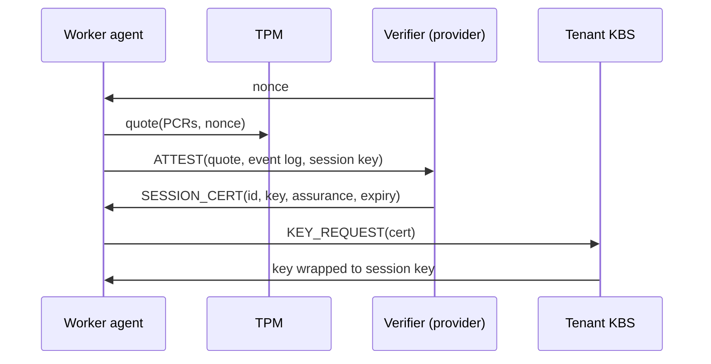
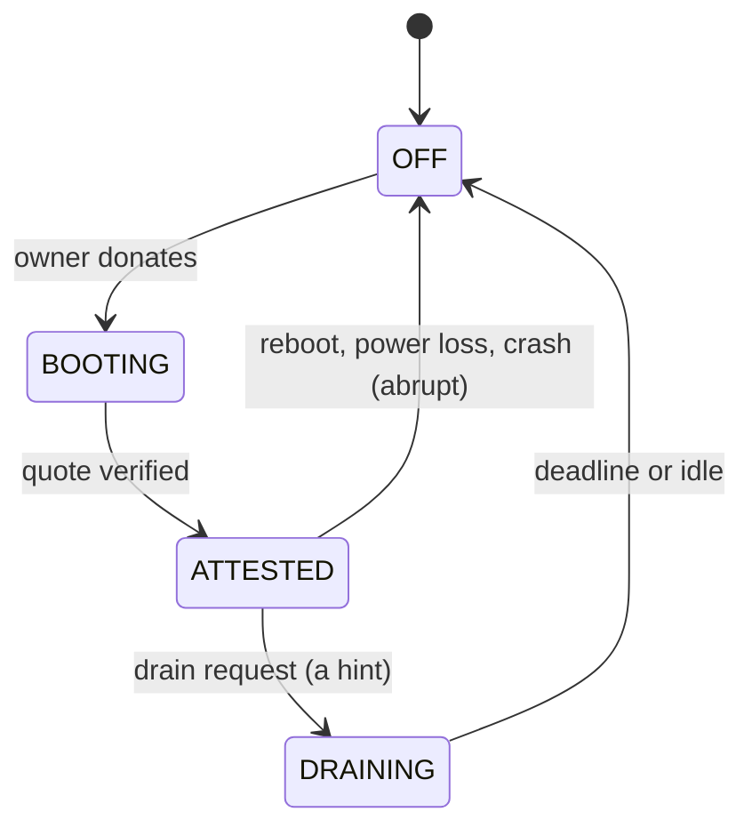
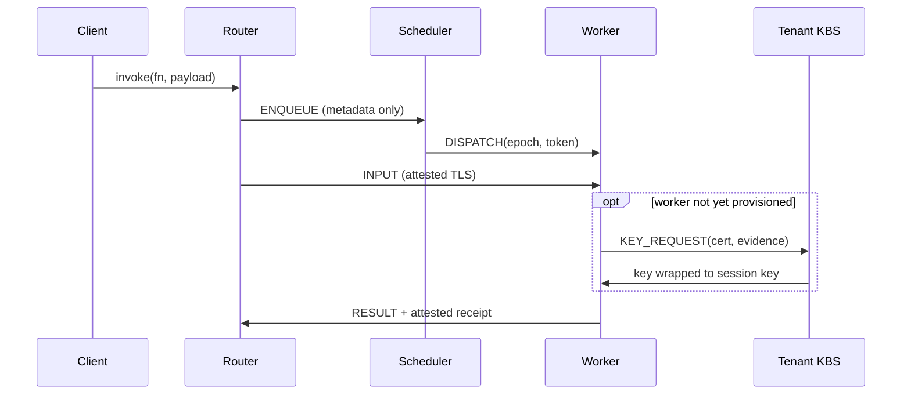
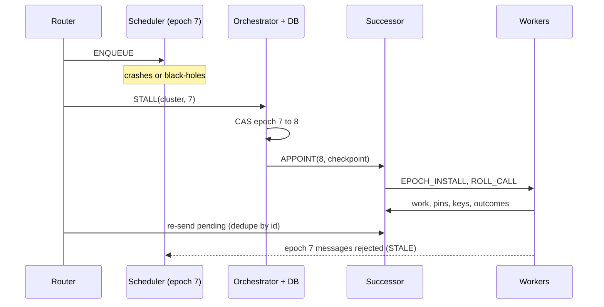
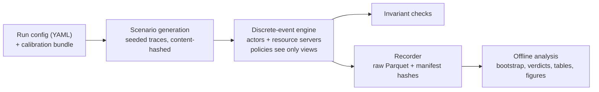

# VOSS, explained informally

Scheduling attested session state for serverless computing on volunteer machines

*Companion to the manuscript (draft 10, ACM TOIT format). Numbers are from the paper. Details marked (repo) come from the repository docs and code, and are not all in the paper.*

---

## TL;DR

- Serverless functions are short, so the time a user waits is mostly **starting a sandbox** and **network distance**, not computing.
- Idle personal computers are numerous and near users. But their owners can **switch them off at any moment**, and the owners **cannot be trusted** with customers' code and data.
- **Remote attestation** (a cryptographic proof of exactly which software a machine booted) means a hostile owner can no longer read or tamper through software. What is left: the machine may vanish, drop work, or answer late.
- The platform must then decide **which machines get each customer's decryption key and pre-started sandboxes**. VOSS decides that with a slow planning loop, and places each call with a fast loop.

---

## How to read this deck

- Order: **vocabulary → motivation → what exists → the insight → how components talk → scheduling core → fault tolerance → evaluation → results → limits**.
- Results include the **negative ones**: the paper reports them on purpose.
- Everything is from **simulation**, calibrated on one laptop. A single-machine emulation (E01) checks part of it.
- Design questions that came out of reviewing this deck are in `docs/critique/CRITIQUE.md`; the plan for them is in `docs/critique/ACTION.md`.

---

# Part 0. Vocabulary

---

## The parties and the objects

- **Provider**: whoever runs the platform. **Tenant**: a **customer**, a developer or company that writes functions. A tenant is *not* a VM. **Volunteer / owner**: owns a computer and donates it. **Worker**: a volunteer's machine while it runs the platform software. **Client**: whoever calls a function.
- **Function**: one piece of tenant code. **Invocation**: one call of it.
- **Sandbox / microVM**: a small virtual machine (Firecracker) that runs one function in isolation. **Warm** sandbox: already started and idle. **Cold start**: starting one from scratch.
- **Snapshot**: saved memory and device state of a started sandbox. Restoring it is faster than booting.
- **Session**: the interval during which a volunteer's machine is booted into the platform.

---

## What a tenant's "secret" is, and SLOs

- A **secret** is a **decryption key controlled by the tenant**. It decrypts the tenant's **code bundles** and its **snapshots** (which contain decrypted memory).
- A machine that holds the key can read that tenant's code and the data in memory. It is released by the tenant's **key broker service (KBS)**, only to machines that pass attestation. This is **provisioning**.
- **SLO**: what a tenant expects. Each synchronous invocation gets a **deadline** of 5× its warm latency (plus 0.05 s). Missing it, or failing, is an **SLO violation**.
- **P99**: the latency that 99% of invocations beat. It captures the slow tail.

---

# Part 1. Motivation

---

## Serverless in one slide

- A developer uploads a function. The platform runs it **on demand**, in a sandbox.
- Most functions finish in **well under a second**, so waiting time is **not computation**. It is the **cold start** plus **network distance**.

```text
T = T_route + T_decide + T_queue + T_prov
  + T_start + T_net + T_exec + T_retry
```

- For functions of tens to hundreds of ms, **`T_start` dominates** unless a sandbox is already warm. `T_prov` is the time to fetch the tenant's key (zero if already done).

---

## The datacenter fix, and the idea

- Providers **keep sandboxes warm** or restore snapshots. Warm sandboxes **hold memory around the clock**.
- Consumer machines are **numerous, near users, and idle most of the day**. BOINC and SETI@home-style systems have used them for two decades, but only for **batch work** with deadlines of hours.
- Idea: serve **latency-sensitive** functions from them. Two things break.

---

## Problem 1: churn. Problem 2: distrust

- **Churn.** An owner can power off at any moment. Everything the platform built on the machine is lost: warm sandboxes, keys. For a 50 ms function, **rebuilding that state dominates**.
- **Distrust.** The owner controls the hardware and OS. They can **read tenant code and data**, **forge results**, or **stop at the worst moment**. The usual defense is to **establish trust before use**.

```text
machine joins ──► establish trust (slow) ──► run work
                         ▲                      │
                         └─── session ends ─────┘
                       (churn destroys the trust)
```

- Trust is paid **per session**. Short sessions mean you pay often. Hence the scheduling problem.

---

## What "donating" means here

- The owner **reboots into a locked platform image** (the "appliance"). No owner login.
- The owner **cannot use the machine** meanwhile. Supply is **scheduled or dedicated machines**, not an idle desktop donating for ten minutes.
- A session ends on reboot or power loss, or after a **drain** (the owner announces "I leave at time X", only a hint).
- Power-on to a worker that is attested and ready: about **65 s** on the calibration laptop (measured, upper bound).

---

## How expensive is "trust"? (measured)

```text
resume warm microVM          ▏ 2 ms     (model value)
restore snapshot, warm       ▏ 7 ms
boot microVM, warm cache     ▍ 154 ms
TPM quote                    ▌ 506 ms
restore snapshot, cold HDD   ▌ 627 ms
boot microVM, cold HDD       ▊ 1.5 s
create 512 MB snapshot       ██ 6.7 s
reboot to kernel             ██████ 21 s
power-on to attested worker  █████████████ 65 s
```

- **65 s versus milliseconds**: 3–4 orders of magnitude. Hence trust **cannot be set up on the per-request path**.
- 65 s = **21 s** (firmware, loader, kernel start) + **44 s** until the verifier accepts the quote (about 14 s is the TPM creating keys and quoting). Median of 9 boots.
- Warm/cold: a file is **warm** if it is in the OS page cache, **cold** if it must be read from disk first. A **TPM quote** is a signature by the TPM chip over its boot measurements and a fresh random number.
- One laptop, hard disk, appliance in "host mode": these are **upper bounds**.

---

# Part 2. What exists, and why it falls short

---

## Volunteer computing, and serverless schedulers

- **BOINC** replicates each task on several machines and accepts the majority answer. That multiplies cost, needs **deterministic** tasks that **return an output**, and shows the input to every replica (**no confidentiality**). Time scale: hours.
- **Serverless schedulers and keep-alive** (Azure's histogram policy, FaasCache, Sparrow) decide when to keep or pre-start sandboxes. They assume **trusted servers that stay up**: a warm sandbox is lost only by policy, never because a laptop lid closed. Nothing in them models a **provisioned secret**.

---

## Harvested, confidential, and trusted-component work

- **Harvested / edge serverless**: spare datacenter capacity that can be **evicted**, or machines near users. The machines belong to the provider or a trusted party. The failure is **announced eviction**, not silent omission, and no secret goes to a party that might read it.
- **Confidential serverless** (SEV-SNP, TDX, SGX): memory encryption protects tenants **from the platform operator**. Mostly **server CPUs** in provider datacenters. Attestation is a **one-time deployment step**, not a resource with a cost, a lifetime and a security price.
- **Trusted components and BFT**: small trusted counters cut the replicas needed for Byzantine agreement. VOSS uses attestation differently: an attested machine is **honest but unreliable**, so we need only **crash tolerance**.
- **Heartbeats** show a machine is alive, not that it makes **progress**: a **gray failure** passes them.

---

## Coverage of required properties

| Approach | Untrusted hosts | Churn | Latency SLOs | Plans trust + warm state | Gray failures | Verifiable accounting |
|---|---|---|---|---|---|---|
| Volunteer computing | • | • | | | ◦ | ◦ |
| Serverless schedulers | | | • | ◦ | | |
| Harvested serverless | | • | • | ◦ | | |
| Confidential serverless | • | | • | | | |
| Trusted-component FT | • | | | | | |
| **VOSS** | • | • | • | • | • | • |

• addressed, ◦ partly, blank = not addressed. *Our own assessment.*

---

# Part 3. The insight

---

## The key observation

- The tenant's function **and** the provider's scheduler code run **only inside a measured, owner-locked appliance image**. A **verifier** checks TPM evidence that exactly this image booted.
- A hostile owner then **cannot read, forge or tamper through software**. What is left: the machine **powers off, drops, delays or throttles**.
- Those are **omission** (accepts work, never returns) and **timing** (returns late) failures. Churn **already forces us to tolerate** them. **One set of mechanisms covers crashes, churn and malice.**
- **Redundant execution is no longer needed for integrity.**
- Scope: an owner with physical access to RAM (cold boot, DMA, bus probing) is outside this unless the hardware encrypts memory.

---

## Attestation and key provisioning



- Boot stages are hashed into the TPM's registers (PCRs). The verifier checks the **signature**, the **manufacturer's certificate chain** and the **event log** against known-good values.
- The **session key** is made inside the appliance and **bound into the quote**. The certificate expires at the earlier of session end and last quote + validity, and is renewed by re-quotes.
- A quote shows what booted **at one moment**, so evidence **goes stale**. Attestation says **nothing about availability**.

---

## Who is the KBS, and when does code arrive?

- The **KBS** holds a tenant's keys and releases them under the tenant's policy. It is **operated by the tenant (or a service it trusts)**, not the provider.
- **Subtlety:** if the KBS accepts any certificate the verifier issued for an approved image, the **verifier is trusted for confidentiality**. If the tenant requires a **fresh quote** that the KBS checks itself, it does not depend on the verifier, at the cost of one more quote.
- Code bundles sit **encrypted** in the provider's **registry** and in peers' caches. **Provisioning** (`PREPARE`) = get the key, **fetch the encrypted bundle**, **decrypt** it. A worker can store and forward ciphertext without the key, but can only **use** it after provisioning.

---

## Property 1, and what we trust

- The owner **cannot run other code** (it fails attestation: no certificate, no key), **cannot read or modify** the image's memory or sealed disk, and results are **signed by a key that never leaves the appliance**.
- The owner **keeps only**: power, the network path, and **when to stop answering**.
- **Trusted:** CPU, TPM, the measured image, each tenant's key broker, and the provider's control plane (availability and accounting). **Out of scope:** physical TPM attacks, appliance bugs, side channels, control-plane failure.
- **If attestation breaks, the robustness results no longer hold.**

---

## So the real problem is "attested session state"

- **Session**: booted and attested. Costly (65 s), **perishable**.
- **Provisioned**, `K[t,j]`: tenant *t*'s key is on machine *j*. Costs a KBS round trip and **exposes** the tenant: every holder is a place the key could leak from.
- **Warm state**: a sandbox or snapshot is ready. Costs memory or disk.
- Three properties conventional schedulers **do not model**: costly to set up, perishable, exposing.

---

## Session lifecycle and the disk cache



- Session end loses the keys and all warm sandboxes.
- The **content-addressed disk cache** (encrypted bundles, root file systems, snapshots) survives **only as ciphertext**, usable again after the next attestation and key release. A corrupted disk can only cause misses, never wrong code.
- Eviction: pinned items stay; others go by **value density** (hits × start-up saved, per byte). LRU is the baseline. In E09 the fancy policy is **at most 3% better**.

---

## Start-up tiers of one function on one machine

```text
L0  nothing cached
 │  fetch code bundle + root file system, verify
 ▼
L1  code + root file system on disk (encrypted) ── boot + init ──┐
 │  after the first init, write a snapshot                       │
 ▼                                                               ▼
L2  snapshot on disk ───────── restore ─────────────►  L3  warm microVM
                                                        idle in memory
                                                             │ dispatch
                                                             ▼
                                                        L4  busy
```

- Going up costs time and memory or disk. The key flag `K[t,j]` is **separate**: the tier says **what is cached**, `K` says **whether this machine can decrypt it**.

---

## Exposure: the security cost of holding a key

```text
E_t = sum, over machines j holding tenant t's key:  (1 − a_j)
```

- Every key holder is one more place the key could leak from. `a_j` ∈ [0,1] is how far we trust machine *j*'s platform (0.80 for the TPM appliance, a policy value).
- So **exposure ≈ the number of key holders, discounted by how trustworthy each is**.
- A **transparent proxy** for attack surface, **not a probability** of compromise. Compare exposure only under the same scores.

---

# Part 4. How the components communicate

---

## Transport and messages

- Every interaction is a **typed message** (`ENQUEUE`, `DISPATCH`, `INPUT`, `RESULT`, `KEY_REQUEST`, `ATTEST`). Components never call each other's code.
- Every channel uses TLS with the worker's **session certificate** ("attested TLS"): a client certificate issued only after attestation.
- Large payloads go **router ↔ worker** over a stream the worker opened to the router. They never pass through the scheduler.
- The **verifier is the certificate authority** for session certificates (repo: doc 04). How its root reaches workers and key brokers, and how fast revocation spreads, is **not specified or evaluated**.

---

## Reaching a scheduler that is a volunteer machine

- Workers are behind **NAT**: they can dial out, not be dialled. The scheduler is **also a volunteer behind NAT**, and home **addresses change**.
- **HTTP and gRPC do not fit**: they need a server at a known `ip:port`. A volunteer's address lives for one session, so every scheduler change would push a new address to every router and worker.
- **Decision: a provider-hosted publish/subscribe broker, one topic set per cluster id** (MQTT as the candidate). Everyone **dials out** to the broker. The scheduler subscribes to its cluster's scheduler topic, workers to their own topic and a cluster-wide one, routers publish to the scheduler topic.
- **Failover becomes "the successor subscribes to the same topic"**: no address hand-out, no reconnect storm.
- The broker is trusted for **availability only**: messages are sealed with session keys and carry the epoch, so a dropping or delaying broker is just an omission fault. Cost: **one extra hop** and one more provider component to keep highly available.
- The **simulator only models network delay** (the 20 ms relay term stands in for the hop). The protocol is an architectural choice.

---

## Clusters: how volunteers are grouped

- The orchestrator groups attested workers into **clusters of tens** by **geographic proximity** (k-medoids on round-trip time). Target 30, range 10 to 60.
- Why: it bounds the planner's problem size and keeps worker-to-scheduler latency low. Each cluster should hold enough **failure domains** (cities, network providers) for a plan to survive losses.
- One worker per cluster is appointed **scheduler**. Workers move between clusters on triggers, with hysteresis, since a moved worker loses its provisioned state.

---

# Part 5. The VOSS design

---

## Goals and principles

- **G1** no secret learned, no result forged by a software-level owner. **G2** tail latency within SLO despite churn. **G3** a machine that drops work, or a stalled scheduler, is bypassed within seconds **without trusting liveness signals**. **G4** a machine cannot claim work it did not do.
- *Non-goals: physical TPM attacks, appliance bugs, side channels, control-plane failure. Invocations are independent.*
- **P1** Attestation turns distrust into unreliability. **P2** Trust is a **managed resource**, planned more slowly than placement. **P3** Liveness is a **hint**; **progress**, seen by a trusted or attested party, is **evidence**.

---

## Architecture


*Numbered flows follow one invocation. The broker carries control messages (2, 3, 8).*

---

## Who is trusted for what, and the scheduler role

- **Router, orchestrator, verifier, Ops DB, registry, broker** (provider): trusted for availability and accounting. Not given tenant keys.
- **Tenant KBS**: releases the tenant's own secrets per policy.
- **Worker**: trusted to execute code faithfully, not for availability.
- **Scheduler**: a **role**, not a machine. The **same image** runs everywhere, so any attested worker can be promoted with no boot. The orchestrator keeps a **ranked list** (survival, speed, centrality, assurance).
- Its **code** cannot misbehave. Its **host** can vanish or be slow, hence failover.

---

## Why is the scheduler on a volunteer machine?

- **This is the design the paper builds and evaluates.** Scheduler failover, scheduler faults and the cluster experiments are for this design.
- **Reasons:** the provider runs **no per-cluster component**; it is the **harder case** for fault tolerance; it offloads the **exact planner's compute**; the pattern (attested code, soft state, lease and fencing, provider arbiter) is reusable.
- **Costs:** a scheduler that can crash or stall (the failover section) and the **networking problem** (previous part).

---

## If the provider hosted the schedulers

```text
workers   clusters   greedy planning   exact planning   placement
          (÷30)      (cores)           (cores)          (0.01 inv/s per worker)
10^3        33         0.009              4.6             0.008 cores
10^4       333         0.09              46               0.08 cores
10^5     3 333         0.9              455               0.8 cores
```

- **Greedy planning is essentially free** for a provider. Volunteer hosting saves compute only for the **exact planner**, whose benefit is not established. So choosing greedy **does not depend on where the scheduler runs**.
- A **global or regional provider-hosted scheduler needs no broker**: workers dial out to a stable address, and failover is ordinary high availability.
- It would also remove **one round trip per invocation**, remove scheduler-host adversaries from the threat model, shrink the attested image, and allow bigger scheduling domains. Planner, placer, estimators, exposure, receipts and key release are **unchanged**.
- **Not evaluated.** Fault-tolerance results are specific to the volunteer-hosted design.

---

## Life of one invocation



- **Metadata** = function, tenant, deadline, input size, idempotence. The scheduler **never sees payloads, results or keys**. ENQUEUE and DISPATCH travel through the broker topics.

---

## Rules for state and receipts

- **Typed messages only.** The **Ops DB is private** to the control plane and **never on the hot path** (router → scheduler → worker → router).
- **Live state stays where it is born**: queues and keys in workers, undispatched work in routers, cost matrices in the scheduler. A new scheduler **asks the workers**, not the DB.
- **Every channel ends inside an attested party.**
- **Receipts**: after an invocation the worker signs invocation and attempt ids, its identity, the epoch, execution time, work units and an output hash. The router checks it and appends it to the DB off the critical path. A machine **cannot claim work it did not do**; it can only decline, which is an omission.

---

# Part 6. The scheduling core

---

## Why two loops

- **Security cost belongs to a group of machines.** A key stays for the whole session, so what matters is **how many different machines hold it**, which does not add up placement by placement.
- **Robustness concerns the group**: is demand still covered if any *f* machines vanish?
- **Setting state up takes seconds**, so it must happen **before** demand arrives. **Choosing a machine for one call** is quick and per-call.

```text
SLOW loop (planner)  every T_plan = 30 s, horizon 60 s
   y: which machines hold which tenant's key
   s: which snapshots are pinned on disk
   w: how many warm sandboxes of each function
   c: how many slots of a machine are earmarked for a tenant
        │  plan; actions PREPARE / WARM / PIN / RELEASE to workers
        ▼
FAST loop (placer)   per invocation, milliseconds
   picks one machine from the confirmed state, may add a hedge
```

- Workers **confirm** actions in heartbeats; the placer counts only on **confirmed** state.

---

## Where does 30 s come from?

- A **design choice, not a measured optimum**, not swept in the experiments.
- Plan actions take a few hundred ms to several seconds, so the period must exceed that. Sessions last minutes to hours, so it must be much shorter. Horizon = 2× period.
- A small pilot at 15 s and 60 s (outside the reported experiments) showed no significant P99 difference.
- The plan is recomputed early when the situation changes materially, and reused otherwise.

---

## Fast loop: what it minimises

```text
J(i,j) = w_i · P_miss(i,j) + ε · E[T_ij] + λ_exp · x_ij
```

- **P_miss**: probability that placing *i* on *j* violates the SLO: *j* fails first, or `T_ij` exceeds the **remaining budget**. **A failure counts as a violation.**
- **E[T_ij]** breaks ties. **x_ij** is the **exposure** added if *j* does not hold the key: σ × (1 − assurance).
- Weights (assumed): `w=1` sync, `0.3` async and filler; `ε = 0.05 per s`; `λ_exp = 1`. So 1 s of latency ≈ a 5-point rise in miss probability; a new key holder with assurance 0.8 costs 0.2, like a 20% chance of a violation.
- **Why per-invocation risk, not P99**: P99 is a population statistic and cannot be assigned to one decision, while the **mean of per-invocation miss probability is the miss rate**. Alternatives (quantile, CVaR, tardiness) are in E03: the quantile variant is 2.8% better, **weak**.

---

## Slow loop: what it minimises

```text
min   Σ_t Λ_t · u_t               uncovered demand, charged per slot
    + memory and disk cost of warm VMs and snapshots
    + λ · Σ σ_t (1 − a_j) y_tj    key exposure
    + ν · Σ |y_tj − y_prev|⁺      plan churn (new key holders)
    − β · Σ b_f (w_fj + γ s_fj)   benefit of warm starts
```

- Each missing slot costs `Λ = 10`, far more than memory or exposure, so coverage is bought unless impossible. All coefficients are weights putting memory, disk, exposure and churn in one unit.
- The planner is **not** a violation minimiser, by design. We still **report** violations everywhere. The router minimises expected completion time with penalties.

---

## Robust coverage

```text
Σ_j  e_j · c_tj   −   (sum of the f_t largest c_tj)   +  u_t   ≥  q_t

e_j  = S_j(H) · (1 − p_j)
```

- `c_tj`: slots of *j* earmarked for tenant *t*. `e_j`: **effective availability** (survives the horizon × does not omit). `q_t`: demand quantile. `f_t`: machines to tolerate losing, default `⌈0.1 × cluster size⌉`. `u_t`: shortfall allowed at a price.
- **Even if the *f* biggest contributors vanish, the rest still cover the demand.** The removed machines are chosen by **worst case**, so no adversary model is needed. It stays **linear** (LP duality).

---

## Why the planner does not minimise violations

- **Circular**: violations depend on where the placer sends calls, which depends on the plan (a two-level problem at every round).
- **No per-request information**: at planning time only a **forecast** exists.
- **Rare, noisy events** (1–5%). A coverage quantile is stable.
- **Violations are not the only cost**: warming everything everywhere puts every key on every machine. So: **minimise cost under a coverage requirement**, and report a Pareto front.
- **No hard guarantee exists** under churn and adversaries. Coverage against **any *f* defectors** is the strongest claim without an adversary model.
- **How coverage serves the SLO**: if arrivals are Poisson, the concurrency is Poisson with mean λ·s; `q_t` is its **95th percentile**. That bounds the share of calls pushed onto the **unprovisioned path**, the main cause of violations.
- **Caveat**: simulated arrivals have 4× bursts, so **coverage falls below 95% during bursts**. The Poisson model is the planner's assumption, not the world.

---

## The greedy planner

- **Inputs** (estimates from the scheduler's view): per machine survival, omission probability, assurance, failure domain, free slots, memory, disk, cache; per hot tenant `q_t`, σ, floor, `f_t`; per hot function memory, snapshot size, start-up saved; the previous plan. **Hot set:** top 20 tenants, 50 functions; **pool** at most 40 machines.
- **Output:** plan `{y, s, w, c}`, turned into idempotent actions.

1. **Rank hot tenants** by demand × cold-start penalty.
2. **Add machines one at a time**, best `availability × assurance ÷ (memory + exposure cost)`, subject to the assurance floor and a **failure-domain cap** (no city holds over half). Stop when coverage holds **with the *f* largest removed**.
3. **Then add warm sandboxes and snapshots** only on machines holding the tenant's key, by **start-up time saved per MB**.

```text
Tenant needs q = 3, tolerates f = 1. Machines: A 0.9, B 0.8, C 0.6, D 0.9 (2 slots each)
f = 0:  A + B = 3.4 ≥ 3                        → 2 machines
f = 1:  A+B = 1.6, A+B+C = 2.8, A+B+C+D = 4.6  → 4 machines
```

- Robustness doubles the key holders here: that is why **robust coverage costs exposure** (13 → 24 in E23).

---

## Greedy versus exact

- **Greedy:** about **8 ms** per plan. **Exact (MILP, HiGHS):** same inputs and outputs, **4.1 s** per cluster. In a pilot, 0.3–1.1 s for 10 machines, 4.7–5.0 s for 40, 17–24 s for 80: it can exceed the planning period.
- The simulator **charges both the same delay** (about 0.1 s). So the exact planner's results are **optimistic about plan staleness**.
- **Decision rule, fixed beforehand:** if exact improves P99 by **under 5%** in **all** regimes, greedy is the method. Result: **1.8%** at medium churn; **8.1%** at high churn but the interval runs from −21% to +1% and **includes zero**: **inconclusive**. We **do not claim** the rule is met. Greedy stays the default.
- Industry keep-alive (fixed timer, idle histogram, FaasCache) is **reactive** and per function. It does not decide who holds secrets or plan for vanishing sessions. Our "keep-alive TTL" baseline is the fixed 10-minute timer; a histogram policy for volunteers is **not** evaluated.

---

## What the scheduler knows and remembers

- **Observed (O)**: reported now by an attested agent or router (free slots, cache, keys), at most a heartbeat (2 s) old. **Learned (H)**: from past outcomes. **Forecast (F)**: future values from H. **Calibrated (C)**: fixed before the run, **not learned online**. **Policy (P)**: weights, sensitivity, floor.
- **Slow loop: mostly forecast. Fast loop: mostly observation.** The **speculative parts are the C items**: start-up and network times assumed exact, declared speeds exact. Sensitivity to wrong estimates is **not tested**.
- **Never used:** true session end, true run time, true behaviour, future arrivals (the policy code cannot import the simulated world).
- **Estimators** (a few numbers each, in memory, checkpointed every 30 s): **Weibull** session survival per tier; **Beta** omission probability per machine, with a **CUSUM** change-point reset (on-off adversaries); a **Bayesian regression** of execution time per function with per-machine offsets; **arrival counts** in 10 s bins, smoothed.

---

## The placer, per invocation

- **Input:** metadata, the scheduler's view (at most one heartbeat old plus its own dispatches), the plan.
- **Candidates:** best **K = 12** by a cheap bound, from confirmed provisioned machines and the **unprovisioned path**. **Infeasible:** draining, session expiring within 5 s of the finish, assurance below floor, no memory.
- **Cost components** (logged): wait for a slot (counts in-flight requests, so load matters), trust, start-up by tier, network, execution.
- **Sync** invocations are placed **immediately** on the lowest `J`. **Async and filler** arrive in **0.2 s windows** and are matched by a **minimum-cost assignment**.
- **Hedge** if best miss probability > **0.2**: duplicate on a **different failure domain**, cancel the loser; at most **10%** of placements. **Admission**: if all candidates miss with probability ≥ 0.95 and even the shortest wait exceeds the budget, **reject** (sync) or **defer** (async). A **retry** excludes the failed machine.

---

## Idempotence, and when no result comes back

- **Idempotent**: calling twice has the same effect as once. **Hedging and retries only apply to idempotent functions**; a lost non-idempotent call is **reported as a failure**.
- **Dispatch watchdog** (router, 1 s): no acknowledgement ⇒ re-send or spill. Nothing ran, so this is always safe. **Result watchdog** (scheduler): no result by the q90 prediction × 1.2 (at least 3 s) ⇒ probe, mark **suspected**.
- **Do platforms guarantee at-least-once? Only on some paths** (checked against vendor docs, Oct 2026): **AWS Lambda** retries failed *asynchronous* calls twice by default and warns of duplicates; a direct *synchronous* call is **not** retried, the caller does it. **Google** event-driven functions run at least once per event (v2 retries are off by default, then a failed event is dropped), HTTP functions are not retried. **Azure** Event Hubs triggers and Durable activities are at-least-once. **Cloudflare Queues**: at least once. OpenWhisk: not verified.
- So the claim is **at-least-once on event and async paths, client retries on request-response paths**. Either way every vendor tells developers to write **idempotent** code, because duplicates arrive sooner or later. VOSS relies on that contract, and goes further by also retrying and hedging **synchronous** calls of idempotent functions.
- In our workload **11 of 12** functions are idempotent, **all synchronous ones**, **by our assumption** (modelled on SeBS). The success results under omission **rest on that**. Whether VOSS should require idempotence or provide idempotency keys is open (C-09, C-10).

---

## Routing between clusters

```text
score(c) = rtt + overhead + backlog
         + health · max(0, miss_rate − θ)
         + [no provisioned capacity for the tenant]
         + [no warm sandbox of the function]
```

- Every term is **seconds of expected delay**. The last two are the **measured** key-release and cold-start times of that cluster (priors 3 s and 0.5 s), charged only when the cluster lacks the capacity or warm sandbox.
- Spilling to another cluster is a decision with an **explicit price**.

---

# Part 7. Fault tolerance and accounting

---

## The progress principle and its detectors

- **Liveness signals** (heartbeats, drain notices, self-reported health) are **hints**. **Progress seen by a trusted or attested observer is evidence.**
- Hard cases: **black hole** (heartbeats on, work dropped), **on-off** (clean record, then defects), **fake drain**.
- **Dispatch watchdog** (router, 1 s) ⇒ **scheduler**. **Result watchdog** (scheduler) ⇒ **worker**. **Cluster stall** (3 fires within 5 s) ⇒ **scheduler**. **Decision latency** (> 200 ms) ⇒ **slow scheduler**. **Outcome rate** (CUSUM) ⇒ **worker**. **Heartbeat**: a **fast path for crashes only**.

---

## Scheduler failover without consensus



- Replicated state machines among possibly adversarial volunteers are **slow**. The provider's orchestrator is a **reliable arbiter**: an atomic **compare-and-swap on an epoch** (a lease). Workers accept dispatches only from the **current (epoch, certificate)** and answer lower epochs with `STALE`: a **fencing token**.
- A scheduler that cannot reach the orchestrator for 5 s **stops dispatching**. A partition causes only **duplicate work**, safe for idempotent functions; for others a duplicate within the lease could repeat its effect.
- With the broker, the successor takes over by **subscribing to the cluster's scheduler topic**.

---

## Scheduler state is soft; credits; no blockchain

- **Undispatched invocations**: held by the **router**. **Running work, confirmed pins and keys**: held by **workers**, learned by a **roll call**. **Estimators**: a **checkpoint** refreshed every 30 s. **Work records**: receipts, nothing to recover. A restarted appliance is a **new instance**.
- **Credits** are proportional to **reference work units**, not time: throttling earns nothing. **Reputation** is kept separate from the survival and omission estimators and only affects rewards and tie-breaks.
- **No blockchain**: receipts are signed by a key that never leaves the appliance, so third parties can already verify them. The remaining risk, the control plane deleting records, suits a signed transparency log (future work).

---

# Part 8. How we evaluated it

---

## Why a simulator, and how it runs



- A platform with **thousands of machines**, **controlled churn and adversaries** and **paired comparisons** cannot be run on real machines. A custom **discrete-event simulator** (Python 3.11, single-threaded, kernel under 70 lines) gives one **total event order**, so runs repeat exactly.
- The **policies are the real code**; the **world** is a **model**. Systems compared on one seed face **identical worlds**.

---

## Nothing is free; what is simulated, calibrated, assumed

- Network delay from **great-circle distance** (about 100 metro areas, 100 km per ms, route factor 1.3) plus last-mile and jitter, **plus 20 ms per relayed endpoint** (15% of workers). Disk reads, CPU contention, **TPM quotes, key release** cost time.
- **Decision latency** is `a + b × work`; the planner is charged **0.02 s + 50 µs per variable** (about 0.1 s), the same for greedy and exact. The coefficients are **placeholders**.
- **Simulated:** queueing, caches, session boots, attestation, failures, detection, failover. **Calibrated:** start-up, snapshot, TPM and boot times, disk speeds. **Literature (swept):** confidential-VM costs. **Assumed (swept):** churn, adversaries, arrivals, assurance, weights.
- Workload: **six tenants, 12 functions** modelled on SeBS, three service classes, Zipf popularity, bursty arrivals, no external calls.

---

## Calibration and E01

- **One laptop**: Intel i3-7020U, discrete **TPM 2.0**, **hard disk**. TPM quote **0.51 s** (placeholder 0.25). Snapshot create **6.7 s** (placeholder 0.2). **Power-on to an attested worker: 65 s** (21 s + 44 s). Not the intended donor machine, no SEV-SNP or TDX, **host mode**: **upper bounds**.
- **E01** (real execution check): lab machine (i7-12700, 125 GB, NVMe), 16 slices of 2 slots, 5 functions, 10-minute runs, seeds 1–3. **Real Firecracker microVMs** for boot, restore, snapshot creation and execution. **Network, attestation, key release, queueing, TPM stay models.**
- **Agrees:** success within 0.6 points; start-up level mix identical; median latency within 6–23%. **Does not meet our cut-offs:** latency **shape** (KS 0.20–0.51), every scenario "partly" close. At light load simulator P99 is 3.7–4.1× the emulation's.
- **Not tested:** network, NAT, attestation, key release, session boot, failover at scale.

---

## Protocol, metrics, baselines

- **Seeds 1–10** per cell (3 for the two largest scale points). **Paired by seed**, mean difference with a **95% bootstrap interval**. **Hypotheses and verdict rules fixed before the runs**: *supported, weak, inconclusive, refuted*. A script **fails the build** if a result stops supporting its sentence.
- Metrics: success, deadline-met, P50 and P99 sync latency, **waste**, donor memory, exposure. A cell is **feasible** if the lower 95% success bound ≥ 0.99 **and** the deadline-met bound or P99 (2, 3, 5 s) meets a target. Maps say **where** a design works.
- **Baselines** (same candidates and cost matrix): no planning, keep-alive TTL (10 min), greedy, MILP, heartbeat-only detection, f = 0, a **simple baseline** (static regions, nearest routing, least-loaded, keep-alive, no hedging), and **Lambda-like / Azure-like** always-on references at list prices.

---

## Reproducibility

- A run is a function of **scenario + seed**, with a SHA-256 result hash. **Needed:** x86-64 with FMA, Linux and glibc, Python 3.11, locked dependencies, **NumPy's vector dispatch pinned to SSE4**.
- **Why:** NumPy's `exp` and `log` differ in the last bits on AVX-512 and AVX2 CPUs; a last-bit change flips a near-tie placement and the run diverges.
- **Verified:** a pinned probe was identical on **4 CPU models and 2 Ubuntu releases**; a full re-run on independent machines matched **2,366 of 2,366** hashes. On ARM and other platforms, only the statistical conclusions are portable.

---

# Part 9. Results

---

## RQ1: trust cost per substrate (simulated, s)

| Substrate | Session | L0 | L2 | L3 |
|---|---|---|---|---|
| appliance (TPM) | **19.2** | 1.45 | 0.0285 | 0.002 |
| measured hypervisor | 2.31 | 1.44 | 0.0284 | 0.002 |
| confidential VM | 1.41 | 2.31 | 0.155 | 0.002 |
| confidential containers | 8.11 | 2.25 | – | 0.002 |
| no attestation | 1.06 | 1.45 | 0.0278 | 0.002 |

- Pre-measurement parameters; measured laptop figure for the appliance is 65 s. The appliance pays **once per session**, then is **as fast as an unattested Firecracker host** (H5 supported).
- "Confidential VMs are 10–100× slower to establish trust" was **refuted**: they are about 93% faster, because the appliance's cost is a **reboot**.

---

## RQ2: feasibility

- At a **3 s sync P99 target**, VOSS is feasible in **9/9** cells (churn × adversaries), **13/16** (substrate × load), **10/12** (population × load). The strongest simple baseline: **none**. At 5 s: **9, 16, 10**. **Only VOSS feasible** (default criterion): 9/9, 9/16, 4/12.
- **Not the right choice:** on **confidential-VM and container substrates at high load** the **simple baseline is the only feasible system** in 4 cells (untested conjecture: cheap sessions leave little to plan away). With **100 workers** nobody is feasible. At a **0.98 deadline-met target** nobody is feasible anywhere.

```text
(a) churn × adversaries          none   a=0.1  a=0.2
    low                          1.3    1.3    1.5
    med                          1.5    1.4    2.1
    high                         1.3    1.4    1.5

(b) substrate × load (inv/s)      5     10     20     40
    appliance_tpm                1.3    1.4    1.5    2.1
    drtm_hv                      1.4    1.4    1.9    2.4
    cvm_snp                      2.2    2.2    2.5    2.9
    coco_pool                    2.8    3.6    4.6    4.0
```

---

## RQ3: planning pays

- **Greedy vs no planning:** sync P99 **−54%** (medium churn), **−59%** (high). **Vs keep-alive:** −27% and −57%. **Exact MILP:** −54% / −63% and −29% / −60%. **H1 supported.** Cost: the MILP holds about **2.1× the warm memory** of keep-alive (129 vs 61 GB). The MILP's 4 s solve is not charged.
- **Ablation** (change in sync P99 when removed):

```text
lifecycle-aware placement   +3.3 s   (largest)
planning                    +1.1 s   (exposure −31)
robust coverage             +0.8 s   (exposure −24)
hedging                     +0.3 s
geo-clustering              −0.09 s  (improves!)  exposure −34
```

- The components that **buy P99 also raise exposure**. Geo-clustering is the **only** one whose removal improves things.

---

## RQ4: scheduler faults and omitting owners

- **Crash:** progress detection **2.2 s**, failover **2.7 s**. **Black hole:** progress **4.2 s**, success **99.95%**; heartbeat-only **60 s** (waits for a timeout), success **96.81%**. **Slow scheduler:** **13.9 s**, the **hardest case**. **H-FT1 supported.**

```text
adversary fraction α    VOSS success    heartbeat-only success
none                      99.99%            99.98%
α = 10%                   99.95%            98.19%
α = 20%                   99.95%            96.79%
```

- At 20% omitting owners VOSS stays at the **churn-only level**; heartbeat-only loses **9× more results**. **H4 supported.**
- `f = 0` changes success by only **0.11 points** (H2 **inconclusive**), but P99 rises (1.43 → 2.05 s): **detection and re-dispatch carry success; robust planning buys tail latency.**
- **Hedging:** always-hedge wastes **10.6%**; risk-proportional **1.8%**, P99 **−13%** at α = 0.1 but interval **[−32%, +1%]**: **inconclusive**.

---

## RQ5: latency, exposure, robustness

- Exposure grows with *f*: **13 → 19 → 24** at f = 0, 0.1, 0.2. The **knee at f = 0.1**: **25% less exposure** for **1.6% more P99** (H3 supported).
- **Per tenant class** it differs: high-sensitivity tenants reach **P99 1.8 s** in one robust configuration. ⇒ Exposure and robustness should be **per-tenant policy**.
- Exposure is in arbitrary-score units.

---

## RQ6: what does not pay

- **Geo-clustering (refuted).** Global scheduler vs static regions, k-means, dynamic clusters on **600 workers** (about 225 attested), **20 inv/s**, clusters of 20–35. Dynamic clusters have **higher P99**: **+17%** (Europe), **+17%** (EU+NA), **+5%** (world), and **5.1× the exposure** in Europe. Likely cause: fewer machines per cluster to pool state; **mechanism not isolated**.
- **Confounds:** the global scheduler **plans over at most 40 machines**, and 20 inv/s does not stress one scheduler, so **scalability was not tested**.
- **Routing:** nearest-region meets **0.991** of deadlines, least-loaded **0.911**. **Caching:** at most 3% better than LRU, **inconclusive**. **Reputation:** −2.4% P99 (**weak**); credits are concentrated (Gini **0.93**, top 10% earn **93%**). **Accounting is off the critical path** (H10 supported).

---

## RQ7: baselines, commercial reference, scale

- **Simple baseline, benign pool:** expected a tie; VOSS has **64% lower P99** (H11 **refuted**), but **1.9× the exposure**.
- **Lambda-like at 20 inv/s:** VOSS P99 **14% higher**, P50 **45% higher**. Cost per million invocations: VOSS about 20 → 10 → 5 USD at 10, 20, 40 inv/s; references about 12 USD. Cost-competitive only **above about 20 inv/s**, and **never lower latency**.

```text
workers     success   sync P99   decision P99
10^2..10^4   99.8%     2–3 s       ≤ 0.5 s
3·10^4       97%       16 s        14 s
10^5         81%       28 s        30 s
```

- Per-worker control traffic stays flat (about 0.7–1 message per second), so the limit is the **central decision path**. The two largest points use **3 seeds**; the bottleneck was not isolated.

---

## Calibration sensitivity and scorecard

- **Placeholders:** VOSS P99 **1.32 s**, simple baseline **3.89 s**. **Laptop-measured:** VOSS **1.17 s**, simple baseline **4.59 s**. The advantage of planning **grows** with measured costs. Do not read absolute numbers as predictions.
- **Scorecard:** **11 supported · 2 weak · 6 inconclusive · 5 refuted.** Refuted: geo-clustering (H7), simple baseline on benign hosts (H11), CVM trust cost ratio (H5). Inconclusive: robust constraint for success (H2), caching (H6), MILP over greedy (H8), hedging (H-FT3). These are **as informative as the supported ones**.

---

# Part 10. Interpretation and limits

---

## What the evidence does and does not support

- **Supports:** managing attested session state as a **planned, perishable resource beats reactive policies**; planning cuts tail latency by roughly **half** under churn; **progress-based detection** keeps success high when owners omit; this holds **across regimes**.
- **Does not support:** **geo-clustering** (slower, more exposure at this scale); the **exact MILP** (only the coverage guarantee justifies it); **caching sophistication and reputation**; and the **commercial reference** has lower latency.
- The **leaner VOSS** the evidence favours: attestation + greedy robust planner + cost-based placer with hedging + progress detection + epoch-fenced failover + receipts.

---

## Threats to validity

- **Simulation, partly validated.** E01 agrees on success and start-up levels, not latency shape, and did not test network, attestation, key release, session boot or failover.
- **One calibration laptop** (hard disk, host mode); confidential-VM numbers from literature. **Assumed churn and workload**: no public trace, six tenants, 12 functions, 11 idempotent by our assumption.
- **Idealised knowledge:** start-up and network costs assumed exact; estimator error not tested.
- **Network model:** a relay penalty only; the broker's capacity, connection set-up and reconnection are not modelled. **Decision cost:** placeholder formula.
- Ten seeds give wide tail intervals; many experiments were run.

---

## Design questions still open

The critique register (`docs/critique/CRITIQUE.md`) and the action plan (`docs/critique/ACTION.md`) hold the full list. The main ones:

- **Scheduler placement.** The networking question is answered by the broker design (D-74). Still open: volunteer-hosted vs provider-hosted, measured (E-SCHED).
- **Trust claims:** the verifier is in the confidentiality trust base in the default key-release mode; physical RAM access defeats Property 1 without memory encryption.
- **Idempotence** contract; **time constants and solver cost** (30 s unswept, MILP charged 0.1 s but takes 4 s); **workload and scale** (six tenants never reach the hot-set limits; the global-scheduler comparison is confounded).

---

## Likely pushback, honest answers

- *"Is the simulator valid?"* Partly. E01 validates start-up and execution on one machine; network, attestation and failover are not validated.
- *"Why is the MILP not the default?"* The decision rule was fixed beforehand; the data are inconclusive, not null.
- *"Why not minimise SLO violations in the planner?"* Circular, no per-request information, noisy, and it would put every key on every machine.
- *"What if attestation breaks?"* Forgery and key theft become possible; the robustness results no longer hold.
- *"Why a volunteer scheduler, and how is it reached?"* It is the harder case, so the mechanisms are tested where they matter; it is reached through a provider-hosted broker; a provider-hosted scheduler is the simpler alternative and is not evaluated.

---

## Workflows (DAGs), future work

- Invocations are independent here. Extension: derive **child demand** from parent rates and **pre-warm children** at parent dispatch; keep workflow state at the **router**; budget speculative warming like hedging. Not evaluated.
- **Next:** a **small real testbed** with network, attestation and failover; measure confidential-VM hosts; compare volunteer-hosted (with broker) and provider-hosted schedulers under a load that stresses one scheduler; shard the orchestrator; adaptive adversaries and credit incentives.
- **Before submission:** verify every bibliography entry, fill in authors, run a proper related-work search.

---

## Takeaways

- Attestation makes owners **unreliable instead of malicious** (for software-level adversaries).
- The new problem is **attested session state**: costly to set up, perishable, exposing.
- **The slow loop plans it, the fast loop uses it, and progress (not liveness) detects failure.** Control traffic reaches a volunteer-hosted scheduler through a provider-hosted topic broker.
- A big win from planning; **several designed parts do not pay**, and the paper says so. The evidence is **simulation-only**, with a partial single-machine check.

---

## Appendix: key defaults

- Plan period / horizon: **30 s / 60 s**. Hot set: top **20 tenants, 50 functions**; planning pool at most **40 machines**. Demand quantile **Q0.95**; `f = ⌈0.1·N⌉`; failure-domain cap 0.5.
- Placer candidates **K = 12**; hedge threshold **0.2**, budget **10%**; async window **0.2 s**.
- Heartbeat **2 s**; silent for **7 s** ⇒ left out of plans; dispatch watchdog **1 s**; sync spill **1.5 s**. Scheduler lease **5 s**; checkpoint **30 s**; decision-latency limit **200 ms**.
- Deadline (sync): **5 × (warm latency + 0.05 s)**. Cluster target size **30** (10–60).
