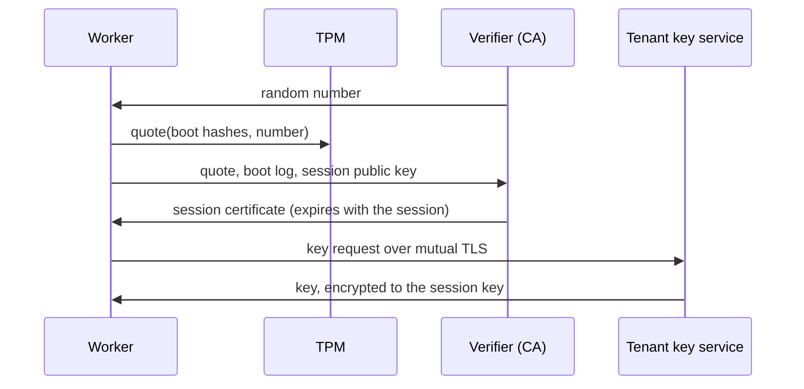
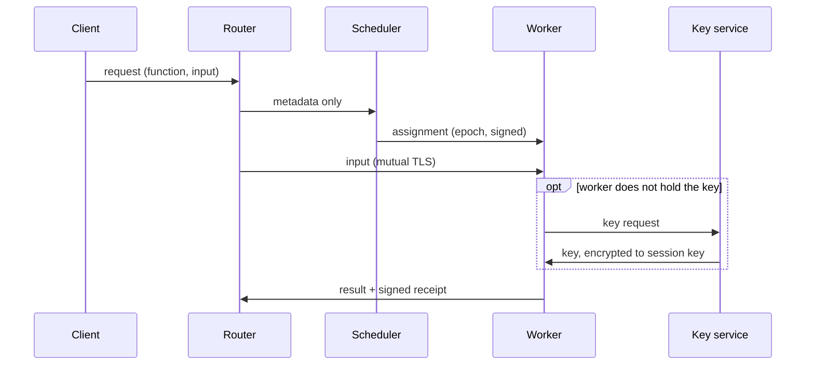

# VOSS, explained informally

Serverless computing on volunteer machines

*Companion to manuscript draft 12 (ACM TOIT format). Numbers are from the paper. The design questions behind this deck are in `docs/critique/CRITIQUE.md`.*

---

## The idea in four lines

- Short serverless functions spend most of their time **starting an environment** and **crossing the network**, not computing.
- Home and office computers are near users and idle most of the day. But owners **switch them off without warning**, and owners **cannot be trusted** with customers' code.
- **Remote attestation** (a machine proves which software it booted) means a hostile owner can only **stop or delay** the machine, not read or fake anything.
- What is left is a scheduling question: **which machines get each customer's key and ready environments, and when**. VOSS answers it with a planner every 30 s and a decision per request.

---

## Words used in this deck

- **Tenant**: a customer who deploys functions. **Invocation**: one call of a function.
- **Volunteer / owner**: owns a donated machine. **Worker**: that machine while it runs our software.
- **Sandbox**: a small virtual machine (Firecracker microVM) that runs one function. **Warm**: already started and idle.
- **Snapshot**: a saved copy of a started sandbox's memory; restoring it is faster than booting.
- **Session**: the time a machine runs our image, from boot until the owner switches off.
- **Key**: the tenant's decryption key for its code and snapshots.
- **P99**: the latency that 99% of requests beat.

---

# Part 1. Why this is hard

---

## Where the time goes

- Before a function runs: pick a machine, wait for a free slot, get the tenant's key if missing, start a sandbox, move the data.
- For a 50 ms function, **starting the sandbox dominates** unless one is already warm.
- A function on a machine is at one of four levels:
  - **L0** nothing there (fetch code, then boot); **L1** code on disk (boot);
  - **L2** snapshot on disk (restore); **L3** warm sandbox (just hand over the request).

---

## Two problems that feed each other

- **Churn**: the owner switches off at any moment, and everything prepared on the machine (warm sandboxes, keys) is gone.
- **Distrust**: the owner controls the hardware and operating system, so they could read the code, fake results, or quit at the worst time.
- The usual fix for distrust is to **check the machine first**, and the check takes time. Churn throws the check away every session.

---

## What trust costs (measured on a laptop)

```text
hand request to warm sandbox  ▏ 2 ms     (model value)
restore snapshot, file cached ▏ 7 ms
boot sandbox, file cached     ▍ 154 ms
TPM quote                     ▌ 506 ms
boot sandbox, hard disk       ▊ 1.5 s
create 512 MB snapshot        ██ 6.7 s
power-on to attested worker   █████████████ 65 s
```

- 65 s against milliseconds: trust must be set up **before** requests arrive.
- One laptop with a hard disk, so these are upper bounds.

---

## The network is slow too

- Volunteers are on home links, often Wi-Fi, with less upload than download. Model: median **100 Mbit/s down, about 30 Mbit/s up**, wide spread.
- File systems are 90–450 MB; snapshots 48–600 MB. A 600 MB snapshot from a neighbour's 30 Mbit/s upload takes **almost three minutes**.
- How VOSS copes:
  - the **planner prepares machines ahead of demand**, so transfers happen while nobody waits;
  - each request is charged the **fetch time over that machine's own link**, so a slow machine loses to a ready one;
  - workers fetch from **nearby workers before the registry**, and snapshots are **never downloaded from the registry**: made locally after the first boot, or copied from a neighbour.

---

## What exists, and what it misses

- **BOINC** runs each task several times and compares answers: costly, needs one right answer, shows the input to everyone, works in hours.
- **Serverless schedulers** (Azure keep-alive, FaasCache, Sparrow, Falcon) assume trusted machines that stay up.
- **Confidential computing** runs on provider servers and treats attestation as one-time setup.
- **Edge computing** already splits slow placement from fast scheduling (Tang et al. 2024, Farhadi et al. 2021), but it places services, not keys, on machines that do not vanish.
- **Heartbeats** (and adaptive versions such as phi-accrual) only show a machine is running, not that it returns work.

---

# Part 2. The key idea: attestation

---

## How attestation works

- While the machine boots, each stage (firmware, loader, kernel) is hashed into the **TPM**, a security chip on most PCs.
- The TPM **signs** those hashes plus a fresh random number. That signed object is a **quote**.
- The **verifier** checks the signature back to the chip maker and compares the hashes with our image.
- A quote shows what ran **at one moment**, so it is refreshed periodically. It says nothing about whether the machine will keep running.

---

## Attestation, certificates and keys



- The verifier is the **certificate authority**: it issues the certificate when the quote passes, sets its **expiry to the session's expiry**, and **revokes it when the session ends**.
- Every connection is **mutual TLS**: both ends show certificates.

---

## What attestation buys

- The owner **cannot run other software** (no certificate, no key), **cannot read or change** the image's memory or encrypted disk, and results are **signed by a key that never leaves the image**.
- What is left: **power and network**. The owner can stop the machine or delay it.
- Those are exactly the failures churn already causes. **One set of mechanisms covers crashes, churn and malice.**
- Limits: physical attacks on the TPM, reading memory of a running machine that does not encrypt memory, bugs in our image.

---

## Everything at the provider is encrypted

- The tenant **encrypts its code before uploading**. The registry, workers' disks and snapshots hold **only ciphertext**.
- The key goes **from the tenant's key service straight to an attested worker**, and lives only in that worker's memory.
- So if the provider's registry, database, router or broker is taken over, the attacker gets **ciphertext and metadata, not code or data**.

---

## Key exposure

```text
exposure of tenant t = sum over machines holding t's key of (1 − trust score)
```

- Every machine holding a key is one more place it could leak from. The **trust score** is a policy value: 0.8 for our TPM image on a consumer PC, 0.95 for a confidential virtual machine.
- It is a count of key holders, discounted by protection. Not a probability.

---

## If attested machines are honest, why limit exposure?

- **Honesty is conditional.** On consumer PCs the attacks we exclude (reading memory of a running machine, TPM firmware flaws, image bugs) are the realistic ones. Limiting exposure is the defence when attestation is not enough.
- **The two failures are not alike.** A faked result harms one request and can be caught by re-running it. A leaked key is **silent and permanent**: it decrypts every bundle and snapshot of that tenant, past and future.
- **It costs nothing measurable.** Removing it changes P99 by **0.02 s** (interval includes zero) and raises exposure. Dropping it would not make anything faster.

---

# Part 3. Who does what

---

## The parties

- **Router** (provider): the front door, described on the next slide.
- **Orchestrator** (provider): forms clusters and appoints each cluster's scheduler.
- **Verifier** (provider): checks quotes and issues and revokes certificates.
- **Registry** (provider): stores encrypted code. **Broker** (provider): carries messages inside a cluster.
- **Key service** (tenant): releases the tenant's key only to attested workers.
- **Workers** (volunteers): run functions in sandboxes. One of them may also act as the **scheduler**.

---

## What the router does

1. It is the **public entry point**: clients send requests to the nearest router.
2. It **chooses the cluster**, by distance, recent failures and whether workers there already hold the tenant's key.
3. It sends only the request's **metadata** to the scheduler and **keeps its own copy** until a worker confirms it started. If the scheduler does not answer within **1 s**, it resends or tries another cluster.
4. It **streams the input** to the chosen worker, **returns the result** to the client, and **checks and stores the signed receipt**.

- It never sees tenant keys.

---

## Two architectures we designed and compared

- **One global scheduler** on **provider hardware**: workers connect to its fixed address; failures handled by ordinary provider replication; the planner sees all machines.
- **Geographic clusters** of tens of machines, each with its own scheduler running **on one of its volunteer machines**: small planning problems, close to workers, no provider server per cluster.
- The scheduler is on a volunteer **only in the clustered design**.
- Experiment E05 compares them. At our scale **the global scheduler was faster**, even though the simulator hosted it on a volunteer (which favours clusters).

---

## Reaching a scheduler on a volunteer machine

- Home routers let machines connect **out** but not **in**, and home addresses change.
- **HTTP and gRPC need a server at a known address.** With thousands of volunteer-hosted schedulers changing machines, nothing like that scales.
- So the provider runs a **publish/subscribe broker** (MQTT): everyone connects **out** to it; each cluster has its own **topics**; the scheduler subscribes to its cluster's topic; routers publish to it.
- **Replacing a scheduler** = the new one subscribes to the same topic. No new address, no reconnection storm.

---

## Can the broker fake messages?

- MQTT itself does not protect against the broker (MQTT-I, 2024, studies exactly this).
- VOSS adds two layers: each connection to the broker is **mutual TLS**, and every control message is **signed end to end** with the sender's session key and carries the **epoch and a sequence number**.
- A worker accepts an assignment only from the **scheduler appointed for the current epoch** (we fixed a gap in the code where this was not checked).
- The broker can **drop or delay** messages, which the failure detectors already handle. It **cannot forge or replay**.

---

## Life of one request



---

# Part 4. Scheduling

---

## Why two loops: different clocks

| Input or decision | Changes or lasts |
|---|---|
| busy slots on a worker | milliseconds, reported every 2 s |
| request rate of a tenant | meaningful over about a minute |
| how long sessions last | learned over hours |
| assign one request | one request |
| keep a sandbox warm | minutes |
| give a worker a key | the rest of its session |

- A decision that **outlasts the refresh of its inputs** must be made from a forecast, ahead of time. A short one can react to the latest state.

---

## Why two loops: two more reasons

- **Some questions are about the whole set of machines**: "is demand still covered if any *f* machines vanish?" and "how many machines hold this key?" One request at a time cannot answer them.
- **Preparing a machine takes seconds to minutes**, more than a request can wait.
- So: the **planner** runs every 30 s and decides keys, warm sandboxes, snapshots and reserved slots. **Request placement** runs per request and picks a worker, mostly from those the planner prepared.

---

## Request placement: what it minimises

```text
J(i,j) = w · P_miss(i,j)  +  0.05 · E[time(i,j)]  +  added exposure(j)
```

- **P_miss**: chance that request *i* misses its deadline on worker *j*: *j* fails first, or the predicted finish is too late.
- **E[time]** breaks ties. **Added exposure** is non-zero only if *j* does not yet hold the key.
- Scale: 1 s of latency counts like a 5-point rise in miss chance; a new key holder with trust score 0.8 counts like a 20% miss chance.
- Why not minimise P99 directly? P99 describes many requests together; it cannot be assigned to one decision. The **average miss chance is the miss rate**.

---

## The planner: what it guarantees

- It cannot minimise misses directly: the requests do not exist yet, and misses depend on later placement.
- Instead it **keeps enough slots ready**: if requests arrive at random at rate λ and each takes *s* seconds, the number running at once is Poisson with mean λs. The planner provisions the **95th percentile** of that number.
- **Losing *f* machines**: after removing the *f* machines that contribute most, the expected slots left must still cover that number. Default *f* = a tenth of the cluster.
- Then it **minimises cost**: memory, disk, exposure, new key releases.

---

## The planner: how it works today (greedy)

1. Take tenants by how much they lose to cold starts.
2. For each, add workers one at a time, best **reliability × trust score per unit of memory and exposure**, until the "lose *f* machines" rule holds.
3. On workers holding the key, add warm sandboxes and snapshots by **start-up seconds saved per MB**.

- About **8 ms** per run. An exact integer program takes **4.1 s** and was **not measurably better**.

---

## The planner: what is weak, and the fix we designed

- The greedy rule values the **tenth warm sandbox as much as the first**, but the first serves most requests and the tenth very few.
- Fix (designed, not yet run): treat each tenant's ready slots as an **Erlang loss system**, where a request that finds all slots busy takes the slow path.
  - The chance of finding all busy depends **only on the mean run time**, and each extra slot helps **less than the previous one**.
  - Warm sandboxes: allocate by **marginal gain per MB** (optimal for such diminishing returns).
  - Key holders: **greedy selection with a (1 − 1/e) guarantee**, protected against the *f* worst losses.
- Details: `docs/proposals/planner-v2.md`.

---

## What the scheduler knows

- **Reported** by workers every 2 s: busy slots, what is cached, which keys they hold, certificate expiry.
- **Learned** from past outcomes: session length, chance of dropping work, run time.
- **Forecast**: next minute's request rate.
- **Fixed** before the run: start-up costs, network delays, machine speeds, weights.
- **Never seen**: when a session will really end, real run times, real behaviour, future requests.

---

## How it learns (1/2)

- **Session length → Weibull distribution**, per class of machine.
  - Why: volunteer sessions are heavy-tailed, and a machine that has been up an hour is less likely to leave in the next minute. A Weibull captures that with two numbers and handles still-running sessions.
  - Not Kaplan–Meier: needs many more finished sessions and says nothing past the longest one seen.
- **Chance of dropping work → Beta distribution**, per worker.
  - Why: each accepted request either comes back or not; a Beta is updated with two counters, and its prior stops a new worker being judged on one or two outcomes.
  - Plus a **CUSUM change detector** to catch a worker that behaves and then starts dropping work, faster than a sliding window.

---

## How it learns (2/2)

- **Run time → Bayesian linear regression** on log run time and log input size, per function, with a small correction per worker.
  - Why linear in logs: run time grows roughly as a power of input size.
  - Why Bayesian: it must work from a handful of samples; the prior comes from the benchmark profile.
  - Not Gaussian processes or BART: they help only for clear non-linearity, need more data, and are too slow for a millisecond decision.
- **Request rate → two moving averages** (1 min and 15 min), take the larger.
  - Why the larger: an idle warm sandbox costs memory, a missing one costs a cold start.
  - Not seasonal models: they need days of history a new tenant does not have.

---

## Duplicates, retries and idempotence

- If the best worker's miss chance is above **0.2**, send a **duplicate** to a worker in another city or provider, and cancel the slower copy. At most **10%** of requests.
- A lost request is placed again, excluding the failed worker.
- Both only for **idempotent** functions (calling twice = calling once). Others report a failure.
- This matches industry: AWS, Google, Azure and Cloudflare deliver **at least once** on event-driven paths, and the client retries on direct calls, so developers are told to write idempotent code anyway.

---

# Part 5. Failures

---

## Judging machines by returned work

- A **heartbeat** only says "I am running". A machine can keep sending it while discarding work.
- So VOSS checks whether **work it accepted comes back**, as seen by the router (provider hardware) or the scheduler (attested code).
- **Router timer**: scheduler did not acknowledge in 1 s → suspect the scheduler.
- **Scheduler timer**: no result by the predicted time (at least 3 s) → probe and suspect the worker.
- **Slow scheduler**: placement slower than 200 ms → replace it.

---

## Replacing a scheduler without voting

- The orchestrator **increments the cluster's epoch** atomically and appoints a new scheduler, naming its certificate.
- Workers accept assignments only from the **current epoch and appointed certificate**; an old scheduler still running is shut out.
- The new scheduler **asks the workers** what they are running and what they hold, restores its estimates from a 30 s copy, and plans again.
- A scheduler cut off from the orchestrator for 5 s stops by itself.

---

## Receipts and credit

- Each result carries a **receipt signed by the worker's session key**: request, worker, epoch, run time, work done, output hash.
- A worker **cannot claim work it did not do**.
- **Credit** pays donors for benchmark work done, not elapsed time.
- A separate **reliability score** records whether owners keep their promises (e.g. a promised all-night session). It only breaks ties.
- No blockchain: signed receipts can already be checked by anyone.

---

# Part 6. Evaluation

---

## How we tested it

- A **deterministic simulator**: thousands of machines, controlled churn and adversaries, identical worlds for every system compared.
- The **policies are the real code**; the world (network, churn, adversaries) is a model.
- **Nothing is free**: network, disk, TPM, key release and decision time all cost simulated time.
- **Calibrated** on one laptop (i3-7020U, TPM 2.0, hard disk). **Checked** against real microVMs on one lab machine (E01): success and start-up mix match, the latency distribution's shape only partly.
- 10 seeds per setting, paired; hypotheses and pass/fail rules written **before** the runs.

---

## Results: where it works

- With a **3 s P99 target**, VOSS works in **9/9** churn × adversary settings, **13/16** trust-technology × load settings, **10/12** population × load settings. The best simple baseline: **none**.
- Where it does not: on **confidential virtual machines at high load**, the simple baseline wins; with **100 workers**, nothing works.

---

## Results: planning and failures

- **Planner vs no planner**: P99 **−54%** (medium churn), **−59%** (high). **vs 10-minute keep-alive**: −27%, −57%.
- Caveat: a stronger single-loop rule (learned keep-alive plus predicted pre-warming) was not tested.
- **20% of owners dropping work**: VOSS keeps **99.95%** success; heartbeat-only detection **96.8%**.
- **Scheduler discarding requests**: found in **4.2 s** by returned work, **60 s** by heartbeats.

---

## Results: what did not pay off

- **Geographic clusters**: P99 **17% higher** than one global scheduler in Europe, and 5× the exposure.
- **Exact solver**: not measurably better than greedy.
- **Smart caching** and the **reliability score**: a few percent at most.
- **Commercial-style datacenter reference**: still faster; VOSS is cheaper only above about 20 requests per second.

---

## Limits

- Simulation only, partly checked on one machine; one calibration laptop.
- Assumed churn and workload: 6 tenants, 12 functions, 11 marked idempotent by us.
- The scheduler takes start-up and network costs as exact.
- Network modelled as delay: broker capacity, reconnection and message signing are not simulated.
- Ten seeds give wide intervals for P99.

---

## What comes next

- Implement and test the **loss-model planner** against greedy, the exact solver and a **strong single-loop baseline**.
- A **small real testbed** with network, attestation and failover.
- Compare **volunteer-hosted and provider-hosted schedulers** under a load that stresses one scheduler.

---

## Takeaways

- Attestation turns hostile owners into **unreliable** ones.
- The problem left is **planning keys and warm sandboxes** that are slow to set up, lost every session, and a leak risk on every extra machine.
- **Plan ahead, place per request, judge machines by returned work.**
- A large win from planning; several designed parts did not pay off, and the paper says so.
