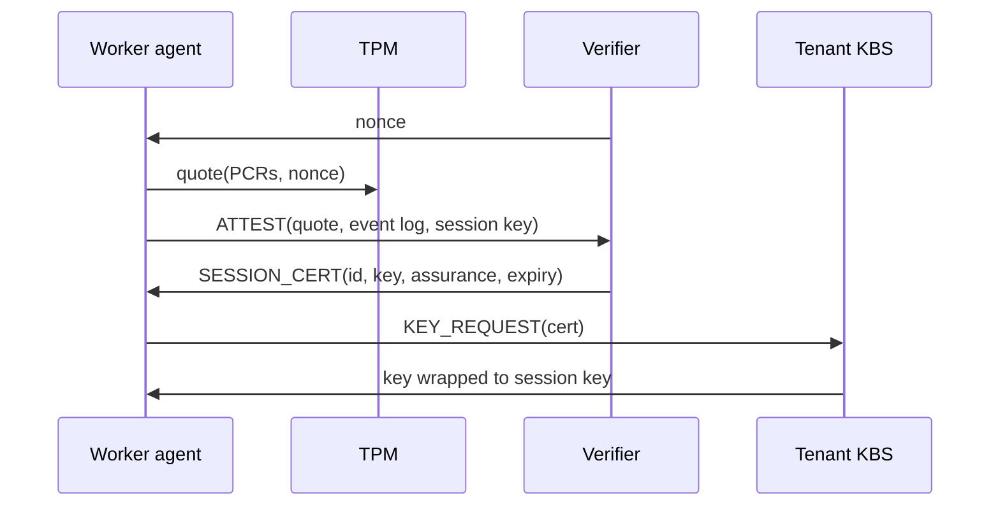
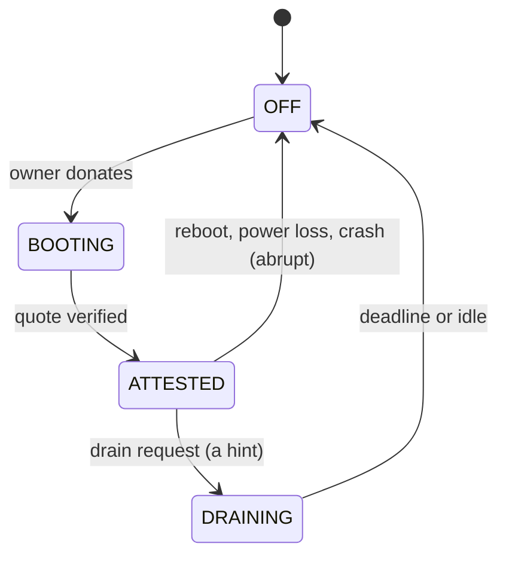
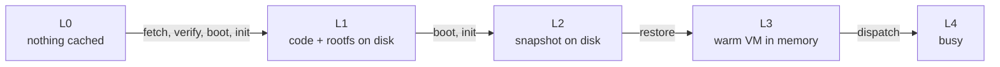
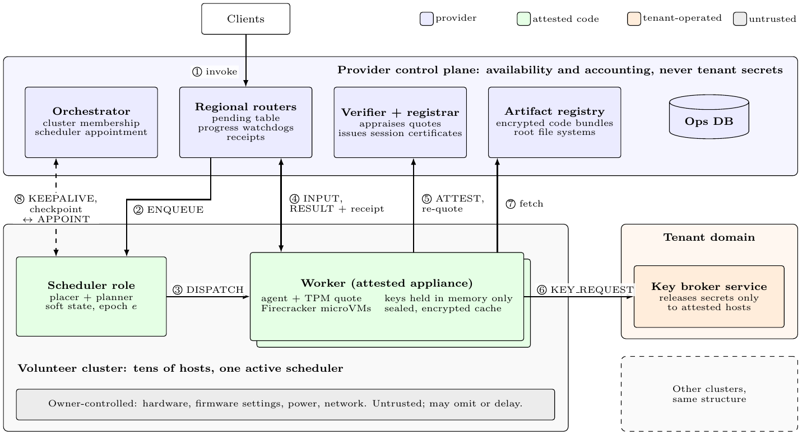
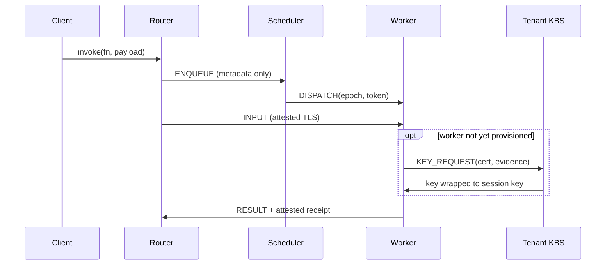
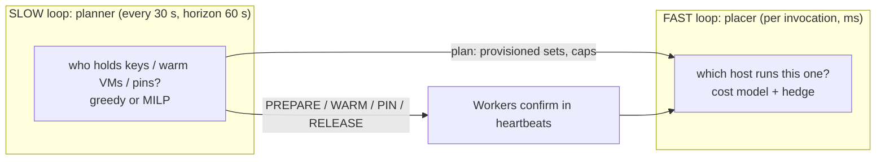
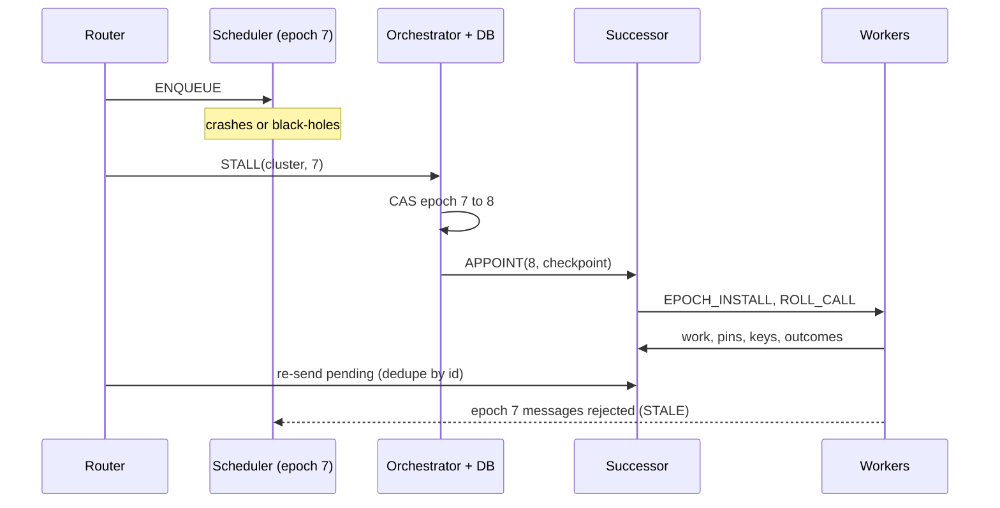
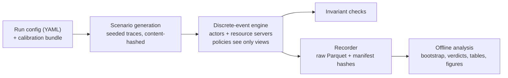

# VOSS, explained informally

Scheduling attested session state for serverless computing on volunteer machines

*Companion to the manuscript (draft 7). Every number here is from the paper.*

---

## TL;DR

- Serverless functions are short, so **cold starts and distance** dominate latency.
- Idle consumer PCs are close to users, but owners **leave abruptly** and are **untrusted**.
- **Attestation** turns a malicious owner into an unreliable one (omit or delay only).
- What is left is a scheduling problem: **where to keep keys and warm state**. VOSS solves it with a slow loop and a fast loop.

---

## How to read this deck

- Order: **motivation → what exists → why we need something new → design → evaluation → honest limits**.
- One idea per slide, 3–4 bullets max.
- Results include the **negative ones**: the paper reports them on purpose.
- Everything is from **simulation**, calibrated on one laptop.

Note: Sections are marked with a single `#` title slide.

---

# Part 1. Motivation

---

## Serverless (FaaS) in one slide

- A developer uploads a function. The platform runs it **on demand**.
- Most functions finish in **well under a second**.
- So the time a user waits is **not computation**.
- It is **cold start** (create a sandbox, load the runtime) plus **network distance**.

---

## Where latency goes

```text
T = T_route + T_decide + T_queue + T_prov
  + T_start + T_net + T_exec + T_retry
```

- `T_prov`: make the host able to read this tenant's code (provision a secret). Zero if already done.
- `T_start`: bring a sandbox to the point of running the function.
- For functions of tens to hundreds of ms, **`T_start` dominates** unless a sandbox is already warm.
- VOSS logs every term separately per invocation.

---

## The datacenter fix and its price

- Providers **keep sandboxes warm** (keep-alive) or restore them from snapshots.
- Warm sandboxes **pin memory around the clock**.
- Meanwhile, consumer desktops and laptops are **numerous, near users, and idle most of the day**.
- Idea: serve latency-sensitive functions from them.

---

## Volunteer computing already exists

- BOINC / SETI@home-style systems harvest idle machines for **two decades**.
- But only for **batch work**, deadlines in **hours or days**.
- A function that runs for **milliseconds** is a different problem.
- Two things break.

---

## Problem 1: churn

- An owner can power off, reboot or reclaim the machine **at any moment**.
- When the session ends, **everything the platform built on the host disappears**:
  - warm sandboxes
  - provisioned secrets
  - (disk caches survive only as ciphertext)
- For a 50 ms function, **rebuilding that state is the dominant cost**.

---

## Problem 2: distrust

- The owner controls hardware and OS.
- They can **read tenant code and data**, **forge results**, or **defect at the worst moment**.
- The usual defense: **establish trust in a host before using it**.

---

## The two problems interact

```text
host joins ──► establish trust (slow) ──► run work
                         ▲                    │
                         └──── session ends ──┘
                       (churn destroys the trust)
```

- Trust is paid **per session**, not once.
- Short sessions mean you pay it often.

---

## How expensive is "trust"? (measured)

```text
resume warm microVM         ▏ 2 ms     (model value)
restore snapshot, warm      ▏ 7 ms
boot microVM, warm cache    ▍ 154 ms
TPM quote                   ▌ 506 ms
restore snapshot, cold HDD  ▌ 627 ms
boot microVM, cold HDD      ▊ 1.5 s
create 512 MB snapshot      ██ 6.7 s
reboot to kernel            ██████ 21 s
reboot to attested worker   ████████████ 44 s
```

- Log scale in the paper (Fig. 1). **44 s vs milliseconds**: 3–4 orders of magnitude.
- Hence trust **cannot be set up on the per-request path**.

Note: Measured on one laptop (Core i3-7020U, discrete TPM 2.0, hard disk). Median of 9 boots for the 44 s.

---

# Part 2. What exists, and why it falls short

---

## 1. Volunteer computing (BOINC)

- Handles untrusted hosts by **replicating** the task and voting on the result.
- Cost multiplied by the replication factor.
- Needs **deterministic, side-effect-free** tasks.
- Protects integrity, **not confidentiality** of inputs. Timescale: hours.

---

## 2. Serverless schedulers and keep-alive

- Decide when to keep sandboxes alive, pre-warm, or use lighter sandboxes and snapshots.
- Assume **trusted, always-on servers**.
- A warm sandbox is lost only by **policy**, never because an owner closed the lid.
- No concept of a **provisioned secret** as a resource.

---

## 3. Harvested and edge serverless

- Run on **harvested datacenter VMs** (evictions) or near users (edge).
- Hosts are operated by the provider or a **trusted party**.
- Failure model: **eviction**, not silent omission by an adversary.
- No secret is handed to a party that might read it.

---

## 4. Confidential serverless (TEEs)

- Use trusted execution to protect functions **from the platform operator**.
- Target **provider-managed server hardware**.
- Treat attestation as a **one-time deployment step**.
- Not as a resource with a **cost, a lifetime and a security price**.

---

## 5. Trusted components and failure detection

- Small trusted components (TPM-like counter/log) cut the replication needed for Byzantine agreement.
- VOSS uses attestation differently: it makes the faulty node **non-Byzantine**, so we can **skip agreement among volunteers**.
- **Heartbeats** infer liveness, not **progress**. A host can heartbeat while dropping work: a **gray failure**.

---

## Coverage of required properties

| Approach | Untrusted hosts | Churn | Latency SLOs | Plans trust + warm state | Gray failures | Verifiable accounting |
|---|---|---|---|---|---|---|
| Volunteer computing | • | • | | | ◦ | ◦ |
| Serverless schedulers | | | • | ◦ | | |
| Harvested serverless | | • | • | ◦ | | |
| Confidential serverless | • | | • | | | |
| Trusted-component FT | • | | | | | |
| **VOSS** | • | • | • | • | • | • |

• addressed, ◦ partly, blank = not addressed. *The assessment is ours (paper Table I).*

---

# Part 3. The insight

---

## The key observation

- Run tenant code **and** scheduler code only inside a **measured, owner-locked appliance image**.
- A verifier checks **TPM-backed evidence** that this exact image booted.
- Then a hostile owner **cannot read, forge or tamper**.
- What is left: the host **powers off, drops, delays or throttles**.

---

## Why that matters

- Those are **omission and timing failures**.
- That is exactly the class churn **already forces us to tolerate**.
- So **one set of mechanisms** covers crashes, churn and malice.
- Redundancy is **no longer needed for integrity**.

---

## Attestation in 30 seconds

```text
boot stages ─hash─► TPM PCRs
verifier nonce ─► TPM signs (PCRs, nonce) = quote
verifier: check signature + cert chain,
          replay event log vs known-good values
KBS (tenant key broker): release secret only to an acceptable host
```

- Quote shows what booted **at one moment**: evidence **goes stale**, must be refreshed.
- Attestation says **nothing about availability**.

---

## Attestation and key provisioning



- The **session key is bound into the quote**: certificate tied to this appliance instance.
- Certificate expires at the earlier of session end and last quote + validity.

---

## Property 1 (threat reduction)

- Owner **cannot run other code**: it fails attestation, so no certificate and no key.
- Owner **cannot read or modify** the image's memory or sealed state.
- Results and receipts are **signed with a key that never leaves the appliance**.
- Owner **keeps only**: power, network path, and **when to stop answering**.

---

## What we trust, and what is out of scope

- **Trusted:** CPU, TPM, memory encryption, the measured image, each tenant's own key broker, the provider control plane (for availability and accounting only).
- **Out of scope:** physical attacks on the TPM, bugs in the appliance, side channels, control-plane failure.
- **If attestation breaks, the robustness results no longer hold.**

---

## So the real problem is "attested session state"

- **Session**: the host booted and attested. Costly (44 s), **perishable** (lost at session end).
- **Provisioned** `K[t,j]`: tenant *t*'s key is on host *j*. **Exposing**.
- **Warm state**: sandbox or snapshot ready. Costs memory or disk.
- Three properties **conventional schedulers do not model**: costly to establish, perishable, exposing.

---

## Session lifecycle



- Session end loses the key set **K** and all warm VMs.
- Disk caches survive as **ciphertext**, valid after next attestation.

---

## Start-up tiers of one function on one host



- Higher tiers cost memory or disk. Deciding **who keeps what where** is itself a scheduling problem.
- The key flag `K[t,j]` is **orthogonal**: needed to decrypt cached L1–L3 artifacts.

---

## Exposure: the security price of warm state

```text
E_t = Σ over hosts j holding t's key:  (1 − a_j)
```

- `a_j` ∈ [0,1] is the host's **assurance** (substrate base × firmware-policy factor).
- More key holders means a **bigger attack surface**.
- It is a **proxy for attack surface**, not a probability of compromise. Base assurances are **policy parameters**.

---

# Part 4. The VOSS design

---

## Goals and non-goals

- **G1** Confidentiality and integrity: no secret leak, no forged result.
- **G2** Latency under churn.
- **G3** Liveness under omission, **without trusting liveness signals**.
- **G4** Verifiable accounting.
*Non-goals: physical TPM attacks, appliance bugs, side channels, control-plane failure. Invocations are independent (DAGs: later).*

---

## Three design principles

- **P1** Attestation turns distrust into unreliability.
- **P2** Trust is a **managed resource** with a cost, a lifetime and an exposure price. Planned on a slower timescale than placement.
- **P3** Liveness is a **hint**; **progress is evidence**.

---

## Architecture



*Numbered flows follow one invocation (next slides). Dashed/8 = control traffic off the hot path.*

---

## Who is trusted for what

| Role | Runs on | Trusted for | Not trusted for |
|---|---|---|---|
| Router | provider | availability, accounting | tenant secrets |
| Orchestrator, verifier, DB, registry | provider | availability, accounting, appraisal | tenant secrets |
| Tenant KBS | tenant | releasing secrets per policy | availability of volunteers |
| **Scheduler role** | attested worker | correct placement | **availability** (host may omit) |
| **Worker** | volunteer, attested | executing code faithfully | availability |

---

## The scheduler is a role, not a machine

- The **same image** runs on every worker.
- So any worker can be **promoted with no boot**.
- One worker per cluster (tens of hosts) is appointed scheduler.
- Its code cannot misbehave, but **its host can still omit or delay**. We handle that with failover (later).

---

## Life of one invocation



- Scheduler **never sees payloads, results or keys**.

---

## Six rules for state and communication

- Every cross-node interaction is a **typed message**. Actors never call each other.
- Ops DB is **private to the control plane**; the **hot path never touches it**.
- **Live state stays where it is born** (queues in routers, keys in workers). After a scheduler change, recover by **asking workers**.
- Routers write the **ground truth of work** as attested receipts. Every channel terminates in an attested party.

---

## Two timescales: why one scheduler is not enough

- **State is set-valued and long-lived**: a key stays for the whole session; exposure depends on *how many distinct hosts*.
- **Robustness is a worst case over subsets**: "does demand survive losing any *f* hosts?" is a property of the whole set.
- **Establishing state takes seconds to tens of seconds**: must happen **ahead of demand**.
- Placement is latency-critical and decomposes, so it stays cheap.

---

## The two loops



- Placer uses only **confirmed** state: never counts on a host that is not yet warm.

---

## Common misreading: "it minimises SLO violations"

| | Minimises | SLO violations? |
|---|---|---|
| **Fast loop** | per-invocation cost `J` | **Yes**, per invocation |
| **Slow loop** | cost under a **coverage constraint** | **No**, by design |
| Router | expected completion time + penalties | Partly |

- We *report* violations everywhere. The **planner** minimises something else, on purpose (next slides).

---

## Fast loop: what it minimises

```text
J(i,j) = w_i · P_miss(i,j) + ε · E[T_ij] + λ_exp · x_ij

P_miss = p_fail + (1 − p_fail) · P(T_ij > remaining budget)
x_ij   = σ_t · (1 − a_j)   if j lacks t's key, else 0
```

- Defaults: `w=1` sync, `0.3` async/filler, `ε=0.05 /s`, `λ_exp=1`.
- Units = **violation-equivalents**: 1 s of latency ≈ 5 points of miss probability. A new key holder of assurance 0.8 costs 0.2 = a **20% chance** of a violation.
- **A failure counts as a violation.**

---

## Why per-invocation miss probability, not P99

- **P99 is a population statistic**: it cannot be attributed to one decision.
- The mean of per-invocation miss probability **is** the deadline-miss rate; its tail drives P99.
- Alternatives (expectation, quantile, CVaR, tardiness) are compared in an ablation (**E03**).

Note: Result of E03: distribution-aware (quantile) beats expectation-only at high churn by 2.8% (weak).

---

## Slow loop: what it minimises

```text
min   Σ Λ_t·u_t                  uncovered demand (priced)
    + donor memory + SSD cost
    + λ·Σ σ_t (1 − a_j) y_tj     key exposure
    + ν·Σ |y − y_prev|⁺          plan churn
    − β·Σ b_f (w + γ s)          warm-start benefit
```

- `y` = who holds the key; `s` = pinned snapshots; `w` = warm VMs; `c` = earmarked slots.
- **Constraint:** robust coverage (next slide).

---

## Robust coverage

```text
Σ_j e_j·c_tj  −  (sum of the f_t largest c_tj)  +  u_t  ≥  q_t
e_j = S_j(H) · (1 − p_j)        survival × not-omitting
```

- Demand quantile `q_t` must be covered **even if the *f* largest allocations vanish**.
- Default `f_t = ⌈0.1·N_cluster⌉`, `q_t` = 95th percentile.
- **No probability model of adversaries**: holds against hosts with a perfect record (an adversary who builds a clean history first).
- Stays **linear** (LP duality), so a MILP can solve it.

---

## Why the planner does *not* minimise violations

- **Circular**: violations depend on the placer's later choices, which depend on the plan (bilevel).
- **No per-request info** at planning time. Only a demand forecast.
- **Rare, noisy events** (1–5%): a count-based objective has high variance.
- **Warming everything** would minimise violations but put every key on every host. The scarce resources are **memory, disk and exposure**.

*No plan can guarantee a deadline under churn and adversaries; coverage against any f defectors is the strongest model-free statement.*

---

## How coverage still serves the SLO

- Arrivals ~ Poisson(`λ_t`), service time `s_t` ⇒ concurrent runs ~ Poisson(`λ_t·s_t`) (M/G/∞).
- `q_t` = its 95th percentile ⇒ 95% chance every invocation **starts immediately** on a provisioned host.
- This bounds invocations forced onto the **unprovisioned path**, the main cause of violations.
- Uncovered demand is priced at **Λ=10/slot**, far above memory (0.05 per 512 MB VM) and exposure (~0.2 per holder).

*Caveat: simulated arrivals are bursty, so realised coverage is **below 95% in bursts**. A design rationale, not a theorem.*

---

## The greedy planner (the default)

1. Sort hot tenants by **demand × cold-start penalty**.
2. For each tenant, repeatedly add the host with the best  
   `S_j (1 − p_j) · a_j  /  (memory cost + exposure cost)`  
   (respecting assurance floor and failure-domain cap) **until coverage with the *f* largest removed ≥ q_t**.
3. Then add warm VMs and snapshots by **value density** until budgets bind.

*Hot set: top **20 tenants / 50 functions**; the long tail stays on the cold path. Solve time: **8 ms**.*

---

## Greedy vs exact MILP

- MILP (HiGHS): joint optimum, warm-started, falls back to greedy. **4.1 s** per cluster.
- **Pre-set kill rule:** if MILP improves P99 by **< 5%** over greedy in **all** regimes, greedy is the method.
- Result: **1.8%** at medium churn; **8.1%** at high churn but the interval **includes zero**.
- Verdict **inconclusive**. We **do not claim the rule is met**; greedy stays the default (chosen before the runs).

---

## The placer in practice

- **Candidates:** best K = **12** hosts from confirmed provisioned ∪ cold path (other attested hosts).
- **Infeasible if:** draining, session would expire within 5 s of predicted finish, assurance below floor, no memory.
- **Sync:** pick lowest `J`. **Async/filler:** min-cost flow per small window.
- **Retries:** re-place with failed host excluded, within budgets.

---

## Hedging and admission

- **Hedge** if best `P_miss > θ = 0.2`, function is idempotent and **budget (10% of placements)** allows.
- Duplicate goes to a **different failure domain**; loser is cancelled on first result.
- **Receipts** make duplicates integrity-safe.
- **Admission:** reject sync (defer async) only under true overload. Cold-start-only misses are admitted since they warm caches.

---

## Estimators: what is learned from history

| Quantity | Method |
|---|---|
| Session survival `S_j(τ)` | **Weibull** per tier, censored max-likelihood; hour-of-day hazard later |
| Omission `p_j` | **Beta posterior** + **CUSUM** change-point (defeats on–off hosts) |
| Execution time | **Bayesian log-linear** regression per function, forgetting 0.995, conformal spread |
| Arrival rate | EWMAs (τ = 60 s, 900 s), max of both and regional rate |

- Drain notices only **shorten** predicted life (they may be fake).

---

## History vs forecast vs assumed

- **O** observed (heartbeat every 2 s, trusted router), **H** learned from history, **F** forecast, **C** calibrated constant, **P** policy.
- **Slow loop** is mostly **forecast**: demand and survival over 60 s.
- **Fast loop** is mostly **observation** (a few seconds old); only run time, short-horizon survival and omission are learned.
- **Speculative parts = C:** start-up costs, network times and declared host speeds are **assumed exact**.
*Never used: true session end, true run time, future arrivals, others' true state. `voss.policy` cannot import the simulated world (enforced statically).*

---

## Clusters and routing

- Orchestrator groups workers into clusters of **tens** (k-medoids on RTT), appoints one scheduler each.
- Router scores each cluster:

```text
score(c) = rtt + overhead + backlog
         + health·max(0, miss_rate − θ)
         + [no provisioned capacity] + cold_start(f)
```

- Spillover to another cluster is a **priced** decision. (Spoiler: geo-clustering does not pay off here.)

---

# Fault tolerance and accounting

---

## The progress principle

- Liveness signals from untrusted hosts (heartbeats, drain notices, self-reported health) are **hints**.
- **Progress seen by a trusted or attested observer is evidence.**
- Hard cases: **black hole** (heartbeats look healthy), **on–off** (clean record first), **fake drain**.

---

## Progress-based detectors

| Detector | Observer | Suspects |
|---|---|---|
| Dispatch watchdog (1 s) | router: ENQUEUE without ACCEPTED | scheduler |
| Result watchdog | scheduler: no RESULT by q90 × 1.2 (≥3 s) | worker |
| Cluster stall | 3 watchdog fires in 5 s | scheduler |
| Decision latency | orchestrator: > 200 ms | slow scheduler |
| Outcome rate | scheduler: CUSUM change point | worker |
| Heartbeat | scheduler | **crash only** (fast path) |

---

## Scheduler failover without consensus



---

## Why no consensus among volunteers

- Replicated state machines on possibly adversarial hosts: **slow** and reintroduce an agreement problem.
- Instead: the **provider orchestrator is a reliable arbiter** (compare-and-swap on the epoch, like a lease).
- Workers accept dispatches only from the **current (epoch, certificate)**. Lower epoch gets `STALE` (a fencing token).
- A partitioned scheduler can only cause **duplicate work**: within at-least-once semantics.

---

## Scheduler state is soft

| State | Held by | Recovery |
|---|---|---|
| Undispatched invocations | router | router resends |
| Running/queued work | workers | roll call |
| Plan (provisioned sets, pins) | workers + checkpoint | roll call, recompute |
| Estimators | checkpoint (every 30 s) | checkpoint, replay |
| Work records | router receipts | nothing to recover |

- Nothing authoritative lives on the old host.

---

## Receipts and credits (no blockchain)

- Each result carries a **receipt signed with the session key**: ids, worker, epoch, execution time, work units, output digest.
- A host **cannot claim work it did not do**; it can only decline (an omission).
- Credits ∝ **reference work units**, not elapsed time: throttling earns nothing.
- **No blockchain**: receipts are already third-party verifiable; the remaining risk (control plane deleting records) fits a signed transparency log (future work).

---

# Part 5. How we evaluated it

---

## Why a simulator

- Thousands of hosts, **controlled churn and adversaries**, and **paired comparison** of policies cannot be run on real machines.
- Custom **discrete-event simulator**, Python 3.11, single-threaded, kernel < 70 lines (heap ordered by time, sequence).
- Policies are the **real code**; the world (network, churn, adversaries) is a **model**.
- No SimPy: one **total event order** makes runs exactly repeatable.

---

## Simulation pipeline



- Systems compared on one seed face **identical worlds** (common random numbers).

---

## Nothing is free

- Network delays from great-circle distance (~100 metro areas, 100 km per ms, ×1.3) plus jitter.
- Disk tiers, CPU contention, **TPM quotes, key release** cost simulated time.
- **Decision latency** of planner, placer, router, orchestrator is modelled as `a + b·work`, so results do not depend on the simulating machine.
- Invariants: every success ran on an attested host after key release; one terminal outcome each; no stale-epoch dispatch.

---

## What is simulated, calibrated, assumed

| Class | Content |
|---|---|
| Simulated (emergent) | queueing, contention, caches, session boots, attestation, failures, detection, failover, hedging waste |
| **Calibrated** (measured) | start-up/snapshot times, TPM quote, boot times, disk speeds, function work |
| Literature (swept) | confidential-VM and DRTM costs |
| **Assumed** (swept) | churn, adversary fractions, arrival intensity, assurance bases, objective weights |

---

## Calibration: one laptop

- Intel Core **i3-7020U**, discrete **TPM 2.0**, **hard disk** (stands in for a donor node).
- TPM quote **0.51 s** (placeholder 0.25), snapshot create **6.7 s** (placeholder 0.2), kernel start to agent **31 s** (placeholder 4).
- Reboot to attested worker **44 s** (median of 9).
- **Limits:** not the intended donor node; no SEV-SNP/TDX; appliance run in **host mode**, so the 44 s is a measured *sum*.

---

## Statistical protocol

- Every cell: **seeds 1–10** (3 for the two largest scale points).
- **Paired by seed**; mean difference with **95% percentile bootstrap** interval.
- Hypotheses and verdict rules **fixed before the runs**: *supported / weak / inconclusive / refuted*.
- A generator **fails the build** if a result stops supporting the manuscript sentence.

---

## Metrics and "feasible"

- Success, deadline-met fraction, P50/P99 sync latency, **waste**, donor memory, key exposure.
- **Feasible cell** = lower 95% bound of success ≥ 0.99 **and** (deadline-met bound ≥ target **or** P99 below 2/3/5 s).
- Feasibility **maps** say *where* a design works, not an average.
- Deadline `D = 5 × (warm latency + 0.05 s)` for sync functions.

---

## Baselines

- Planning: **none** (reactive), **keep-alive TTL**, **greedy**, **MILP**. Detection: **heartbeat-only**. Robustness: **f = 0**.
- **Simple baseline**: static regions, nearest routing, least-loaded placement, keep-alive, no hedging. Plus an **unattested** variant.
- **Commercial-style references** (Lambda-like, Azure-like): always-on datacenter hosts, priced from list prices, same engine.
- Baselines use the **same candidates and cost matrix**.

---

## Reproducibility

- A run = function of **scenario + seed**; each carries a SHA-256 result hash.
- Needed: **x86-64 with FMA**, Linux + glibc, Python 3.11, locked deps, **NumPy SIMD pinned to SSE4**.
- Why: NumPy's `exp`/`log` differ in the last bit between AVX-512 and AVX2; a last-bit flip changes a near-tie placement, then the whole run.
- Verified: pinned probe identical on **4 CPU models, 2 Ubuntu releases**; full sweep re-run: **2,366 of 2,366** hashes match.

*ARM and other platforms: only the **statistical** claim is portable.*

---

# Part 6. Results

---

## Research questions

- **RQ1–2** What does trust cost per substrate? Where is volunteer FaaS **feasible**?
- **RQ3–4** Does planning attested session state pay? Does progress detection make malice look like churn?
- **RQ5–6** What do robustness and exposure cost? Which components do **not** earn their complexity?
- **RQ7** How does VOSS compare with simple baselines, a commercial reference, and at scale?

---

## RQ1: trust cost per substrate (simulated, s)

| Substrate | Session | L0 | L2 | L3 |
|---|---|---|---|---|
| appliance (TPM) | **19.2** | 1.45 | 0.0285 | 0.002 |
| DRTM hypervisor | 2.31 | 1.44 | 0.0284 | 0.002 |
| CVM (SEV-SNP) | 1.41 | 2.31 | 0.155 | 0.002 |
| CoCo pool | 8.11 | 2.25 | – | 0.002 |
| no attestation | 1.06 | 1.45 | 0.0278 | 0.002 |

- Appliance pays **once per session**, then is **as fast as unattested Firecracker** (warm/snapshot within a few %). H5 supported.
- "CVMs are 10–100× slower to establish" was **refuted**: they are ~93% faster.

---

## RQ2: feasibility, the headline

- At a **3 s sync P99 target**, VOSS is feasible in **9/9** cells (churn × adversaries), **13/16** (substrate × load), **10/12** (population × load).
- The strongest simple baseline: **none**.
- At 5 s: VOSS feasible in **9, 16, 10** cells.
- **Only VOSS feasible** (default criterion): 9/9, 9/16, 4/12 cells.

---

## RQ2: where VOSS is *not* the right choice

- On **confidential-VM / CoCo substrates at high load**, the **simple baseline is the only feasible system** in 4 cells. Conjecture (untested): cheap sessions leave little cold-start cost to plan away.
- With **100 workers**, **no system is feasible** in any cell: a minimum population is needed.
- At a **0.98 deadline-met target**, nobody is feasible anywhere.

---

## Feasibility map (VOSS sync P99 in s)

```text
(a) churn × adversaries          none   a=0.1  a=0.2
    low                          1.3    1.3    1.5
    med                          1.5    1.4    2.1
    high                         1.3    1.4    1.5

(b) substrate × load (inv/s)      5     10     20     40
    appliance_tpm                1.3    1.4    1.5    2.1
    drtm_hv                      1.4    1.4    1.9    2.4
    cvm_snp                      2.2    2.2    2.5    2.9
    coco_pool                    2.8    3.6    4.6    4.0
```

---

## RQ3: planning pays

| Planner (sync P99) | vs no planning | vs keep-alive TTL |
|---|---|---|
| Greedy, medium churn | **−54%** | −27% |
| Greedy, high churn | **−59%** | −57% |
| MILP, medium / high | −54% / −63% | −29% / −60% |

- **H1 supported.** Cost: MILP holds ~**2.1× the warm memory** of keep-alive at medium churn (129 vs 61 GB).
- Planning is **one of the two largest levers**.

---

## RQ3: ablation, who matters

```text
removing a component → change in sync P99
lifecycle-aware placement   +3.3 s   (largest)
planning                    +1.1 s   (exposure −31)
robust coverage             +0.8 s   (exposure −24)
hedging                     +0.3 s
geo-clustering              −0.09 s  (improves!)  exposure −34
```

- The components that **buy P99 also raise exposure**.
- Geo-clustering is the **only** one whose removal improves things.

---

## RQ4: scheduler faults

| Fault | Detector | Detect (s) | Success |
|---|---|---|---|
| crash | progress | 2.2 | 99.95% |
| crash | heartbeat-only | 5.0 | 99.87% |
| **black hole** | **progress** | **4.2** | **99.95%** |
| **black hole** | **heartbeat-only** | **60** | **96.81%** |
| slow scheduler | progress | 13.9 | 99.95% |

- Heartbeats cannot see a black hole. **H-FT1 supported.**
- Slow-but-alive is **hardest**: evidence must accumulate (14 s).

---

## RQ4: omitting owners

| Adversaries (α) | VOSS success | Heartbeat-only success |
|---|---|---|
| none | 99.99% | 99.98% |
| 10% | 99.95% | 98.19% |
| 20% | **99.95%** | **96.79%** |

- 20% omitting owners ⇒ VOSS stays at **churn-only level**; heartbeat-only loses **9× more results**. **H4 supported.**
- Robust coverage (`f = 0` ablation) changes success by only **0.11 points** (H2 **inconclusive**), but P99 goes up (1.43 → 2.05 s).
- **Detection carries success; robust planning buys tail latency.**

---

## RQ4: hedging

- **Always hedge:** lower P99 but **10.6%** extra attempts.
- **Risk-proportional hedging:** **1.8%** extra attempts; P99 **−13%** at α=0.1.
- But the interval is **[−32%, +1%]**: **inconclusive** (H-FT3).
- "Cheap insurance, not shown to be necessary."

---

## RQ5: latency, exposure, robustness

- Exposure grows with robustness *f*: **13 → 19 → 24** at f = 0, 0.1, 0.2.
- Knee at **f = 0.1**: **−25% exposure** for **+1.6% P99** (H3 supported).
- But **per tenant class** it differs: high-sensitivity tenants reach **P99 1.8 s** in one robust config.
- ⇒ Exposure and robustness should be **per-tenant policy**, not global constants.

---

## RQ6: geo-clustering does not pay (refuted)

- Dynamic clusters have **higher P99** than one global scheduler: **+17%** (Europe), **+17%** (EU+NA), **+5%** (world). **H7 refuted** at all three.
- And **5.1× the key exposure** in Europe (9 clusters, each needs its own key holders).
- Likely cause: fewer hosts per cluster to pool warm state and keys. **Mechanism not isolated.**
- No population found where geo-clustering wins at our scale.

---

## RQ6: caching and reputation

- **Routing:** nearest-region meets **0.991** of deadlines; least-loaded only **0.911**.
- **Caching (GDSF + P2P + HDD tier):** ≤3% better than LRU, **inconclusive**; ~98% of starts are already warm.
- **Reputation tie-break:** −2.4% P99 (**weak**). **Credits are concentrated:** Gini **0.93**, top 10% earn **93%**.
- **Accounting is off the critical path** (settlement 10→300 s changes P99 ≤ ±1.5%). **H10 supported.**

---

## RQ7: simple baseline, commercial reference

- **Simple baseline on a benign homogeneous pool**: we expected a tie; VOSS has **64% lower P99** (H11 **refuted**). But VOSS holds **1.9× the exposure**.
- **Lambda-like reference at 20 inv/s**: VOSS P99 **+14%**, P50 **+45%**.
- **Cost per million invocations:** VOSS ~20 → 10 → 5 USD at 10/20/40 inv/s; references ≈ 12 USD.
- Cost-competitive only **above ~20 inv/s**, and **never lower latency**.

---

## RQ7: scale

```text
workers   success   sync P99   decision P99
10^2..10^4   99.8%     2–3 s       ≤ 0.5 s
3·10^4       97%       16 s        14 s
10^5         81%       28 s        30 s
```

- Per-worker control traffic stays flat (≈0.7–1 msg/s), so the limit is the **central decision path**, not message volume.
- Two largest points use **3 seeds** in a cheaper simulator mode. Bottleneck not isolated.

---

## Calibration sensitivity

| Bundle | VOSS P99 | Simple baseline P99 |
|---|---|---|
| Placeholder | 1.32 s | 3.89 s |
| Laptop-measured | **1.17 s** | **4.59 s** |

- The advantage of planning **grows** with measured costs.
- The qualitative conclusion is **not an artifact of placeholders**. Do not read absolutes as predictions.

---

## Hypothesis scorecard

- **11 supported · 2 weak · 6 inconclusive · 5 refuted** (pre-stated rules).
- Refuted: geo-clustering (H7), simple baseline on benign hosts (H11), CVM trust cost ratio (H5).
- Inconclusive: robust constraint for success (H2), caching (H6), MILP over greedy (H8), hedging (H-FT3).
- The refuted and inconclusive entries are **as informative as the supported ones**.

---

# Part 7. Interpretation and limits

---

## What the evidence supports

- Managing attested session state as a **planned, perishable resource beats reactive policies**.
- Planning cuts tail latency by roughly **half** under churn.
- **Progress-based detection** is what keeps success high when owners omit.
- Holds **across regimes** in the feasibility maps, not just at one point.

---

## What it does not support

- **Geo-clustering**: slower, more exposure.
- **Exact MILP**: not shown better than greedy; only the **coverage guarantee** justifies it.
- **Caching sophistication, reputation**: a few % at most.
- **Commercial reference** has lower latency.

*Leaner VOSS favoured by the evidence: attestation + greedy robust planner + cost-based placer with hedging + progress detection + epoch-fenced failover + receipts.*

---

## Threats to validity

- **Simulation only**: no multi-machine validation. Compare designs, not absolute latencies.
- **One calibration laptop** (HDD, host mode). CVM/DRTM numbers are literature.
- **Assumed churn and workload**: no public trace of consumer donation sessions.
- **Idealised scheduler knowledge**: start-up/network costs assumed exact; **error injection not tested**. 10 seeds give wide tail intervals.

---

## Likely pushback, and honest answers

- *"Is the simulator valid?"* Not validated end to end. **E01** (simulator vs a real small cluster) is open (needs an emulation testbed).
- *"Why is MILP not the default?"* Pre-set kill rule + no demonstrated gain; **inconclusive**, not null.
- *"Why not minimise SLO violations in the planner?"* Circular, no per-request info, noisy, and violates the memory/exposure budgets.
- *"What if attestation breaks?"* Robustness results no longer hold (forgery and key theft become possible).

---

## Workflows (DAGs): not evaluated

- Treat invocations as independent in this paper.
- Extension: derive **child demand** from parent rates; **pre-warm children** at parent DISPATCH to overlap start-up with execution.
- Keep workflow state at the **router**; per-node receipts as progress evidence.
- Risk: speculative warming wastes memory and widens exposure, so **budget it like hedging**, only on already-provisioned hosts.

---

## Future work and open items

- **Real small testbed** to validate the simulator (E01); measure CVM hosts to replace literature values.
- Shard the orchestrator tier; revisit geo-clustering at larger scale.
- Adaptive adversaries; credit-based incentives.
- **Before submission:** verify every bibliography entry, fill author/venue, related-work search.

---

## Takeaways

- Attestation makes owners **unreliable, not malicious**.
- The new problem is **attested session state**: costly, perishable, exposing.
- **Slow loop plans it, fast loop uses it, progress (not liveness) detects failure.**
- Big win from planning; **several designed parts do not pay**, and we report that. Evidence is **simulation-only**: next step is a real testbed.

---

## Appendix: key defaults

| Parameter | Value |
|---|---|
| Plan period / horizon | 30 s / 60 s |
| Hot set | top 20 tenants, 50 functions |
| Demand quantile, robustness | Q0.95, `f = ⌈0.1·N⌉` |
| Candidates, hedge | K = 12, θ = 0.2, budget 10% |
| Heartbeat, dispatch watchdog, spill | 2 s, 1 s, 1.5 s |
| Scheduler lease, checkpoint | 5 s, 30 s |
| Deadline (sync) | `5 × (warm latency + 0.05 s)` |
