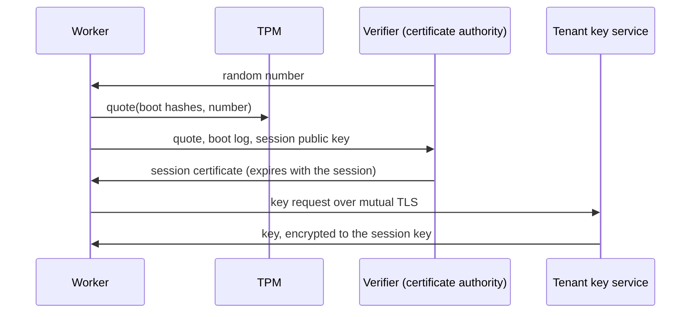
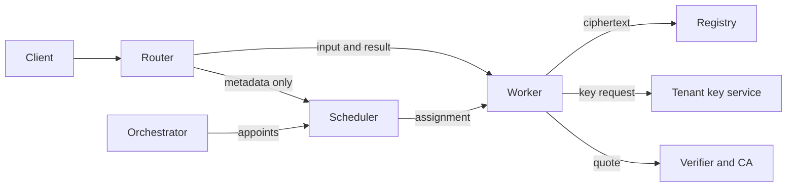
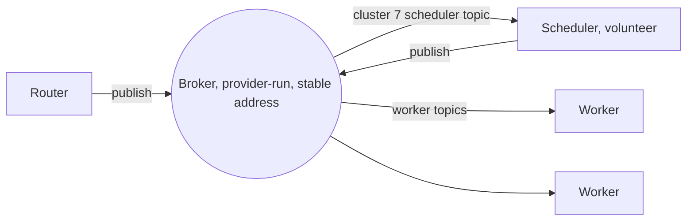
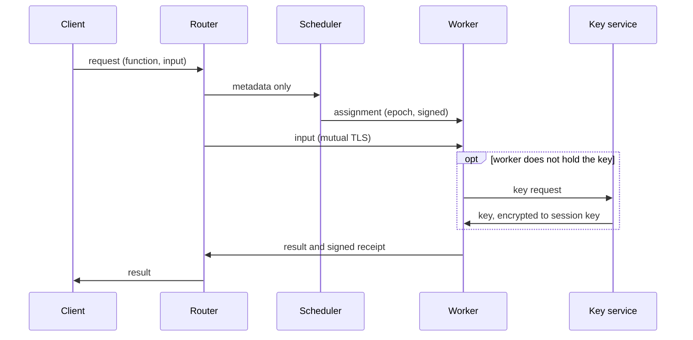

# VOSS, explained plainly

Serverless computing on volunteer machines

*Companion to manuscript draft 13 (ACM TOIT format). Numbers come from the manuscript macros and `docs/validation/ROUND4-results.md`. Slides marked TODO wait for reruns that are still in progress.*

---

## The idea in four lines

- Short serverless functions spend most of their time **starting an environment** and **crossing the network**, not computing.
- Home and office computers are near users and idle most of the day. But owners **switch them off without warning**, and owners **cannot be trusted** with customers' code.
- **Remote attestation** (a machine proves which software it booted) means a hostile owner can only **stop or delay** the machine. The owner cannot read or fake anything inside it.
- What is left is a scheduling question: **which machines get each customer's key and ready environments, and when**. VOSS answers it with a planner that runs every 30 s and a separate decision for every request.

---

## Words used in this deck

- **Tenant**: a customer who deploys functions. **Invocation**: one call of a function. **Provider**: runs the platform.
- **Volunteer / owner**: owns a donated machine. **Worker**: that machine while it runs our software.
- **Sandbox**: a small virtual machine (a Firecracker microVM) that runs one invocation in isolation. **Warm**: already started and idle. **Snapshot**: a saved copy of a started sandbox, faster to restore than a sandbox is to boot.
- **Slot**: each worker runs a fixed number of invocations at once, one per slot.
- **Session**: from the moment a machine boots our image until the owner switches it off. **Churn**: machines leaving and joining.
- **Key**: the tenant's decryption key for its code and snapshots.
- **P99**: the latency that 99% of requests beat (the slow end of the distribution).
- **Idempotent**: running a call twice has the same effect as running it once.

---

## Where the time goes

- A **cold start** is the delay to create an environment and load the language runtime before a function can run. For a function of tens to hundreds of milliseconds it can take longer than the function itself.
- Before a function runs: wait for a slot, get the tenant's key if the worker lacks it, start a sandbox, move data.
- A function is at one of four levels on a worker:
  - nothing cached (fetch the code, then boot);
  - code on disk (boot);
  - snapshot on disk (restore);
  - warm sandbox (hand the request over).
- Providers hide cold starts by keeping environments alive in datacenters. That holds memory around the clock, and does nothing about distance to the user.

---

## What trust costs (measured on one laptop)

```text
restore snapshot, file cached ▏ 7 ms
boot sandbox, file cached     ▏ 154 ms
TPM quote                     ▌ 0.51 s
restore snapshot, hard disk   ▌ 0.63 s
boot sandbox, hard disk       ▊ 1.45 s
create a snapshot             ██ 6.7 s
power-off to attested worker  █████████████ 65 s   (median of 9 boots)
```

- Handing a request to a warm sandbox takes milliseconds. Becoming an attested worker takes **65 s**: thousands of times more. So trust must be prepared **before** requests arrive.
- One laptop with a hard disk (Intel Core i3-7020U). The 65 s is a sum of measured steps on its installed system, not one boot of the final locked image.

---

## The network is slow too

- Volunteers sit on home links. Model: median **100 Mbit/s down and about 30 Mbit/s up**, wide spread, shared by all of a worker's transfers.
- File systems are 90 to 450 MB and snapshots up to 600 MB. A 600 MB snapshot over a 30 Mbit/s upload takes about **2.7 minutes** (4800 Mbit / 30 Mbit/s).
- How VOSS copes with slow volunteer links:
  - the planner **prepares workers ahead of demand**, so transfers happen while nobody waits;
  - each request is charged the **transfer time over that worker's own link**, so a slow worker loses to a ready one;
  - workers fetch from **nearby workers before the provider's registry**;
  - snapshots are **made locally** rather than downloaded.

---

## Two problems that feed each other

- **Churn**: an owner can switch off or reboot at any moment. Everything prepared on the machine goes, including warm sandboxes, cached code and the keys it was given.
- **Distrust**: the owner controls the hardware and the operating system, so they could read the code, forge results, or leave at the worst moment.
- The usual answer to distrust is to **check the machine first**, and that check takes time. Churn throws the result away at every session end.

---

## What exists, and what it misses

- **Volunteer computing (BOINC)** runs each task on several machines and compares answers: costly, and it shows the input to every machine. Built for jobs with deadlines of hours.
- **Serverless schedulers** (Azure keep-alive, FaasCache, Sparrow, Falcon) assume trusted machines that stay up.
- **Confidential computing** protects customers from the operator, but on provider servers that do not vanish.
- **Edge computing** already splits slow placement from fast routing, but it places services, not keys, on machines that disappear.
- **Heartbeats** (a periodic "I am running" message) show only that a machine can send messages. An owner can keep them coming while discarding work.

---

## How attestation works

- While the machine boots, each stage is hashed into the **TPM**, a security chip in most PCs.
- On request the TPM signs those hashes plus a fresh random number. That signed object is a **quote**.
- A **verifier** checks the signature back to the chip maker and compares the hashes with our image.
- A quote shows what ran at one boot. It is refreshed periodically, and it says nothing about whether the machine will keep running.
- We use attestation as deployed today (as in Keylime). Its cost is what matters for scheduling.

---

## What attestation buys

- The image is signed, has a read-only checked root file system, has **no owner login**, and its cache disk is encrypted with a key the TPM releases only to the expected image.
- An owner cannot run other software (it fails attestation, so it gets no certificate and no key), cannot read or change the image's memory or disk, and cannot forge results (signed by a key that never leaves the image).
- **Property 1**: anything a worker or scheduler machine does that others can observe, and that its owner can cause through software, is a **crash, a dropped message or a delayed message**.
- So the machinery churn forces on us also covers malicious owners, and running every task several times to check results is unnecessary.
- Not covered: lab-grade physical attacks on the TPM, reading memory of a running machine that does not encrypt memory, flaws in our image, side channels.

---

## Encryption at rest, before the key service

- The tenant **encrypts its code with its own key before uploading it**. Snapshots are encrypted with the same key when written.
- The provider's registry and the workers' disks hold **only ciphertext**.
- The key travels from the **tenant's own key service** straight to an attested worker, and stays in that worker's memory until the session ends.
- Anyone who takes over the registry, database, routers or broker gets ciphertext and metadata, but no code or data.
- So any worker can store and forward a bundle, but only a worker holding the key can use it. Only such workers create snapshots, because a snapshot contains decrypted memory.

---

## Mutual TLS and the certificate lifecycle



- The verifier is the **certificate authority**. It issues the certificate when the quote passes and sets its **expiry to the session's expiry**. Periodic re-quotes keep it valid.
- It **revokes the certificate when the session ends** (or a re-quote fails) and tells routers, the scheduler and the key services.
- **Mutual TLS** means both ends prove who they are. Every connection uses it, so each end is a provider service or an attested image.

---

## How a worker gets a tenant's key

- Attestation shows a machine runs our image, not that it may see a given tenant's data. Each tenant's key service applies the tenant's policy, for example "image version at or above this one".
- One round trip: the worker presents its certificate, the key service checks the policy and returns the key encrypted to the worker's session key. The worker keeps it in memory only.
- Who the tenant trusts depends on its policy:
  - accept any certificate the verifier issued for an approved image: the tenant also trusts the verifier;
  - require a fresh quote: the key service checks it itself, at the cost of one more quote per release.
- Identity costs hardware (a hash of the TPM's endorsement key), so many identities need many machines.

---

## Key exposure

- Every machine holding a tenant's key is one more place it could leak from if our assumptions fail.
- **Key exposure** of a tenant = the sum over its key holders of (1 minus the holder's **trust score**).
- **Trust score**: a number from 0 to 1 set by policy for the machine's trust technology: 0.8 for the TPM image on a consumer PC, 0.95 for a confidential virtual machine on a server processor.
- It counts holders, discounted by protection. It is **not** a probability of compromise. We report it next to latency and never merge them.
- Tenants can set a minimum trust score below which a machine never gets their key.
- Five trust technologies are modelled (TPM image measured; two confidential-VM kinds from the literature; a measured hypervisor; none, used by baselines). The scheduler does not depend on which.

---

## Why limit exposure if attested machines are honest?

- **Honesty is conditional.** It holds only under the assumptions on the earlier slide. On consumer hardware the excluded cases are the realistic ones: memory reading, TPM firmware flaws, bugs in our image. Exposure is the defence for when attestation is not enough.
- **The harm is asymmetric.** A forged result harms one invocation and can be caught by re-running it. A leaked key is silent and permanent: it decrypts every bundle and snapshot of that tenant, past and future.
- **It costs almost nothing.** Removing the exposure term changes P99 by 0.02 s (95% interval up to 0.06 s, includes zero) and raises exposure by 2.6 (E19, 10% of owners dropping work).
- Dropping it would weaken the defence without making anything faster.

---

## The parts of the system



- **Router**: public entry point. **Scheduler**: chooses workers. **Orchestrator**: forms clusters and appoints schedulers. **Verifier**: checks quotes, issues certificates. **Registry**: stores ciphertext. **Key service**: tenant's own, releases keys only to workers the verifier accepted.
- The provider's services are trusted to stay up and keep correct records, but never receive tenant keys.

---

## The router's role: four jobs

1. **Choose a cluster** for each invocation, scoring the expected delay: round trip, the cluster's queue, recent misses, key-release time if nobody there holds the key, cold-start time if nothing is warm.
2. **Send the metadata** (never the input) to that cluster's scheduler.
3. **Keep a copy** until a worker confirms it started, and resend or redirect it if the scheduler has not answered within 1 s.
4. **Stream the input** to the chosen worker, return the result, and store the worker's signed receipt.

- The router runs on provider hardware, so its view of "did the work come back" can be trusted.

---

## Two architectures

- **Global**: one scheduler on **provider hardware** at a stable address. Workers connect to it. Its failures are handled by ordinary replication. **No broker is needed.**
- **Clustered**: workers are grouped by network distance into clusters of about 30. Each cluster's scheduler runs on **one of its own volunteer machines** (the code is in every image, so any worker can take the role). The provider runs no server per cluster. Schedulers are reached through a **publish/subscribe broker with one topic set per cluster**.
- Both use the same scheduler logic.
- The clustered design needs a way to reach schedulers behind home routers, and a way to replace them when they fail. The next slides cover both.
- Compute is not the reason for volunteer-hosted schedulers: greedy planning for 100,000 workers in clusters of 30 needs about one processor core.

---

## The broker and end-to-end signed messages



- A home router lets a machine open connections outwards but not accept them, and its address changes. So **every party dials out to the broker**; nobody needs another's address. Replacing a scheduler means the successor subscribes to the same topic.
- Protocol: **MQTT**, whose clients always connect outwards and whose at-least-once delivery suits idempotent messages.
- MQTT does not protect against the broker itself (MQTT-I adds that). So each connection is mutual TLS and **every control message is signed end to end** with the sender's session key, carrying the epoch and a sequence number. The broker can drop or delay messages, but cannot forge or replay them.
- Cost: one extra hop and one more replicated provider service; about 0.46 KB/s per worker. Broker capacity and signing cost are not simulated.

---

## Life of one request



---

## Why two loops

How often the scheduler's inputs change, and how long its decisions last:

| Input or decision | Changes or lasts | Learned from |
|---|---|---|
| Busy slots, cached state on each worker | milliseconds | worker reports every 2 s |
| Request rate per tenant and function | about a minute | request counts |
| Session length, chance a worker drops work | hours | past sessions and outcomes |
| Assign one invocation | one invocation | current state |
| Keep a sandbox warm | minutes | forecast of request rate |
| Give a worker a tenant's key | the rest of the session | forecasts of rate and survival |

- A decision that outlasts its inputs' refresh must be made from a **forecast, ahead of time**. A short decision can react to the latest state.
- Questions like "how many workers hold this key?" are about a **set** of workers. A loop that sees one invocation at a time cannot answer them. Preparing a worker takes seconds to minutes, more than a request can wait.
- So: a **planner** every 30 s (keys, warm sandboxes, slots reserved per tenant), and **request placement** for every invocation. The 30 s period was not swept: plan actions take up to several seconds, sessions last minutes to hours.

---

## Request placement: one invocation, one worker

- **Used for**: choosing a worker for this invocation, from 12 candidates (key holders, plus attested workers that would first need a key).
- It picks the smallest J = P(miss) + 0.05 x expected seconds + exposure added if the worker lacks the key.
- **Why this form**: we minimise this invocation's own chance of missing its deadline, because P99 describes many invocations together and cannot be assigned to one decision. The small latency term breaks ties.
- Weights mean one second of latency counts as a 5-point rise in miss probability; giving a medium-sensitivity tenant's key to a 0.8-trust worker counts as a 20% chance of a miss.
- Asynchronous calls are collected for 0.2 s and matched together by minimum-cost matching. If the best miss chance exceeds 0.2 and the function is idempotent, a second copy goes to a different city or internet provider.
- The scheduler never sees real session ends, real run times or future arrivals.

---

## The planner: how many slots to keep ready

- **Used for**: deciding ahead of demand which workers hold each tenant's key, which functions stay warm, and how many slots are reserved.
- **Sizing.** If calls arrive at random at rate r and each holds a slot for s seconds, the number running at once is Poisson with mean r x s. The planner reserves the **95th percentile** of that, so 95% of the time an arriving call finds a ready slot. Why Poisson: it needs only a rate and a mean run time, both learnable; real arrivals are burstier, so the experiments measure misses directly.
- **Cover against loss.** The reserved capacity must still hold if **any f workers vanish** (default a tenth of the cluster), counting each worker by its chance of staying. Removing the f largest contributions is the worst case, so no model of an adversary is needed. Why this form: it is a standard robust-optimisation constraint that becomes linear (Bertsimas and Sim).
- It then minimises memory, disk, key exposure and key releases, minus start-up time saved by warm sandboxes.

---

## The planner: greedy, and why not an exact solver

- **Greedy planner (default)**: tenants in order of cold-start loss; add workers one at a time by best ratio of (reliability x trust score) to (memory and exposure cost) until the cover condition holds; then add warm sandboxes by start-up time saved per megabyte. About **8 ms** per run.
- **Exact alternative**: an integer program (HiGHS), about **4 s** per cluster.
- **Why greedy**: before any experiment we fixed a rule: if the exact program did not lower P99 by at least 5% in some setting, greedy would be the method. It did not (see results).
- A new plan is computed only if inputs changed beyond a tolerance. Differences become repeatable, rate-limited actions (fetch key, keep snapshot, start sandbox, release), and request placement counts only what workers have confirmed.

---

## Estimators (1 of 2): survival and dropped work

An estimator turns past outcomes into a number a decision needs.

- **Session survival**: a Weibull distribution of session length per class of machine, fitted by maximum likelihood, with still-running sessions counted as censored.
  - *Used for*: the chance a worker stays through the next 60 s (planner, placement).
  - *Why*: availability studies find heavy-tailed sessions; Weibull shape below one says a machine up for an hour is less likely to leave in the next minute; two parameters fit from a few dozen sessions.
- **Dropped work**: a Beta distribution over the chance an accepted invocation never returns, updated by two counters, with a prior so a new worker is not judged on one outcome; a CUSUM change detector resets it when a good worker starts dropping work.
  - *Used for*: miss probability and for suspecting workers.
  - *Why*: cheap, works from very few outcomes, and CUSUM catches a change of behaviour that a running average would be slow to show.

---

## Estimators (2 of 2): run time and request rate

- **Run time**: a Bayesian linear regression of log run time on log input size, per function, with a small correction per worker.
  - *Used for*: expected latency, slot-wait replay, deadlines.
  - *Why*: run time grows roughly as a power of input size; a prior lets it work from a handful of samples. Gaussian processes or regression trees need more data and more time than a millisecond decision allows.
- **Request rate**: the larger of two moving averages (1 and 15 minutes).
  - *Used for*: sizing slots and warm sandboxes.
  - *Why*: it errs towards preparing too much, which costs memory rather than a cold start.
- **Slot wait**: replay each worker's queue from the predicted run times of jobs sent there; a waiting synchronous call gets a free slot before queued asynchronous ones (no preemption). A cluster-wide mean was the first version, and it was wrong (see the defect slide).

---

## Duplicates and retries

- **Duplicate** (hedge): if the best worker's miss chance exceeds 0.2, the function is idempotent and fewer than 10% of placements are already duplicated, a second copy goes to the best worker in a **different city or internet provider**. The slower copy is cancelled when the first result arrives.
- **Retry**: a lost invocation is placed again, excluding the failed worker, within a budget.
- **Why only at-risk calls**: duplicating everything doubles load; duplicating slow requests is known to cut tail latency (Dean and Barroso).
- Only idempotent functions are duplicated or retried. Next slide: why that is a fair condition.

---

## Idempotence is the platform contract

- A function is **idempotent** when running it twice equals running it once. VOSS retries and duplicates only functions marked idempotent.
- This is the contract developers already accept on commercial platforms:
  - **AWS Lambda** retries failed asynchronous invocations and warns of duplicate events.
  - **Google** event-driven functions run **at least once**.
  - **Azure** and **Cloudflare** deliver events **at least once**.
- On those platforms, at-least-once applies to the **event and asynchronous paths**; on **direct calls the client retries**. VOSS follows the same split.
- In the evaluation, 11 of 12 functions are idempotent (our assumption). If a platform could not require idempotence, success under omission would need re-measuring.

---

## Judging workers by returned work

- A heartbeat shows only that a machine can send messages. VOSS checks whether **work a machine accepted comes back**, as seen by a router or a scheduler.
- Router: expects the scheduler's acknowledgement within 1 s, else resends and suspects the scheduler. Scheduler: expects each result by its predicted 90th-percentile completion time x 1.2 (at least 3 s), else probes and suspects the worker.
- A suspected worker gets no new work and leaves the plan; its idempotent work is retried or duplicated elsewhere. Heartbeats stay as a fast signal of plain crashes but never clear a suspicion.
- Measured: with 20% of owners dropping work, **99.95%** of requests succeed, against **96.8%** with heartbeats (9 times more lost results).
- A scheduler that discards work while sending heartbeats is found in **4.2 s** (0.7 timeouts) against the 60 s heartbeat timeout (132 timeouts).

---

## Replacing a scheduler without agreement

- Agreement among volunteers that may be hostile is avoided: the provider's **orchestrator** is a reliable referee, and a scheduler holds no state that cannot be rebuilt.
- Each cluster has an **epoch** counter in the orchestrator's database. An atomic **compare-and-swap** (change only if the value is still what I read) increments it and names the new scheduler's certificate, like a lease.
- Workers accept assignments only for the current epoch and certificate. A cut-off scheduler that is still running is shut out, and stops by itself after 5 s without the orchestrator.
- The successor asks workers what they run and hold, restores estimators from a copy saved every 30 s, and plans again. A cut-off scheduler can only cause duplicate work.
- Crashed scheduler: found in 2.2 s, replaced in 2.7 s. Slowed scheduler: 14 s, because evidence must build before a slowdown can be told from load.
- **Receipts**: each result carries a receipt signed by the worker's session key. No blockchain is needed; anyone can check a signature.

---

## How we evaluate

- A deterministic, single-threaded discrete-event simulator. The scheduling policies are the **real code**; the world (machines, sessions, network, adversaries, arrivals) is drawn from named seeded streams, so all systems on a seed face the **same world**.
- About 100 cities for delays; 200 workers, 30 minutes per run; three machine classes with heavy-tailed sessions and city-wide shocks; six tenants, 12 functions, bursty day-and-night arrivals.
- Costs of start-up, snapshots, quotes and boots come from one laptop; confidential-VM costs from the literature.
- The single-machine emulation with real microVMs agrees with the simulator on success (within 0.6 points) and median latency (within 6 to 23%), and only partly on the latency shape. Network, attestation and failover are **not validated** on real machines, so we compare designs, not absolute latencies.
- Churn and the workload are assumed (no public trace exists) and swept.

---

## Baselines and protocol

- **Same candidates, same cost model, same request placement** for every system; one policy differs.
- Single-loop baselines: no planner (a key is fetched when an invocation needs it); a 10-minute keep-alive timer; unbounded keep-alive; the **Azure hybrid histogram** policy (learns each sandbox's idle times, pre-warms and keeps alive accordingly). Plus **provisioned_keys**: holds each tenant's key ahead on the most reliable workers.
- **Paired seeds**: the same simulated world for both systems. We report the mean per-seed ratio with a 95% **bootstrap interval** (resample the seeds to see how far the mean could move).
- Hypotheses and their pass rules were **written down before the runs**. For H12 to H16 a **Holm correction** keeps the chance of any false positive below 5%.
- 20 seeds (10 for the exact solver and the session-length experiment).

---

## Result 1: planner against the strongest single loops

| System (medium churn) | P99 (s) | Warm memory (GB) | Key exposure |
|---|---|---|---|
| no planner | 1.673 | 1.4 | 7.9 |
| keep-alive, 10 min | 1.534 | 56.6 | 7.2 |
| keep-alive, unbounded | 1.542 | 75.2 | 7.2 |
| Azure-style histogram | 1.569 | 38.9 | 7.2 |
| **greedy planner** | **1.177** | 86.7 | 18.5 |

- P99 is **21% lower at medium churn and 18% lower at high churn** than the best single loop (ratio 0.793 [0.734, 0.848] and 0.822 [0.759, 0.874]; below 0.95 in 19 and 20 of 20 seeds; H12 supported).
- The price: keys on about **2.5 times as many workers** (18.5 against 7.2).
- Success is above 99.9% everywhere and every system meets a 3 s target. The differences are in the tail between 1.2 and 1.7 s.
- The histogram policy holds about a third less warm memory than the fixed timer and is no faster.

---

## Result 2: where the gain comes from (decomposition)

- **provisioned_keys** asks the greedy planner *how many* workers should hold each tenant's key, then picks *which* workers by reliability only: no cover against losses, no warm-sandbox planning. Same exposure as greedy.
- Its P99 is 1.243 s: 17% (medium) and 14% (high) below the best single loop. That is about **80% of greedy's gain**.
- Choosing the workers well and planning warm sandboxes adds the rest: greedy is 0.949 [0.927, 0.970] of provisioned_keys' P99 at medium churn and 0.957 at high churn. Excludes 1, but not our 5% bar (H15: weak).
- So most of the value is the **set-level decision of how many workers hold each key**, which a per-request loop cannot make. The finer choices of who and what add about a fifth.

---

## Result 3: what does not explain the gain

- **Not key-release delay**: waiting for a key touches 0.1 to 0.4% of synchronous invocations in every system.
- **The tail is one episode**: in the seeds with the largest lead, a baseline's tail is one episode of 40 to 120 s in which one tenant's synchronous calls queue about 10 s behind long asynchronous jobs on the 2 to 6 workers holding its key. Greedy has 11 to 20 holders.
- **Not survival information (H16)**: we varied session length from a quarter to four times the medium mean (E25, 10 seeds). The planner's lead stays between 15% and 25% in all six cells. Hiding survival estimates from the planner changes P99 by less than 3% everywhere. So we cannot attribute the gain to choosing long-lived workers.
- Plausible, **untested**: the planner looks 60 s ahead while sessions last hours, so survival is close to 1 for most workers.

---

## Result 4: keys are released often, not rarely

- A key serves a whole session, so one might expect the planner to amortise each release over many calls. It does not.
- After warm-up at medium churn: the planner releases keys about **270 times per run**, a keep-alive timer about **6**.
- One release serves about **30** synchronous invocations under the planner, about **1350** under the timer.
- The planner buys **spare capacity on many holders** rather than a few durable ones.
- Open question: a planner that reuses keys longer might keep the gain at lower exposure. Not tested.

---

## Result 5: planner v2 and the exposure budget

- **Erlang (loss-model) planner, erlang_greedy**: treats each tenant's reserved slots as a loss system (a call that finds all slots busy goes to a worker without the key). Why: the value of a set of holders is then submodular, so greedy has the classic (1 - 1/e) guarantee **per tenant only** (not for the joint plan).
- Outcome vs greedy: **14 to 20% less exposure**, but **+2.5% to +5% P99** and **+9% to +13% warm memory**. Not adopted (H13); reported as the lower-exposure point on the front.
- **Exposure-budget variant (erlang_dpp)**: P99 matches, but it **did not meet its budget** (exposure 17.7 against 14.6 for erlang_greedy at medium churn; H14). A likely cause, unverified: it measures exposure over the planning pool only.
- **Exact program**: P99 1.167 against 1.177 s (medium) and 1.232 against 1.209 s (high), about 1.5 times the warm memory, and its 4 s solve time is not charged to the simulated clock, which favours it. Not better, so greedy stays.

---

## The placement defect, and its correction

- **Defect (C-46)**: our first request placement estimated the wait for a slot from one cluster-wide mean run time. A queue of long asynchronous jobs looked short, so synchronous calls queued for seconds on the few workers holding a tenant's key instead of moving to another worker. This handicapped every baseline and **made the planner's lead look larger** (earlier results of 54 to 59% must not be quoted).
- **Correction**: replay each worker's queue from predicted run times, and let a waiting synchronous call take a free slot before queued asynchronous ones.
- All systems in the main comparison use the corrected placement. VOSS with the old placement is within about 2%.
- **Still on the original placement**: ablations, failure detection, geographic clusters and scale. Those are about VOSS alone; the baseline comparisons are being rerun (TODO slide).

---

## Ablations and the components that paid

Remove one part at a time (10% of owners dropping work, E19, original placement):

- placement ignoring start-up levels: **+3.3 s** of P99;
- no planner: **+1.1 s**;
- no cover against losing f workers: **+0.8 s** (it buys tail latency; success changes by 0.11 points);
- no duplicates: **+0.3 s** (cheap insurance, not shown to be necessary);
- no exposure term: +0.02 s, interval includes zero.
- The components that buy P99 also raise exposure: the planner by 31 units.

---

## What did not pay off

- **Geographic clusters**: the only part whose removal *improves* P99 (by 0.09 s). They hold 5.1 times the key exposure of a global scheduler (9 clusters in Europe), since each cluster needs its own key holders. At 600 workers the global scheduler was faster by 17% (Europe), 17% (Europe and North America), 5% (world). That experiment ran the global scheduler on a volunteer machine, which favours clusters.
- **Exact solver**: not measurably better than greedy.
- **Cost-aware caching** and the **reliability score**: P99 changes by a few percent at most.
- **Planner v2** and the **exposure budget**: previous slides.
- **Survival-aware worker choice**: no measurable effect.

---

## TODO: baselines, feasibility map, commercial reference

- **TODO** (reruns in progress with the corrected placement: E10b, E17b, E20ab, E24b).
- Simple baseline against VOSS: *to be filled*.
- Commercial-style datacenter reference: *to be filled*. The current draft says only that it is faster.
- Feasibility map (which systems meet a latency target in which settings): *to be filled*.
- Calibration sensitivity: *to be filled*.
- Do not quote older numbers for these.

---

## Limits

- **Simulation, partly validated.** No multi-machine deployment has checked the simulator.
- **Assumed workload and churn.** Six tenants, 12 functions, 200 workers; the planner's limits on tenants and functions never apply. Absolute differences are 0.3 to 0.5 s of P99, with every system under 3 s.
- **Idealised knowledge.** Start-up, trust and network costs and declared worker speeds are taken as exact. Calibration is one laptop with a hard disk.
- **Network and decision costs.** Broker capacity, reconnection and signing are not modelled; decision time is a placeholder formula.
- **Statistics.** 20 seeds (10 for the exact solver and the session experiment); the best single loop is chosen on the test seeds, which favours the baselines.
- **Scale.** Success stays at 99.8% up to 10,000 workers, 97% at 30,000 and 81% at 100,000, where decision latency has grown to tens of seconds. The limit is the central decision path.
- **Reliance on attestation.** If attestation fails, adversaries could forge results and read keys, and exposure stops being a proxy for risk.

---

## Questions a reviewer will ask (1 of 2)

- **Do you need the slow planner at all?** Yes: 21% / 18% lower P99 than the strongest single loops. But about 80% of that comes from one set-level decision (how many holders per key), not from the finer choices.
- **If attested machines are honest, why limit exposure?** Honesty is conditional; a leaked key is permanent; it costs about nothing measurable.
- **Is the greedy planner ad hoc?** It is cheap (8 ms) and the exact program is not better. The loss-model version has a per-tenant guarantee but traded latency and memory for exposure, so it is not the default.
- **Was the baseline fair?** Our own placement defect initially made baselines look worse; it is corrected, and the Azure-style policy is included.

---

## Questions a reviewer will ask (2 of 2)

- **How are schedulers on home machines reached?** Everyone dials out to a provider-run broker with one topic set per cluster; messages are signed end to end.
- **Why no blockchain or voting?** Attested machines can only stop or delay, so voting is not needed; a signed receipt can already be checked by anyone.
- **Is it only simulation?** Yes, with one-laptop calibration and a single-box emulation. The paper says so and compares designs, not absolute latencies.
- **Do retries break non-idempotent functions?** They are never retried or duplicated; the contract matches commercial platforms.
- **Can results be reproduced?** Runs are bit-reproducible: an independent re-run of 2,366 runs matched every result hash.

---

## Takeaways

- Attesting a locked image turns hostile owners into machines that stop or delay. What is left is a **scheduling problem**: which machines get a key and ready environments, when all of it is slow and lost at session end.
- A slow planner sizing the set of key holders beats the strongest single loops by about 18 to 21% in P99, at about 2.5 times the key exposure.
- Judging workers by returned work keeps success high when owners drop work.
- Several designed parts did not pay off, and we corrected a placement defect that had flattered the planner.
- Next: a small real testbed, a many-tenant workload, a planner that churns keys less, and the pending baseline reruns.
