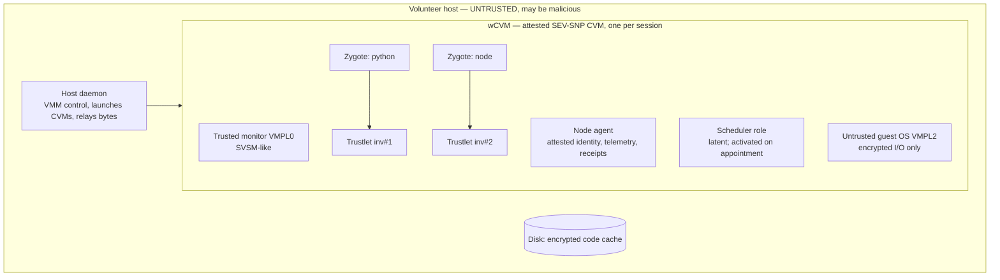

# Proposal 0001 · Confidential VOSS: malicious, unreliable volunteers on CVMs

**Status:** ACCEPTED (2026-10-09) and folded into `docs/architecture/00`–`10` and `docs/DECISIONS.md`. Kept as design history; the architecture docs are authoritative.

## 0. What changed and why

- The vetted-honest assumption made the motivation too narrow. **Volunteers are now untrusted and may be malicious.**
- Tenant code runs only inside **confidential VMs (CVMs)** on a common hardware TEE (all hosts have the same TEE).
- The cost of this choice is cold start. A plain Firecracker microVM boots in ~40 ms; a CVM takes ~0.2 s at best
  (SEVeriFast), ~3.5–8 s typically (QEMU/OVMF), and up to ~17 s with Confidential Containers. VM snapshots,
  templates and memory dedup do not work for CVMs, and launches serialize on the security processor (PSP).
- So the redesign has two problems to solve together: **(A) make malicious hosts harmless** and **(B) amortize
  confidential cold starts on hosts that churn**, in small geo clusters.

## 1. Threat model v2 (proposed)

**Trusted:**
- The CPU TEE: one vendor, proposed AMD SEV-SNP (§8 Q2).
- Code whose measurement is attested.
- The tenant's key broker.
- The provider-run orchestrator tier, trusted for **availability and accounting only, not confidentiality** (§8 Q3).

**Untrusted (Byzantine) hosts.** A malicious host can:
- crash, preempt, or stop the CVM at any time;
- drop, delay, reorder or replay any message;
- throttle or deschedule vCPUs;
- lie about anything outside the TEE (free capacity, owner activity, "preemption" notices);
- delete or roll back anything on its disk;
- launch extra copies of attested images;
- observe traffic sizes and timing.

It **cannot** read or modify TEE-protected memory or execution, and it cannot forge attestation reports or messages
signed by attested keys.

**Out of scope (stated, cited as future work):**
- side channels and TEE vulnerabilities (rejected by a minimum-TCB-version attestation policy, not defended);
- physical attacks;
- denial of service against the trusted orchestrator.

**Key insight for the paper.** Once all tenant code and all VOSS control code (worker agent and scheduler) run inside
attested CVMs, a malicious host can no longer *lie through the protocol*. What remains of its power is exactly:

1. **Omission** (crash, drop, black-hole);
2. **Timing and performance faults** (delay, throttle);
3. **Lies about unattested metadata.**

TEEs transform Byzantine nodes into omission/timing-faulty nodes (Madsen et al.; DISC'25). VOSS was built to tolerate
unreliability, so the thesis becomes: **confidential computing turns volunteer untrustworthiness into volunteer
unreliability, and VOSS schedules around unreliability.** The new obligations are:

- (i) detect omission **without trusting liveness signals** (a host can keep heartbeats flowing while dropping work);
- (ii) make confidential cold starts cheap enough for FaaS.

## 2. Ideation and critique rounds

### Round 1: one fresh CVM per invocation

**Idea:** the strongest isolation, mirroring Firecracker-per-invocation.

**Critique:**
- Cold start of 0.2–17 s per invocation, against sub-second functions.
- Concurrent launches serialize on the PSP (50 → ~1.8 s each, SEVeriFast).
- Attestation on every invocation.

**Verdict:** rejected. Kept only as the strawman baseline `cvm_per_invocation`.

### Round 2: keep-alive pools of per-function CVMs (classic warm pools)

**Idea:** keep each function's CVM warm after use, with a TTL or histogram policy.

**Critique:**
- **Memory.** CVM pages are pinned and cannot be deduplicated across VMs, and each CVM carries a full guest. Volunteer
  hosts have little RAM, so per-function pools cover only a handful of functions.
- **Fragmentation.** Small clusters (tens of workers) cannot keep a warm CVM for the long tail of functions.
- **Churn.** Churn destroys pools, and rebuilding them pays the PSP-serialized boot again.
- **Host limits.** ~500 CVMs per host (ASID limit) is irrelevant for volunteers; memory binds first.

**Verdict:** a baseline (`cvm_keepalive`), not the design.

### Round 3: function-agnostic pre-attested shells with late binding (CoCo-style pool)

**Idea:** boot generic CVM shells in the background, attest each once, and keep them unbound. On first use, bind a
shell to a tenant by releasing keys and pulling, verifying and decrypting code inside the guest. This is possible
because SNP and TDX attestation is guest-initiated.

**What it fixes:**
- Fungible shells reduce fragmentation.
- Boot and attestation leave the critical path.

**Critique:**
- **Binding is slow.** In-guest image pull and decrypt is seconds (+3–5 s over host pull in CoCo).
- **Shells become tenant-locked after binding.** Isolation between tenants relies on CVM boundaries, so a bound shell
  serves one tenant until destroyed.
- **Memory per shell is still a full guest.**
- **Replenishment pays PSP serialization and is destroyed by churn.**

**Verdict:** a strong *portable* option that maps 1:1 onto production CoCo/Trustee. It becomes the industry baseline
`coco_pool`.

### Round 4: one long-lived CVM per worker plus trustlets (Wallet-style nested isolation)

**Idea:**
- Each worker boots **one** long-lived CVM per volunteer session: the **worker CVM (wCVM)**.
- Inside it, a trusted monitor at the highest privilege level (VMPL0, SVSM-like) runs pre-initialized **runtime
  zygotes**. A Python zygote is ~147 MB shared copy-on-write.
- Each invocation runs in a **trustlet** forked from a zygote: ~60 KB of private memory, warm start < 10 ms (Wallet).
- The untrusted guest OS (VMPL2) only shuttles encrypted I/O.

**What it fixes:**
- CVM boot and attestation are paid **once per worker session**, not per function or per invocation.
- The PSP is touched once per session.
- Memory per *additional* function is tiny, so warm state is cheap and the keep-alive problem shrinks to
  "keep the right runtime zygotes".
- Trustlets isolate tenants inside one CVM, so one wCVM serves many tenants.
- Small clusters and long-tail functions become viable.

**Critique:**
- **(a) Maturity.** Requires SNP VMPLs (Intel needs TD partitioning). Wallet and COCONUT-SVSM are research-grade:
  Python only, no external network I/O in the prototype. *Answer:* VOSS is evaluated in simulation, the sandbox
  strategy is a config axis, and the portable CoCo path (Round 3) is modeled alongside. The scheduling contributions
  do not depend on which wins; the regime map shows which does.
- **(b) Heavy-tailed sessions.**
  - A one-time wCVM init of ~0.2–12 s (boot path dependent) is wasted when a volunteer session ends early.
  - *Answer:* the survival model predicts session residual life, and the orchestrator admits a worker as schedulable
    only after its wCVM is attested.
  - Boot is a donor cost, not a latency cost, because workers are not schedulable until ready.
- **(c) The wCVM is a per-worker unit of failure.** The worker was already the unit of failure.
- **(d) A shared wCVM concentrates tenants on one host.** That host can only omit (§1). Anti-affinity applies for
  replicated critical work.

**Verdict:** this is **the VOSS default**. The rest of the design assumes it.

### Round 5: distributed-systems critique under malicious *and* unreliable hosts

| # | Attack or weakness | Why the old crash design fails | Redesign |
|---|---|---|---|
| 1 | **Black-holing:** host keeps the wCVM alive (heartbeats flow) but drops dispatches or results | Heartbeat-based detectors never fire | **Progress-based failure detection.** The trusted routers see `ENQUEUE→ACCEPTED→RESULT` for every invocation, and per-invocation watchdogs come from the predictor (already designed). A worker or scheduler is suspected on **missing progress**, not missing heartbeats. Heartbeats become hints only |
| 2 | **Selective omission** (drop only valuable tenants) | — | All control and data channels are TLS terminated **inside** attested CVMs, so the host cannot read which tenant or function a message carries. Targeted omission degrades to untargeted omission, which looks like unreliability. Size/timing leakage is out of scope; padding is an optional knob |
| 3 | **Fake preemption or drain notices** to dodge penalties | Old reputation spared "owner preemption" | Owner signals come from the untrusted host, so they are **hints that only make the scheduler more conservative**. They never excuse failures. Reliability is learned per host from outcomes (survival model). Reputation only measures declared-commitment breaches and the omission rate |
| 4 | **Performance deception** (fast on benchmarks, throttled later) | One-time benchmark | Capacity is **measured continuously from inside the wCVM** (attested agent, secure TSC), and the predictor learns delivered speed. **Schedulable capacity = attested slots in the wCVM, never host claims** |
| 5 | **Malicious scheduler host** | Scheduler logic could lie | Scheduler code runs inside a wCVM, so its decisions are attested. Its host can only omit or delay: routers detect stalled clusters (no `ACCEPTED`) and the orchestrator also replaces **slow** schedulers (decision-latency SLO). Succession stays |
| 6 | **Cloning:** host launches two copies of an attested scheduler | Split-brain | Appointment binds the epoch to the *specific instance's* attested key. Workers accept dispatches only from the appointed instance's key + epoch (fencing already exists) |
| 7 | **Rollback** of persisted enclave state | TEEs do not protect state at rest across restarts | **Soft-state succession is rollback-immune by construction:** schedulers keep no durable state on hosts, checkpoints live at the trusted orchestrator, and worker-retained outcomes stay in wCVM memory. A restarted CVM is a new instance that must be re-appointed |
| 8 | **Forged work and credit fraud** | Previously "assumed honest" | Results are produced and signed inside the wCVM (channel-bound to its attested key). Routers record **TEE-attested receipts**, so credit fraud requires doing the work. Credits count *reference work units*, not elapsed time, so throttling earns nothing |
| 9 | **Sybil and whitewashing** | Previously "solved by vetting" | **Hardware-rooted identity:** the attestation chain identifies the chip (SNP VCEK, chip ID). One identity per TEE-capable CPU, so whitewashing costs a CPU. This has a privacy cost to state |
| 10 | **Collusion** of many hosts in one cluster | — | Only correlated omission is possible, handled by spillover, failure-domain anti-affinity and outcome-based reliability |
| 11 | **Delegated attestation** (scheduler verifies workers locally to save a cloud RTT) | Tempting for latency | **Rejected:** it widens the blast radius (a scheduler would hold the cluster's tenant keys) and adds complexity. Tenant keys are wrapped by the tenant's broker directly to each wCVM's attested key, and the scheduler never sees them. The cloud round trip happens only on cold paths |
| 12 | **Blockchain re-evaluation** | Removed under honest nodes | **Still not needed.** TEE-signed receipts already give third-party-verifiable work records, and a chain would not stop omission, the only remaining attack. A transparency log stays parked |

### Round 6: small clusters, geography and churn

| Concern | Effect | Design response |
|---|---|---|
| wCVM boot paid per volunteer session; heavy-tailed sessions | Wasted donor CPU on short sessions | Admission by predicted residual session length; boot path parameterized (SEVeriFast-like 0.2 s to OVMF ~8 s) |
| PSP serialization | Only matters when a host launches many CVMs (Round 2/3 strategies) | Model the PSP as a per-host FIFO resource. The wCVM design launches ~1 CVM per session, so it largely avoids it |
| Diurnal waves (a whole timezone rejoins at once) | Many hosts boot at once (parallel across hosts) | Not a PSP problem; the cluster is unschedulable until wCVMs attest, so the router spills over |
| Small cluster, many functions | Per-function warm state is unaffordable | Warm state = **runtime zygotes**. Few runtimes cover all functions; per-function code is cached cheaply inside wCVMs |
| Zygote placement | Runtime coverage dies with churn | New policy, **zygote coverage**: keep ≥ k zygotes per runtime per cluster, spread over survival-diverse workers. The ILP prewarm plan decides |
| Encrypted code distribution | Registry may be far | Function code is encrypted and content-addressed, so **P2P sharing via untrusted hosts is safe**: only attested wCVMs get the key, and the digest is checked inside |
| Pinned memory | Donor cost is higher than for plain VMs | Donor memory budget is a hard constraint; wCVM size is a parameter |
| CVM I/O tax (21–28% net) | Slower transfers and I/O-bound functions | Explicit slowdown factors in network and execution models |

## 3. Converged architecture (v2)

### 3.1 Components per worker



- **Host daemon (untrusted):** launches the wCVM and relays bytes. Its claims are ignored.
- **wCVM (trusted once attested):**
  - Monitor, node agent and latent scheduler role are all measured into the launch measurement, so **every
    attested worker is a valid scheduler candidate** with zero boot cost at promotion.
  - Zygotes and trustlets are created by the monitor.
  - The untrusted guest OS handles network and disk as ciphertext.
- **Portable variant `coco_pool`:** the same node agent and scheduler run in a small long-lived *control CVM*, and
  tenant code runs in per-tenant CoCo shells (Round 3). This is the production-mappable baseline.

### 3.2 Attestation and key flow (once per session; once per function per wCVM)

```mermaid
sequenceDiagram
    participant H as Host daemon (untrusted)
    participant W as wCVM (attested)
    participant O as Orchestrator verifier (trusted)
    participant K as Tenant KBS (tenant-owned)
    participant S as Scheduler (in another wCVM)
    H->>W: launch (PSP queue, pre-encrypt, boot path)
    W->>W: keypair; SNP report binds pubkey
    W->>O: JOIN + report (cert chain cached by verifier)
    O-->>W: worker identity cert (chip id, TCB, measurement, expiry)
    W->>S: mutual TLS (identity cert + appointment token of S)
    Note over W,S: all control traffic inside TLS terminated in CVMs
    S->>W: DISPATCH fn F (first time on this wCVM)
    W->>K: RCAR: fresh report for key of F
    K-->>W: key wrapped to wCVM pubkey (scheduler never sees it)
    W->>W: fetch encrypted code (registry or P2P), verify digest, load into zygote, measure
    W->>W: fork trustlet (< 10 ms), run, sign result
```

### 3.3 Confidential lifecycle ladder (replaces S0–S4)

| State | Meaning | Cost to reach "running" (calibration seeds) |
|---|---|---|
| **L0** no wCVM | Worker not attested; **not schedulable** | wCVM launch (PSP queue + pre-encryption ∝ initial image + boot path 0.2–8 s) + attestation (report ms + RTT to verifier) |
| **L1** wCVM, runtime zygote absent | | Zygote creation: runtime init + measurement (∝ MB; ~1 s for 60 MB with software SHA) |
| **L2** zygote ready, function not loaded | | First-use key release (tenant KBS RTT) + encrypted code fetch (registry or P2P) + digest + load + measure |
| **L3** function loaded | | Trustlet fork (< 10 ms) |
| **L4** busy | | Queue |

Losses: owner preemption, crash or host kill → back to L0 (memory lost). The encrypted code cache on disk may
survive, but the host may delete or roll it back, so it is only a hint verified by digest.

### 3.4 Invocation path (deltas from doc 08)

- **Router ↔ wCVM:** TLS sessions established at worker attestation. Payloads and results are end-to-end encrypted
  to the wCVM, and the host sees ciphertext.
- **Results are channel-bound to the attested key**, so the router logs an attested receipt (work log stays in the
  orchestrator DB; no chain).
- **Detection:**
  - Router watchdog: no `ACCEPTED` → scheduler/cluster suspicion.
  - Scheduler watchdog from the predictor: no `RESULT` → worker suspicion, then retry or hedge.
  - Outcome-based reliability per host.

### 3.5 What stays from the current design

- Geo clusters, orchestrator/scheduler/worker roles, and the per-cluster ILP and predictors.
- Succession with soft state, now also justified as rollback-immune.
- `net.send` geo delays, reproducibility, the DB private to the orchestrator, router-written work log, and no
  blockchain.

**Changes:**
- Threat model and motivation.
- Lifecycle ladder and keep-alive → zygote coverage.
- Failure detection becomes progress-based.
- Reputation inputs.
- Worker identity becomes hardware-rooted.
- Cost-model terms for attestation, key release and CVM slowdowns.

## 4. How to run TEEs in the simulator

No simulator models TEEs, and we do not emulate cryptography. As with microVMs (doc 02 §5), each TEE step is a
**composition of simulated resources plus calibrated delays**:

| Step | Model |
|---|---|
| CVM launch | `PSP` = per-host FIFO server (one launch at a time, service time per launch); then pre-encryption = bytes ÷ `psp_encrypt_rate`; RMP/pin setup ∝ memory; boot-path delay distribution per `boot_path` ∈ {severifast, ovmf, igvm_stage0}; guest boot × `cvm_boot_slowdown` |
| Memory acceptance | eager: ∝ memory size; lazy: amortized into first use; huge pages factor |
| Attestation | report generation (PSP op, ms) + `net.send` to the verifier (geo RTT) + verification CPU (~ms) + cert-cache miss penalty (KDS fetch) |
| Key release | `net.send` RTT to the tenant KBS location + policy check delay |
| Code load | encrypted fetch (registry or P2P via `net.send`) + in-guest decrypt (CPU ∝ bytes) + measure (∝ bytes) |
| Zygote / trustlet | runtime init (CPU) + measure; fork ~ms; per-trustlet private memory |
| Execution | runtime × (1 + δ_cpu) for compute, × (1 + δ_io) for network and disk portions, VMEXIT-heavy class factor; I/O transfer bandwidth × (1 − io_tax) |
| Memory | pinned, no dedup; wCVM base + zygotes + trustlets ≤ donor envelope |
| Adversary | per-host `behavior` ∈ {honest, crash-prone, black-hole(p), selective(p), throttle(f), fake-signals, clone-attempt}; injected by scenario traces like churn |

The parameters live in `configs/calibration/tee_snp.yaml` (and a `tee_tdx.yaml` sensitivity profile), seeded from
the research notes and replaced by our own measurements in P9 (needs an SNP host: §8 Q6).

**Sandbox classes for the cold-start comparison** (your request): `firecracker`, `qemu_vm`, `kata`, `qemu_snp_ovmf`,
`qemu_tdx`, `cloudhv_snp_igvm`, `coco_kata_snp` (attested, encrypted image), `severifast`, `voss_wcvm_trustlet`
(cold / zygote-ready / warm), `coco_pool` (late-bound shells), `cvm_keepalive`. Each class is a ladder plus
parameters, compared per SeBS function in isolation (E-CS1) and end-to-end under churn (E-CS2).

## 5. New research framing

**Motivation:** abundant idle **server-class** capacity outside data centers (labs, universities, SMB and colo
servers, homelabs, edge micro-DCs) is untrusted and unreliable. Confidential computing makes it safe to run tenant
code there, but CVMs are slow to start and costly to keep warm, and volunteer churn destroys warm confidential
state.

**Contributions (candidate):**
1. Threat reduction: TEE + attested control plane + progress-based detection turns malicious volunteers into
   omission/timing faults, which VOSS's churn machinery already handles.
2. Confidential warm-state design for churny hosts: one wCVM per session, runtime-zygote coverage, P2P encrypted
   code.
3. Geo-clustered, risk-aware placement whose cost includes the confidential lifecycle ladder.
4. Rollback-immune soft-state succession for TEE-hosted schedulers.
5. A viability map including TEE costs.

**New hypotheses:**

| ID | Hypothesis |
|---|---|
| H-C1 | Under a fraction *m* of black-holing hosts, VOSS's P99 and success rate match those under churn with an equal effective failure rate; heartbeat-based detection does not |
| H-C2 | wCVM + zygotes beat per-function CVM keep-alive and CoCo pools on P99 at equal donor memory by orders of magnitude in cold-start time; the gap shrinks as sessions shorten |
| H-C3 | Churn-aware zygote coverage beats LRU/TTL on cold-start rate in small clusters |
| H-C4 | PSP serialization dominates only for multi-CVM strategies during bursts and rejoins |
| H-C5 | Progress-based detection bounds the time-to-detect a black-holing scheduler to ≈ `T_dispatch` + appointment, with low false positives |

**New experiments:**
- **E-CS1:** cold-start comparison across sandbox classes.
- **E-CS2:** sandbox strategy × churn × memory budget.
- **E-CS3:** adversary mix sweep.
- **E-CS4:** PSP contention.
- **E-CS5:** zygote coverage policies.

## 6. Critique of the converged design (round 7, open risks)

1. **Hardware reality.**
   - **Risk:** SNP and TDX exist only on server CPUs, so "volunteer" means server-class donors.
   - **Mitigation:** be explicit; Arm CCA may reach clients later; the TEE profile is a parameter.
   - **Honest status:** a real narrowing, but far broader than "vetted only", and it buys zero trust.
2. **Dependence on VMPL trustlets.**
   - **Risk:** research-grade (Wallet).
   - **Mitigation:** the `coco_pool` path is always evaluated; if trustlets are unavailable, VOSS still works with
     higher cold-start costs.
3. **Omission is cheap for attackers.**
   - **Risk:** a malicious majority in a small cluster could degrade service.
   - **Mitigation:** outcome-based reliability moves work away; spillover; per-chip identity limits Sybil.
   - **Honest status:** availability under large malicious fractions is an evaluation question (E-CS3), not a
     guarantee.
4. **Orchestrator trust.**
   - **Risk:** reviewers will push on "zero trust".
   - **Mitigation:** it holds no tenant secrets (tenant-owned KBS); it is trusted only for availability and
     accounting, the same as any cloud control plane.
5. **Metadata leakage** (size and timing, which tenant is hot). Out of scope; padding knob only.
6. **TCB-version policy may exclude volunteers on old firmware.** Model it as an admission filter (fraction
   excluded).

## 7. Impact on docs and roadmap (the refactor, after acceptance)

| Doc | Change |
|---|---|
| 00 overview | New motivation, threat model v2, roles with wCVM, diagrams |
| 01 core | Adversary traces; PSP resource; no other change |
| 02 environment | TEE profile, wCVM lifecycle ladder (L0–L4), CVM slowdowns, pinned memory, adversary behaviors |
| 03 scheduling | Cost terms (attestation, key release, zygote state), zygote coverage policy, progress-based suspicion inputs |
| 04 reputation/accounting | Outcome-based reliability; attested receipts; reference-work credits; chip-rooted identity |
| 07 fault tolerance | Omission-tolerant succession: progress-based detection, slow-scheduler replacement, instance-bound appointment, rollback argument |
| 08 state/protocols | TLS-in-CVM channels, attestation/KBS messages, receipts, encrypted P2P code |
| 09 threat model | Replaced by threat model v2 and the critique table |
| 06 experiments, ROADMAP | E-CS1..5, H-C1..5; P1/P2 include the TEE model; P9 needs SNP hardware |

## 8. Decisions needed from you (round-2 input)

| # | Question | My recommendation |
|---|---|---|
| Q1 | In-CVM isolation default: **Wallet-style trustlets** (VMPL, research-grade, best latency and density) or **CoCo per-tenant shells** (production-grade, slower)? | Trustlets as the VOSS default; CoCo pool always evaluated as the industry path |
| Q2 | Common TEE: AMD SEV-SNP or Intel TDX? | **SEV-SNP** (VMPL trustlets, SEVeriFast, QEMU/CH support); TDX as a sensitivity profile |
| Q3 | Who releases tenant keys: a **tenant-owned KBS** (orchestrator never sees secrets) or an orchestrator-run KBS (simpler)? | Tenant-owned (true zero trust toward the provider) |
| Q4 | Keep the blockchain removed, using TEE-signed receipts in the work log? | Yes |
| Q5 | Accept the motivation shift to **server-class** untrusted donors (plus future client TEEs)? | Yes; it is the honest framing |
| Q6 | Do you have access to an SEV-SNP (or TDX) **bare-metal host** for calibration (boot, attestation, zygote, trustlet costs)? | Needed for credible P9; otherwise we rely on published numbers and say so |
| Q7 | Adversary behaviors to model: omission (random, selective, black-hole), throttling, fake owner signals, cloning, replay. Anything else (e.g., colluding Sybil clusters)? | The listed set |
